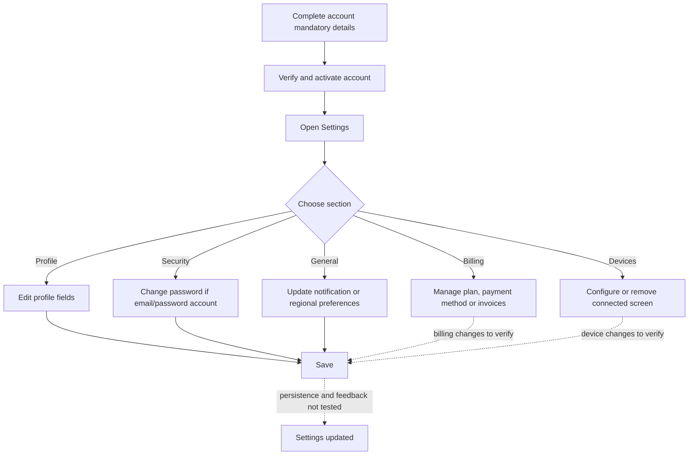

# Account Settings

| Field | Details |
|---|---|
| User | Signed-in account |
| Application route | `/settings` |
| Existing wiki/Jira mapping | Profile and communication preferences [IA-466](https://insta-ad.atlassian.net/browse/IA-466), email notifications [IA-374](https://insta-ad.atlassian.net/browse/IA-374), payment methods [IA-215](https://insta-ad.atlassian.net/browse/IA-215), invoices [IA-292](https://insta-ad.atlassian.net/browse/IA-292), connected screen management [IA-518](https://insta-ad.atlassian.net/browse/IA-518), and account context [IA-4](https://insta-ad.atlassian.net/browse/IA-4) |
| Application review | 2026-11-16 |
| Status | Current application UI documented; updates not saved or verified |

## 1. Purpose and prerequisites

The Settings area exposes profile, security, general preferences, billing-related controls, and connected-device management. It is available in the signed-in application after account authentication. Account mandatory details and verification/activation are described in [Sign-up and Login](./Sign-up-and-Login.md).

## 2. Settings workflow



### Sample UI: settings sections

```text
+------------------------------------------------------------------+
| Settings                                                         |
| [Profile] [General]                                              |
+------------------------------------------------------------------+
| Profile Information                                              |
| First name [________] Last name [________]                       |
| Email [managed by auth] Phone [managed by auth]                   |
| Address [________________________] Pin/Zip [________]             |
|                                                  [Save Profile]   |
+------------------------------------------------------------------+
| Password & Security                                              |
| Current password [________] New password [________]               |
| Confirm new password [________]               [Change Password]  |
+------------------------------------------------------------------+
```

This is a schematic transcription of the profile tab; General and billing controls are described in section 4.

## 3. Profile and security

The Profile section showed:

- First and last name fields
- Email and phone fields marked as managed by the authentication provider
- Address and postal-code fields
- Save Profile action
- Password-change form with current password, new password (minimum eight characters), and confirmation
- Password change described as available only for email/password accounts

No profile information or password was changed.

## 4. General preferences

The General section exposed:

### Notification preferences

- Campaign performance summaries
- Device offline/health alerts
- Billing and invoice notifications
- Weekly growth recommendations
- Save Notification Settings action

### Regional and campaign preferences

- Default region (the reviewed UI showed Dhaka, with Chattogram, Sylhet, and Khulna options)
- Timezone (the reviewed UI showed Asia/Dhaka and UTC)
- Default campaign goal (Reach, Engagement, or Conversions)
- Default slot (Prime Time, Morning, or Afternoon)
- Update Preferences action

### Other visible controls

- Subscription plan and renewal summary with Upgrade Plan and Manage Plan actions
- Payment method and billing history controls, including update/add method and invoice download
- Connected screen/device entries with location, online/offline status, Configure, and Remove controls
- Platform Preferences actions to save all changes, reset to defaults, and export settings

The review did not save preferences, change subscriptions, manage payment methods, download invoices, or configure/remove devices. Some displayed data may be sample or account-specific; verify actual persistence and business rules before treating it as canonical product behavior.

## 5. Existing Jira mapping and gaps

| Settings area | Existing related Jira reference | Scope note |
|---|---|---|
| Profile and communication preferences | [IA-466](https://insta-ad.atlassian.net/browse/IA-466) | Existing profile/preferences work; Settings persistence was not tested. |
| Notification preferences | [IA-374](https://insta-ad.atlassian.net/browse/IA-374) | Existing email-notification feature; the visible preference controls were not saved or verified. |
| Payment methods and invoices | [IA-215](https://insta-ad.atlassian.net/browse/IA-215), [IA-292](https://insta-ad.atlassian.net/browse/IA-292) | Related billing work documented in [Billing and Subscriptions](./Billing-and-Subscriptions.md); no payment method or invoice action was completed. |
| Connected screen/device controls | [IA-518](https://insta-ad.atlassian.net/browse/IA-518) | New screen-management feature includes device controls; Configure/Remove behavior remains unverified. |
| Account and authentication context | [IA-4](https://insta-ad.atlassian.net/browse/IA-4) | Account-level reference only; it does not imply that every Settings control is included. |

Jira search found existing component issues for the settings sections, so no umbrella Settings feature was created. Their existence does not confirm app persistence or end-to-end behavior.

## 6. Related documentation

- [Sign-up and Login](./Sign-up-and-Login.md)
- [User Home Page](./User-Home-Page.md)
- [Billing and Subscriptions](./Billing-and-Subscriptions.md)
- [Host Screen Management](./Host-Screen-Management.md)
