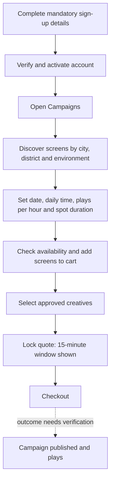
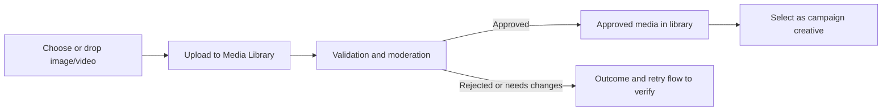

# Advertiser Campaigns and Media

| Field | Details |
|---|---|
| User role | Customer / advertiser / campaign publisher |
| Parent wiki feature | [Customer flow](./User-Account-Customer-Flow.md) |
| Related Jira | Advertiser campaigns and media library [IA-517](https://insta-ad.atlassian.net/browse/IA-517), under Customer Experience [IA-139](https://insta-ad.atlassian.net/browse/IA-139); Customer Pathway and Onboarding [IA-140](https://insta-ad.atlassian.net/browse/IA-140), story [IA-141](https://insta-ad.atlassian.net/browse/IA-141), customer-fields task [IA-149](https://insta-ad.atlassian.net/browse/IA-149) |
| Application review | 2026-11-16 |
| Status | Current application UI documented; end-to-end actions not verified |

## 1. Purpose

The Customer is the advertiser and campaign publisher. The application exposes campaign discovery and creation, media upload, and an advertisement library. This page documents the observed application UI as a current-state reference. Future Customer booking, payment, moderation, analytics, and publishing requirements in the [Customer flow](./User-Account-Customer-Flow.md) remain in scope and are not replaced by this snapshot.

The proposed plan-based subscription, geography and business-category targeting model is documented separately in [Resource Management and Monetization](./Resource-Management-and-Monetization.md) and [Billing and Subscriptions](./Billing-and-Subscriptions.md). Examples include all businesses in Kleinostheim, bakeries in Aschaffenburg, shoe shops and gyms across Bavaria or Germany, and all Germany. The Basic plan example allows up to 10 devices in one selected Ort, with an advertiser-selectable number of available slots per device (up to six). Pricing is per slot/device/month by locality tier; Kleinostheim low tier is €60 per slot, so all six slots cost €360/device/month and 10 fully booked devices cost €3,600/month. Broader regional, category-specific and nationwide audiences belong to higher plan entitlements whose caps and prices remain TBD. The live discovery UI and campaign flow have not been verified to support all of those targeting combinations.

## 2. Access prerequisites

The user must first complete account-level mandatory details and account verification/activation under [Sign-up and Login](./Sign-up-and-Login.md), Jira feature [IA-4](https://insta-ad.atlassian.net/browse/IA-4). The signed-in app displayed these features in an activated account. This review did not verify role-specific approval gates or access behavior for inactive accounts.

## 3. Advertiser workflow

The diagram reflects the visible campaign stages. Actions after creative selection were not submitted, so quote, checkout, and publication outcomes remain unverified.



### Sample UI: campaign discovery

```text
+------------------------------------------------------------------+
| Create Campaign      1 Discover  >  2 Creatives  >  3 Quote > 4  |
+------------------------------------------------------------------+
| From [date] To [date] | Daily [start] to [end]                    |
| Plays/hr [2 v]       | Duration [30s v]       [Check Availability]|
+------------------------------------------------------------------+
| City [search]          District / Zone [search]  Environment [v]  |
|                                                                  |
| Screen card                         | Map                        |
| Name · location · device            | screen markers             |
| timezone · resolution · footfall    |                            |
+------------------------------------------------------------------+
| Campaign Cart: selected screens | Advisory prices until quote lock|
+------------------------------------------------------------------+
```

This is a schematic transcription of visible controls, not a pixel-accurate screenshot.

## 4. Campaign list

**Route:** `/campaigns`

The Campaigns page is titled “My Campaigns” and offers:

- Campaign list with Cards, Map, and Split views
- Refresh action
- New Campaign action
- Empty state directing the user to discover screens and create a campaign

The page describes campaign management. No campaign was created during the review.

## 5. Campaign creation

**Route:** `/campaigns/create`

The observed campaign wizard has four stages:

1. **Discover & Screens**
   - Set start and end dates.
   - Set daily start and end times.
   - Choose plays per hour (observed choices: 1, 2, 3, 4, or 6).
   - Choose spot duration (observed choices: 10, 15, 30, or 60 seconds).
   - Search by city and district/zone.
   - Filter by environment (all, indoor display, outdoor display).
   - Browse screen cards and a map; screen cards show location, device type, timezone, environment, resolution, estimated footfall, and daily plays.
   - Check availability and add selected screens to the campaign cart.
2. **Select Creatives**
   - Select ad media for the campaign. The stage is visible but was not progressed through during the review.
3. **Lock Quote**
   - The UI shows a 15-minute quote lock.
   - Prices and availability are labeled estimates before quote generation; availability may change before checkout.
4. **Checkout**
   - Checkout is the final visible stage. Payment and campaign activation were not tested.

The cart indicates that it auto-saves for two hours and that prices remain advisory until locked. No screens, quote, or checkout were submitted.

## 6. Media library and advertisements

**Route:** `/ads`

The page has an upload area and Media and Ads tabs.

### Upload UI

- Supports image extensions JPEG, JPG, PNG, GIF.
- Supports video extensions MP4 and WebM, with duration shown as 5–60 seconds.
- Provides drag-and-drop or file selection.
- Describes validation and moderation after upload, before media can be used to create advertisements.
- Provides an Upload to Media Library action.

### Media and Ads tabs

- Media tab is described as the uploaded-file library; approved assets appear in the Ads tab.
- Ads tab is described as advertisements created from approved media.
- The empty Ads state says no advertisements exist yet.

No file was uploaded and no ad was created. Validation rules beyond the displayed formats/duration, moderation states, rejection handling, and publication behavior remain to be verified.



### Sample UI: media library

```text
+------------------------------------------------------------------+
| Ads & Media                                             [Refresh] |
+------------------------------------------------------------------+
| Upload Media                                                    |
| [ Drop files here or click to select ]                           |
| Images: JPEG / JPG / PNG / GIF   Video: MP4 / WebM (5-60 sec)   |
|                                      [Upload to Media Library]   |
+------------------------------------------------------------------+
| Media Library                         [ Media ] [ Ads ]          |
| Uploaded files / moderation status / approved advertisements    |
+------------------------------------------------------------------+
```

This is a schematic transcription of visible controls, not a pixel-accurate screenshot.

## 7. Related future requirements

The [Customer flow](./User-Account-Customer-Flow.md) continues to define the planned Customer journey, including resource browsing, booking, payment, customer-specific fields, and open product questions. Public-site claims such as live analytics, reach reporting, and QR publishing were not confirmed in the signed-in workflows during this review.

## 8. Existing Jira mapping and gaps

| Application feature | Existing related Jira reference | Scope note |
|---|---|---|
| Customer advertiser pathway | [IA-140](https://insta-ad.atlassian.net/browse/IA-140), [IA-141](https://insta-ad.atlassian.net/browse/IA-141) | Existing Customer pathway references; they remain distinct from the campaign/media feature. |
| Customer-specific fields | [IA-149](https://insta-ad.atlassian.net/browse/IA-149) | Existing task to define Customer-specific fields; not a dedicated campaign/media issue. |
| Campaign scheduling, screen selection, quote lock, checkout | New feature [IA-517](https://insta-ad.atlassian.net/browse/IA-517) | Created after Jira search found no matching campaign or advertiser issue. Captures the deployed UI baseline; checkout and publication remain unverified. |
| Media upload, validation, moderation, ad library | New feature [IA-517](https://insta-ad.atlassian.net/browse/IA-517) | No matching media/creative issue existed. The Jira feature links to this page's UI and workflow documentation; moderation outcomes remain unverified. |
| Analytics and QR publishing | No dedicated issue identified in the current wiki | These are public-site claims; signed-in workflows were not verified. |

Related existing references do not establish that the full feature is implemented or covered by Jira. Confirm issue scope and workflow behavior separately.
