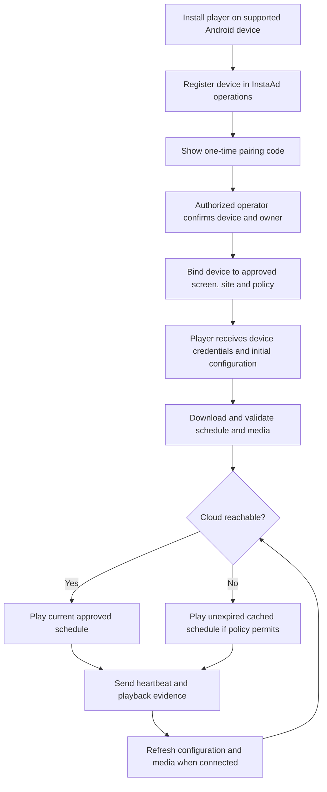

# Android Screen Player

| Field | Details |
|---|---|
| Audience | Android player engineers, cloud/API engineers, screen operations, and Hosts |
| Scope | Android application that pairs a physical screen with InstaAd cloud services and plays its assigned campaign schedule |
| Status | Proposed development scope; the current deployed app and device-player capabilities have not been verified |
| Related documentation | [Resource Management and Monetization](./Resource-Management-and-Monetization.md), [Host Screen Management](./Host-Screen-Management.md), [Advertiser Campaigns and Media](./Advertiser-Campaigns-and-Media.md), [First Organization Customer Pilot Readiness](./First-Organization-Customer-Pilot-Readiness.md) |
| Related Jira | Android Screen Player Application [IA-521](https://insta-ad.atlassian.net/browse/IA-521), under workstream [IA-299](https://insta-ad.atlassian.net/browse/IA-299); screen registration, groups and pairing [IA-518](https://insta-ad.atlassian.net/browse/IA-518); resource management [IA-324](https://insta-ad.atlassian.net/browse/IA-324); campaigns/media [IA-517](https://insta-ad.atlassian.net/browse/IA-517) |
| Last updated | 2026-11-19 |

## 1. Purpose

The Android Screen Player is the device-side application for a physical advertising display. It connects a registered screen to InstaAd cloud services, downloads its approved playback configuration and media, plays the schedule, and reports device health and playback evidence.

This page defines a proposed feature and development scope. Do not treat pairing, cloud synchronization, offline playback, proof-of-play, remote management, or any other behavior below as already implemented until it has been tested on the supported device and documented as deployed.

The player must honor the resource ownership and slot policy in [Resource Management and Monetization](./Resource-Management-and-Monetization.md). In particular, do not infer device ownership from the physical location, and do not play Host content or paid campaign content outside the schedule and permissions assigned to that screen.

## 2. Users and responsibilities

| Actor | Responsibility |
|---|---|
| InstaAd device operator | Registers the device, approves pairing, assigns its owner/site, publishes configuration, monitors status and manages supported updates. |
| Screen-owning Host | May view the Host's own screen status and configure approved content for the included Host slot, if enabled by the finalized policy. |
| Customer / campaign publisher | Creates and pays for campaigns; does not directly pair devices or override the screen's ownership and operational controls. |
| Android player | Authenticates as a device, obtains only its assigned configuration/media, plays valid scheduled content and reports status. |

## 3. Proposed device lifecycle

The pairing mechanism, credential lifecycle and offline authorization rules are design decisions. A pairing code should be short-lived and single-use; it must not itself become a persistent device credential.

## 4. Player capabilities

### 4.1 Pairing and device identity

- Pair only after an authorized operator approves the device and confirms the screen owner, operator, physical site and active status.
- Establish a unique, revocable device identity. Store secrets using Android's supported secure storage and transmit them only over authenticated encrypted connections.
- Reject expired, revoked, unapproved or mismatched device credentials. Provide a recovery/re-pairing process that invalidates the previous identity.
- Show an unambiguous player state (unpaired, awaiting approval, active, offline, error) without exposing pairing secrets.

### 4.2 Configuration and media synchronization

- Fetch a versioned configuration assigned to the device: schedule, slot policy, approved creative references, playback settings, time zone and validity window.
- Download media over authenticated transport, validate integrity and supported format before adding it to the playable cache.
- Apply configuration atomically: a partial or invalid update must not replace the last known-good configuration.
- Remove stale media only when it is no longer referenced by the active schedule and storage pressure requires cleanup.
- Report configuration and media versions so operations can diagnose stale or incomplete devices.

The cloud API contract, polling/push mechanism, supported media formats, storage budget and configuration version policy must be agreed between player and backend teams before implementation.

### 4.3 Playback and slot policy

- Play only approved, currently valid schedule entries assigned to this device; use the configured time zone and deterministic schedule boundaries.
- Enforce the finalized loop and slot durations, Host-owner slot choice, campaign booking windows, and InstaAd promotion policy from the shared resource model.
- Prevent overlap, truncation or unintended extension of booked content. If a creative cannot play within its assigned duration, report a clear playback error instead of silently shifting later items.
- On a schedule gap, follow an explicit fallback policy (for example, approved house content or a neutral screen); never invent or extend a paid booking.
- Resume safely after app/process/device restart without corrupting playback state or duplicating delivery evidence.

The proposed 6 × 10-second loop and the 5–10-second InstaAd promotion timing are unresolved business rules. Do not hard-code them until Product finalizes whether the promotion is inside or in addition to each slot.

### 4.4 Offline operation and recovery

- Cache an approved schedule and its required media for a bounded, configurable offline window.
- Play cached content only while its schedule and authorization remain valid; stop or use the approved fallback after expiry.
- Queue heartbeat and playback events locally with event timestamps and unique IDs, then retry delivery when connectivity returns.
- Make event upload idempotent so retries do not duplicate proof-of-play or reporting counts.
- Back off repeated network failures, expose connectivity/sync state, and resume downloads from a safe point where supported.
- Define storage-full, corrupt-media, clock drift, time synchronization, reboot and prolonged-outage behavior.

Offline playback is not proof of billable delivery by itself. Reporting and billing rules must define how delayed, missing or unverifiable playback evidence is treated.

### 4.5 Health, diagnostics and updates

- Send heartbeats with device identity, app version, configuration version, connectivity, playback state, last successful sync and actionable error codes.
- Avoid collecting unrelated personal data. Do not use the player's camera, microphone, contacts or location permissions unless a separately approved product requirement needs them.
- Support operator-visible diagnostics and a safe restart/recovery path. Remote controls must be authorized, auditable and limited to supported actions.
- Define signed update distribution, staged rollout, rollback and minimum supported Android versions before remote updating is enabled.
- Provide operational alerts for stale heartbeat, failed configuration/media sync, storage errors, repeated playback errors and revoked devices.

## 5. Cloud and data responsibilities

The cloud side is expected to provide the following contracts; endpoint names and wire formats are intentionally unspecified until the backend API is designed:

1. **Enrollment:** validate a one-time pairing claim and issue/revoke device credentials.
2. **Device configuration:** return the current versioned, screen-scoped schedule and policy.
3. **Media delivery:** authorize access to approved creative and provide integrity metadata.
4. **Heartbeat and diagnostics:** accept health state, app/config versions and structured error codes.
5. **Playback evidence:** accept uniquely identified play-start/play-complete/failure events with schedule entry, creative, device and timestamp references.
6. **Remote management:** expose only authorized configuration refresh, disable/revoke and supported recovery/update operations.

The backend remains authoritative for resource ownership, campaign approval, booking windows, slot allocation, payment state and whether a device may participate. The player must not determine or modify these commercial entitlements locally.

## 6. Security and privacy requirements

- Use TLS for cloud communication and scoped, revocable per-device credentials; never embed shared production credentials in the application package.
- Keep credentials out of logs, screenshots, crash reports and analytics. Restrict local access to cached media/configuration as supported by the device.
- Validate server responses, schedule validity, media integrity and remote commands before use.
- Apply least privilege to Android permissions and explain each requested permission in the development documentation.
- Audit pairing, ownership changes, disable/revoke events and remote actions in the cloud.
- Define secure behavior for rooted/unsupported devices, app tampering, clock changes, factory reset and lost devices.

## 7. Acceptance criteria

The feature is ready for controlled pilot only when all of the following are demonstrated on the agreed Android hardware and OS versions:

1. An authorized operator can pair an unregistered player once, bind it to the correct screen and owner, and revoke/re-pair it without reusing the old credential.
2. A device can retrieve only its own active configuration and authorized media; unapproved, expired or revoked devices cannot fetch or play newly assigned campaigns.
3. A valid configuration and media set can be downloaded, integrity-checked and applied without disrupting the last known-good schedule if the update fails.
4. Playback follows the approved loop, time zone, Host slot choice, campaign window and promotion policy, with no overlapping or extended booked entries.
5. A network interruption follows the documented cache/expiry policy; reconnection synchronizes state and uploads queued events without duplicate evidence.
6. Operations can identify the device's last heartbeat, app/config version, sync state and actionable playback errors.
7. Process restart, device reboot, clock drift, low storage, corrupt/unsupported media and prolonged offline scenarios produce the documented safe outcome.
8. Device credentials are not present in logs or package source, and the app requests only approved Android permissions.
9. A staged update can be rolled back or disabled through the documented release process.

## 8. Delivery and test plan

- Confirm supported device models, Android versions, screen orientation/resolution, audio policy, network requirements, kiosk/lock-task behavior and power recovery expectations.
- Agree API schemas and error semantics with backend before implementation; version the contracts and maintain a test environment.
- Test pairing, authorization and credential revocation; configuration replacement; media validation; time-zone and daylight-saving transitions; schedule changes; and offline/reconnect behavior.
- Run long-duration playback and soak tests on representative hardware, including restart/power-loss and low-storage cases.
- Verify proof-of-play reconciliation against the cloud schedule and define handling for late, duplicate or missing events.
- Pilot first with controlled screens and non-billable test campaigns; enable paid delivery only after Product and Operations sign off on the loop policy and evidence rules.
- Roll out by device cohort with health monitoring, a rollback path and documented operator support procedures.

## 9. Related Jira mapping

| Jira | Relationship |
|---|---|
| [IA-521](https://insta-ad.atlassian.net/browse/IA-521) — Android Screen Player Application, under [IA-299](https://insta-ad.atlassian.net/browse/IA-299) | Owns the Android client, cloud integration, playback, offline recovery, device diagnostics and rollout acceptance criteria in this page. |
| [IA-518](https://insta-ad.atlassian.net/browse/IA-518) | Existing screen registration, groups and pairing scope; align enrollment and device identity to this work. |
| [IA-324](https://insta-ad.atlassian.net/browse/IA-324) | Existing resource management scope; align player configuration to resource ownership and lifecycle. |
| [IA-517](https://insta-ad.atlassian.net/browse/IA-517) | Existing campaign/media scope; align creative approval and media delivery. |
| [IA-299](https://insta-ad.atlassian.net/browse/IA-299) | Parent workstream for resource, booking and screen-player development. |

The new player feature issue key must be added to the first row and to the resource-management feature mapping when created. Existing references are related work and do not imply those capabilities are complete.
