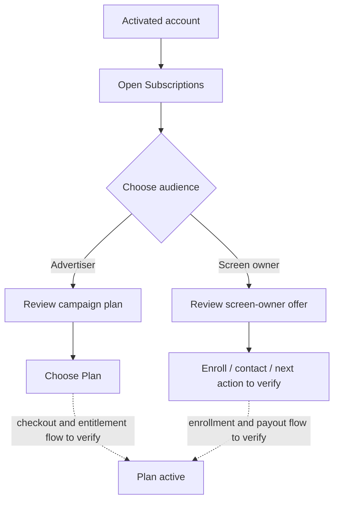

# Billing and Subscriptions

| Field | Details |
|---|---|
| User roles | Customer / advertiser and Host / screen owner |
| Application route | `/subscriptions` |
| Existing wiki/Jira mapping | Subscriptions and Plans [IA-262](https://insta-ad.atlassian.net/browse/IA-262), Plans and Pricing [IA-263](https://insta-ad.atlassian.net/browse/IA-263), plan selection [IA-264](https://insta-ad.atlassian.net/browse/IA-264), pricing decision [IA-272](https://insta-ad.atlassian.net/browse/IA-272), plan limits [IA-288](https://insta-ad.atlassian.net/browse/IA-288), subscription lifecycle [IA-275](https://insta-ad.atlassian.net/browse/IA-275), payments and billing [IA-213](https://insta-ad.atlassian.net/browse/IA-213), recurring billing/invoices [IA-292](https://insta-ad.atlassian.net/browse/IA-292), Host payouts [IA-250](https://insta-ad.atlassian.net/browse/IA-250); role context is in [Customer flow](./User-Account-Customer-Flow.md) and [Host flow](./User-Account-Host-Flow.md) |
| Application review | 2026-11-16 |
| Status | Current application UI documented; offers and payment workflows not verified |

## 1. Purpose

The Subscriptions page presents advertiser plans and screen-owner offers. The page copy describes campaign publishing plans and ways for screen owners to monetize display inventory. No plan was selected and no payment was made during review.

The confirmed advertiser Basic subscription lets the Customer select up to **five screens** for ad display at **€50 per selected screen per month** (maximum €250/month when all five are selected). This is an advertiser entitlement; it is not a limit on the number of screens a Host may own, register or list. Subscription fees remain separate from campaign booking revenue, Host type 1 screen payouts and Host type 2 fixed space rent. See [Resource Management and Monetization](./Resource-Management-and-Monetization.md) for the shared commercial rules.

The rollout proposal waives Customer application-use/subscription fees for the first release and first-100 Customer cohort, with expansion from the first pilot to 10 Customers after successful process validation. The precise waived fees, duration, eligibility and payment treatment still require approval. This does not make campaign bookings free unless separately approved. Host-owner subscription pricing is deferred until first-100 cohort data can support a sustainable comparison against booking fees for both Hosts and InstaAd; see the cohort metrics in [Resource Management and Monetization](./Resource-Management-and-Monetization.md).

## 2. Subscription selection workflow

The app shows plans and actions to choose/manage a plan. The purchase and entitlement flow was not tested.



```text
+------------------------------------------------------------------+
| Subscriptions & Offers                                           |
| Advertiser Plans             Screen Owner Offers       Growth Ready|
+------------------------------------------------------------------+
| Advertiser Basic                                                 |
| Choose up to 5 screens · €50 per selected screen/month            |
| 1 active campaign · 1 media asset · 1 play/hour                  |
| Daily 09:00-17:00 · basic targeting/reporting   [Choose Plan]    |
+------------------------------------------------------------------+
| Screen-owner offers (separate from advertiser screen selection)  |
| Pro: priority/earnings | Network Partner                         |
+------------------------------------------------------------------+
```

This is a schematic summary. The app displayed €50/month campaign-plan copy; the product clarification for the advertiser Basic plan is €50 per selected screen per month, with a five-screen maximum. Purchase mechanics and enforcement are not independently verified.

## 3. Advertiser plan shown

The advertiser Basic subscription is for campaign publishers and allows the Customer to select up to five screens to display ads. Price is **€50 per selected screen per month**; if all five are selected, the subscription total is **€250/month**. The plan card also displayed the following campaign features/limits:

- Up to one active campaign
- Up to one uploaded media asset
- One play per hour
- Daily playback window 09:00–17:00
- Basic location targeting
- Standard time-slot scheduling
- Basic campaign reporting

The screen count and per-screen price are the clarified advertiser Basic terms. The other plan details are displayed UI copy; enforcement and purchase flow are not independently verified.

## 4. Screen-owner offers shown

Screen-owner offers are separate from the advertiser's Basic subscription. The previous documentation incorrectly attributed the five-screen Basic limit to a screen owner. It applies to the advertiser's selected ad-placement screens and does **not** establish a Host screen registration or ownership limit. Screen-owner plan limits and prices are not confirmed here. The page also displayed:

- **Screen Owner Pro:** priority campaign allocations, earnings dashboard, and payout insights
- **Network Partner:** intended for malls, co-working hubs, and transport networks with high-traffic screens

No complete pricing or enrollment workflow for these offers was verified.

## 5. Relationship to other app workflows

- Advertiser plans relate to campaign and media use in [Advertiser Campaigns and Media](./Advertiser-Campaigns-and-Media.md).
- Screen-owner offers relate to screen registration in [Host Screen Management](./Host-Screen-Management.md).
- Host payout and tax requirements remain in the [Host flow](./User-Account-Host-Flow.md), including the planned Host verification gate.
- The shared proposed subscription, slot, booking-revenue and fixed-rent model is in [Resource Management and Monetization](./Resource-Management-and-Monetization.md).

The presence of plan cards does not establish that checkout, subscription entitlement enforcement, ad playback limits, earnings calculation, or payouts work end to end.

## 6. Existing Jira mapping and gaps

| Application feature | Existing related Jira reference | Scope note |
|---|---|---|
| Advertiser Basic: select up to five ad screens at €50 per selected screen/month | [IA-263](https://insta-ad.atlassian.net/browse/IA-263), pricing decision [IA-272](https://insta-ad.atlassian.net/browse/IA-272), plan selection [IA-264](https://insta-ad.atlassian.net/browse/IA-264), and entitlement enforcement [IA-288](https://insta-ad.atlassian.net/browse/IA-288) | Five-screen limit applies to the Customer's ad-placement selection; it is not a Host inventory cap. Show selected-screen count and monthly total before checkout. |
| Plans and subscription catalog | [IA-262](https://insta-ad.atlassian.net/browse/IA-262), [IA-263](https://insta-ad.atlassian.net/browse/IA-263), [IA-264](https://insta-ad.atlassian.net/browse/IA-264), [IA-268](https://insta-ad.atlassian.net/browse/IA-268) | Existing plan/catalog scope. Purchase and entitlement enforcement have not been independently verified. |
| Subscribe, lifecycle, entitlement and recurring billing | [IA-275](https://insta-ad.atlassian.net/browse/IA-275), [IA-276](https://insta-ad.atlassian.net/browse/IA-276), [IA-287](https://insta-ad.atlassian.net/browse/IA-287), [IA-292](https://insta-ad.atlassian.net/browse/IA-292) | Existing implementation scope. No purchase, renewal, cancellation, entitlement, or invoice workflow was tested in the app. |
| Checkout and payment methods | [IA-213](https://insta-ad.atlassian.net/browse/IA-213), [IA-215](https://insta-ad.atlassian.net/browse/IA-215), [IA-226](https://insta-ad.atlassian.net/browse/IA-226) | Related existing payment and checkout issues; the visible Settings controls do not establish that these flows work end to end. |
| Host rental payments, earnings and payouts | [IA-255](https://insta-ad.atlassian.net/browse/IA-255), [IA-250](https://insta-ad.atlassian.net/browse/IA-250), [IA-251](https://insta-ad.atlassian.net/browse/IA-251) | Existing Host payment/payout requirements. Screen-owner offers and payout behavior were not verified. |

These are related existing Jira issues; their existence does not confirm that app plan selection, checkout, entitlements, invoices, or payouts work end to end. No additional billing feature was created.

## 7. Related documentation

- [Advertiser Campaigns and Media](./Advertiser-Campaigns-and-Media.md)
- [Host Screen Management](./Host-Screen-Management.md)
- [User Account Host Flow](./User-Account-Host-Flow.md)
- [User Account Customer Flow](./User-Account-Customer-Flow.md)
