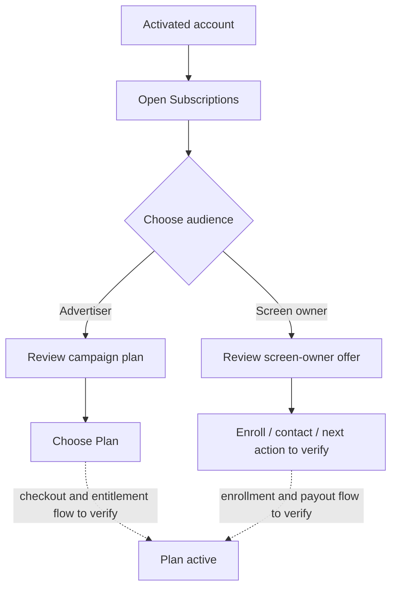

# Billing and Subscriptions

| Field | Details |
|---|---|
| User roles | Customer / advertiser and Host / screen owner |
| Application route | `/subscriptions` |
| Existing wiki/Jira mapping | Subscriptions and Plans [IA-262](https://insta-ad.atlassian.net/browse/IA-262), Plans and Pricing [IA-263](https://insta-ad.atlassian.net/browse/IA-263), plan selection [IA-264](https://insta-ad.atlassian.net/browse/IA-264), subscription lifecycle [IA-275](https://insta-ad.atlassian.net/browse/IA-275), payments and billing [IA-213](https://insta-ad.atlassian.net/browse/IA-213), recurring billing/invoices [IA-292](https://insta-ad.atlassian.net/browse/IA-292), Host payouts [IA-250](https://insta-ad.atlassian.net/browse/IA-250); role context is in [Customer flow](./User-Account-Customer-Flow.md) and [Host flow](./User-Account-Host-Flow.md) |
| Application review | 2026-11-16 |
| Status | Current application UI documented; offers and payment workflows not verified |

## 1. Purpose

The Subscriptions page presents advertiser plans and screen-owner offers. The page copy describes campaign publishing plans and ways for screen owners to monetize display inventory. No plan was selected and no payment was made during review.

## 2. Subscription selection workflow

The app shows plans and actions to choose/manage a plan. The purchase and entitlement flow was not tested.



```text
+------------------------------------------------------------------+
| Subscriptions & Offers                                           |
| Advertiser Plans             Screen Owner Offers       Growth Ready|
+------------------------------------------------------------------+
| Starter Campaign                                                |
| €50 / month                                                      |
| 1 active campaign · 1 media asset · 1 play/hour                  |
| Daily 09:00-17:00 · basic targeting/reporting   [Choose Plan]    |
+------------------------------------------------------------------+
| Screen Owner Program                                             |
| Basic: up to 5 screens | Pro: priority/earnings | Network Partner|
+------------------------------------------------------------------+
```

This is a schematic transcription of the displayed page. Pricing and purchase mechanics are not independently verified.

## 3. Advertiser plan shown

The page displayed a **Starter Campaign** plan at **€50/month**, described for local businesses starting campaigns. Listed limits and features:

- Up to one active campaign
- Up to one uploaded media asset
- One play per hour
- Daily playback window 09:00–17:00
- Basic location targeting
- Standard time-slot scheduling
- Basic campaign reporting

These are details shown in the reviewed UI and are not independently verified commercial terms.

## 4. Screen-owner offers shown

The page displayed a Screen Owner Program with:

- **Screen Owner Basic:** register up to five screens and start monetizing with automated ad playback
- **Screen Owner Pro:** priority campaign allocations, earnings dashboard, and payout insights
- **Network Partner:** intended for malls, co-working hubs, and transport networks with high-traffic screens

No complete pricing or enrollment workflow for these offers was verified.

## 5. Relationship to other app workflows

- Advertiser plans relate to campaign and media use in [Advertiser Campaigns and Media](./Advertiser-Campaigns-and-Media.md).
- Screen-owner offers relate to screen registration in [Host Screen Management](./Host-Screen-Management.md).
- Host payout and tax requirements remain in the [Host flow](./User-Account-Host-Flow.md), including the planned Host verification gate.

The presence of plan cards does not establish that checkout, subscription entitlement enforcement, ad playback limits, earnings calculation, or payouts work end to end.

## 6. Existing Jira mapping and gaps

| Application feature | Existing related Jira reference | Scope note |
|---|---|---|
| Plans and subscription catalog | [IA-262](https://insta-ad.atlassian.net/browse/IA-262), [IA-263](https://insta-ad.atlassian.net/browse/IA-263), [IA-264](https://insta-ad.atlassian.net/browse/IA-264), [IA-268](https://insta-ad.atlassian.net/browse/IA-268) | Existing plan/pricing scope; the reviewed plan cards and displayed terms have not been independently verified. |
| Subscribe, lifecycle, entitlement and recurring billing | [IA-275](https://insta-ad.atlassian.net/browse/IA-275), [IA-276](https://insta-ad.atlassian.net/browse/IA-276), [IA-287](https://insta-ad.atlassian.net/browse/IA-287), [IA-292](https://insta-ad.atlassian.net/browse/IA-292) | Existing implementation scope. No purchase, renewal, cancellation, entitlement, or invoice workflow was tested in the app. |
| Checkout and payment methods | [IA-213](https://insta-ad.atlassian.net/browse/IA-213), [IA-215](https://insta-ad.atlassian.net/browse/IA-215), [IA-226](https://insta-ad.atlassian.net/browse/IA-226) | Related existing payment and checkout issues; the visible Settings controls do not establish that these flows work end to end. |
| Host rental payments, earnings and payouts | [IA-255](https://insta-ad.atlassian.net/browse/IA-255), [IA-250](https://insta-ad.atlassian.net/browse/IA-250), [IA-251](https://insta-ad.atlassian.net/browse/IA-251) | Existing Host payment/payout requirements. Screen-owner offers and payout behavior were not verified. |

These are related existing Jira issues; their existence does not confirm that app plan selection, checkout, entitlements, invoices, or payouts work end to end. No additional billing feature was created.

## 7. Related documentation

- [Advertiser Campaigns and Media](./Advertiser-Campaigns-and-Media.md)
- [Host Screen Management](./Host-Screen-Management.md)
- [User Account Host Flow](./User-Account-Host-Flow.md)
- [User Account Customer Flow](./User-Account-Customer-Flow.md)
