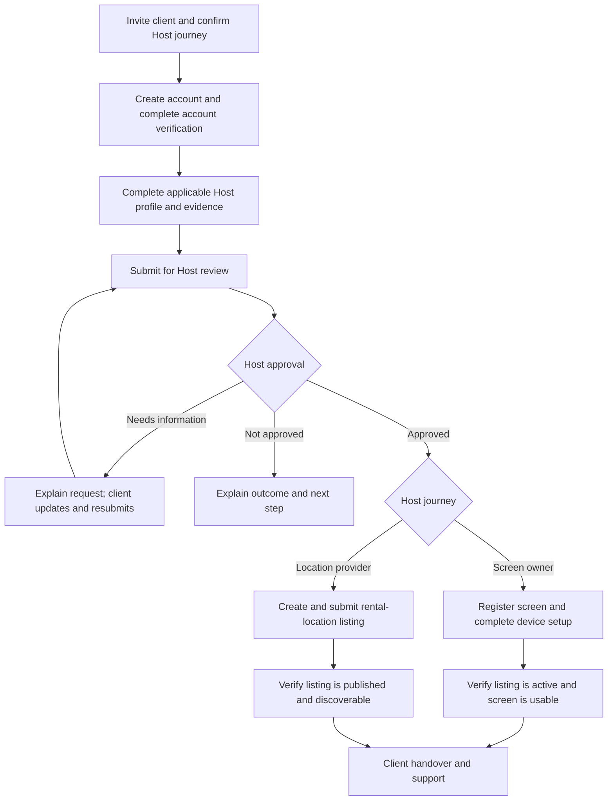

# First Host Client Readiness

| Field | Details |
|---|---|
| Audience | First external Host client and the InstaAd team preparing their account |
| User journeys | Host type 1: screen owner; current app Host type 2: advertiser-rentable location provider |
| Related product documentation | [Host flow](./User-Account-Host-Flow.md), [Host Screen Management](./Host-Screen-Management.md), [Host Rental Location Listings](./Host-Rental-Location-Listings.md), [Account Settings](./Account-Settings.md), [Billing and Subscriptions](./Billing-and-Subscriptions.md) |
| Related Jira | Account activation [IA-4](https://insta-ad.atlassian.net/browse/IA-4); Host onboarding and verification [IA-449](https://insta-ad.atlassian.net/browse/IA-449); Host activation checklist [IA-450](https://insta-ad.atlassian.net/browse/IA-450); Host review [IA-470](https://insta-ad.atlassian.net/browse/IA-470); keep inventory inactive until Host activation [IA-478](https://insta-ad.atlassian.net/browse/IA-478); screen management [IA-518](https://insta-ad.atlassian.net/browse/IA-518); current app rental-location listing [IA-519](https://insta-ad.atlassian.net/browse/IA-519) |
| Status | Pilot readiness checklist; completion and end-to-end operation have not been independently verified |
| Last updated | 2026-11-19 |

## 1. Purpose

Use this page to decide whether one real Host client can safely sign in, complete the right Host journey, set up their screen or location, and reach a clear usable outcome with help available if something fails. It describes what must be ready for the client, not a claim that every item is already implemented.

The existing Host flow remains the source of planned mandatory Host details, verification, approval and inactive-inventory requirements. This checklist complements it and does not replace those requirements.

## 2. Choose the client's Host journey before onboarding

| Client's activity | Application path | Host mapping | Key distinction |
|---|---|---|---|
| Client owns or is authorized to operate an advertising screen and wants to list that screen | My Screens / Register Screen | Host type 1 | The client operates and maintains the listed screen. |
| Client offers a shop, building, or other location for advertisers to rent | Rent Location / Create Listing | Host type 2 in the current app | The current form offers a location to advertisers. Its meaning is not yet confirmed to match the future Host type 2 requirement below. |
| Client wants to list both a screen and a location | Both application paths, if enabled for the account | Host type 1 and current-app Host type 2 | Verify and collect evidence for each asset/right separately. |

**Product decision required:** the existing future Host type 2 requirement describes a space where an InstaAd-controlled resource is assembled. The current app's Rent Location workflow describes a location advertisers can rent. Do not treat these as the same offer or promise a specific commercial arrangement until the product owner confirms the pilot model. See [Host flow](./User-Account-Host-Flow.md).

## 3. Client journey and hand-offs

The diagram includes planned approval gates and observed app areas; the end-to-end flows, status handling and customer-facing outcomes still require verification before they can be promised to a client.

## 4. Must be ready before inviting the client

| Readiness gate | What the client must be able to do or understand | Verification evidence |
|---|---|---|
| Account access | Receive the invitation or sign-up link, create/sign in to the account, verify required contact methods, recover access, and sign out safely. | Run a fresh client test from invitation/sign-up through sign-out and successful return. Confirm account activation is correctly gated under [IA-4](https://insta-ad.atlassian.net/browse/IA-4). |
| Correct Host journey | Understand whether they are listing a screen, a rentable location, or both; navigate to the correct area in the application. | Walk the chosen journey with the actual client role and permissions. Do not expose an irrelevant or confusing Host type. |
| Host details and verification | See the applicable identity/business/ownership, payout/tax and public-profile requirements; understand what is mandatory, why evidence is requested, what is private, and how to get help. | Confirm each field, validation, secure document handling, allowed evidence and jurisdiction rules. Verify the review checklist and submit path against [IA-449](https://insta-ad.atlassian.net/browse/IA-449), [IA-450](https://insta-ad.atlassian.net/browse/IA-450), and related Host stories. |
| Review and activation | See submitted, under-review, information-requested, approved and rejected states as applicable; know what action is needed and when. | Test status changes, client-visible messages and email/in-app notifications. Confirm the review owner and realistic turnaround. Do not allow inventory to appear active before approval ([IA-470](https://insta-ad.atlassian.net/browse/IA-470), [IA-478](https://insta-ad.atlassian.net/browse/IA-478)). |
| Support and expectations | Know how to contact the team, expected support hours/response time, review timing, and what the pilot does not yet support. | Give the client a working support contact and written, accurate expectations before they begin. |

The existing Host flow lists identity, business and ownership, payout/tax, and public-profile sections. It also notes open decisions about jurisdiction-specific evidence and individual-host ownership evidence. Confirm applicable requirements with Product/Legal before collecting sensitive documents or presenting draft requirements as policy.

## 5. Host type 1: screen-owner launch gates

The current app exposes `/devices`, `/devices/register`, and `/devices/groups`. The first screen-registration step was observed, but registration submission, screen groups, pairing, playback and health monitoring were not verified end to end.

Before the screen-owner client is considered ready:

- The client can add a screen with the required device, format, location, address, map, tags and photo details, and sees clear validation and recovery for invalid or failed submissions.
- The client knows which screen attributes are public to advertisers and can preview/correct the listing before it becomes visible.
- The client can complete the next registration step and understands how to install/open the player and pair the physical screen securely.
- The client can confirm that the screen is online and playing approved test content, see an offline/error state, and knows how to recover or request support.
- Screen groups are either working and explained, or excluded from the pilot without blocking basic screen setup.
- The screen/listing remains hidden and unavailable until required Host and listing approvals are complete.
- The client understands who installs and maintains the display, who supplies creative content, what content is allowed, and how operating hours and maintenance incidents are handled.
- The client sees accurate advertiser discovery status and any expected earnings/payment information only after those amounts and rules are confirmed.

Related scope: [Host Screen Management](./Host-Screen-Management.md), [IA-518](https://insta-ad.atlassian.net/browse/IA-518), Resource and Space Listing [IA-189](https://insta-ad.atlassian.net/browse/IA-189), Host type 1 listing [IA-190](https://insta-ad.atlassian.net/browse/IA-190), and resource lifecycle [IA-324](https://insta-ad.atlassian.net/browse/IA-324).

## 6. Current app Host type 2: rental-location launch gates

The app exposes `/rent-location/listings` and `/rent-location/listings/new`. The observed form includes title, description, location type, address/map details, dimensions, electricity availability, rent amount and period. Saving, review, publication, booking and payments were not tested.

Before this location-provider client is considered ready:

- Product confirms what the client is offering, who may rent/use the site, and how this offer aligns with or differs from the future Host type 2 resource-space model.
- The client can save, reopen, edit and submit a listing, with clear required-field validation and a useful confirmation/error state.
- The client can review the location pin, address, photos/details and the public listing before publication.
- Ownership or authority to offer the premises is checked. For a tenant-operated shop, a lease can support the right to occupy/use the premises but does not prove building ownership; determine whether the lease permits advertising/location rental and whether separate landlord consent is required.
- A listing review decision and publication status are visible to the client. The client can correct requested information and resubmit.
- An advertiser can discover the approved location, understand its price, availability, access terms and any restrictions, and complete the intended booking/request process.
- The client understands how access, setup, cancellations, damages, rent calculation, payout timing, taxes and disputes work. Do not promise rent or a payout feature until these flows and terms are confirmed.
- The listing remains unavailable until required Host/listing approval is complete.

Related scope: [Host Rental Location Listings](./Host-Rental-Location-Listings.md), current-app listing [IA-519](https://insta-ad.atlassian.net/browse/IA-519), existing future Host type 2 listing [IA-194](https://insta-ad.atlassian.net/browse/IA-194) and rental payment [IA-255](https://insta-ad.atlassian.net/browse/IA-255).

## 7. Payments, privacy and operational safeguards

Before the first client is asked to use the service commercially, the responsible team should verify and communicate:

- Which payout methods and countries are supported; required tax information; fees, payout schedule, minimum payout and failed-payout handling.
- Whether a subscription or plan is required, the actual price and limits, cancellation/refund rules, and whether the client must add a payment method.
- Which profile and listing information is public versus private. Identity documents, tax IDs, addresses and payout details must not be exposed in public listings.
- Secure handling, access control, retention/deletion and support procedures for identity and ownership evidence.
- The approved terms, privacy notice, consent, content rules and any jurisdiction-specific legal requirements for screens or rental locations.
- A named person/team who can resolve account verification, listing review, device offline, payment, and content-moderation issues.

The application has billing/subscription and settings screens, but available UI alone does not establish that purchase, entitlement, payout, invoice, privacy or settings changes work end to end. Refer to [Billing and Subscriptions](./Billing-and-Subscriptions.md) and [Account Settings](./Account-Settings.md).

## 8. Go / no-go checklist

Mark **Go** only when the checks for the selected client journey pass in a production-like account and environment. Record evidence or the responsible owner for every item.

| Check | Type 1 screen owner | Current-app Type 2 location provider |
|---|---:|---:|
| Sign-up, account verification, sign-in and recovery tested | [ ] | [ ] |
| Correct user role, active workspace and permissions verified | [ ] | [ ] |
| Host evidence requirements and secure submission confirmed | [ ] | [ ] |
| Review, requested changes, approval/rejection and notifications tested | [ ] | [ ] |
| Pre-approval inventory is not public/bookable | [ ] | [ ] |
| Client can complete setup and correct errors without staff intervention | [ ] | [ ] |
| Approved inventory is visible to the intended advertiser/customer | [ ] | [ ] |
| End-to-end operating action tested: test playback or location request/booking | [ ] | [ ] |
| Price, usage/access terms, payment and payout expectations confirmed | [ ] | [ ] |
| Support contact, incident path and client handover ready | [ ] | [ ] |

If a core row is not verified, classify the client as a **supervised pilot** or **not ready** rather than describing the feature as production-ready. Clearly document manual workarounds, who performs them, and the limitations the client must accept.

## 9. Related documentation

- [Host flow](./User-Account-Host-Flow.md)
- [Host Screen Management](./Host-Screen-Management.md)
- [Host Rental Location Listings](./Host-Rental-Location-Listings.md)
- [Billing and Subscriptions](./Billing-and-Subscriptions.md)
- [Account Settings](./Account-Settings.md)
