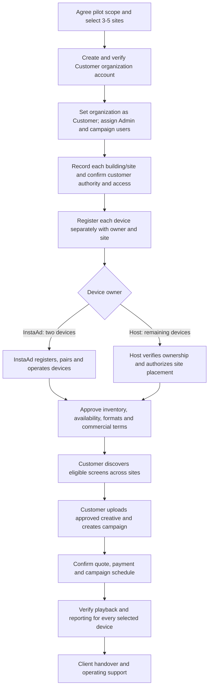

# First Organization Customer Pilot Readiness

| Field | Details |
|---|---|
| Audience | First advertiser/customer organization and InstaAd pilot team |
| Pilot scenario | One organization account placing screens at 3–5 sites in its buildings; two devices owned by InstaAd and the remaining devices owned by independent Hosts |
| User role | Customer / advertiser / campaign publisher |
| Related documentation | [Customer flow](./User-Account-Customer-Flow.md), [Organizations and Workspaces](./Organizations-and-Workspaces.md), [Advertiser Campaigns and Media](./Advertiser-Campaigns-and-Media.md), [Host Screen Management](./Host-Screen-Management.md), [First Host Client Readiness](./First-Host-Client-Readiness.md), [Resource Management and Monetization](./Resource-Management-and-Monetization.md) |
| Related Jira | Account activation [IA-4](https://insta-ad.atlassian.net/browse/IA-4); organization/team/workspace management [IA-108](https://insta-ad.atlassian.net/browse/IA-108), workspaces [IA-113](https://insta-ad.atlassian.net/browse/IA-113), organization Admin [IA-90](https://insta-ad.atlassian.net/browse/IA-90); Customer experience [IA-139](https://insta-ad.atlassian.net/browse/IA-139), Customer onboarding [IA-140](https://insta-ad.atlassian.net/browse/IA-140); campaign and media [IA-517](https://insta-ad.atlassian.net/browse/IA-517); screen management [IA-518](https://insta-ad.atlassian.net/browse/IA-518); Android Screen Player [IA-521](https://insta-ad.atlassian.net/browse/IA-521); slot inventory and monetization [IA-520](https://insta-ad.atlassian.net/browse/IA-520); resource discovery [IA-300](https://insta-ad.atlassian.net/browse/IA-300), booking [IA-312](https://insta-ad.atlassian.net/browse/IA-312), and payments [IA-213](https://insta-ad.atlassian.net/browse/IA-213) |
| Status | Pilot-specific requirements and readiness checklist; cross-owner campaign operation is not verified end to end |
| Last updated | 2026-11-19 |

## 1. Purpose and pilot assumptions

This guide describes what must be ready for the first organization Customer to use InstaAd across several physical sites. The customer uses an organization account and wants screens installed or operated at 3–5 locations in buildings belonging to or managed by that organization. InstaAd owns the devices at two locations; independent Hosts own the devices at the other locations.

For planning only, this guide assumes one device at each site: two InstaAd-owned devices plus one to three Host-owned devices. Confirm the final site and device counts during pilot setup. The number of buildings/sites and the number of registered devices must be recorded separately in the system.

This pilot is an **advertiser/customer organization** using screen inventory. The customer organization is not automatically a Host and should not be given ownership or administrative control of devices merely because they are installed in its buildings.

This organization is the first Customer pilot in the staged rollout: validate the process with this Customer, expand to 10 Customers total only after success criteria are met, then continue toward the first 100 Customers with the approved Customer application-use fee waiver. The exact free-period inclusions and duration are not yet finalized; campaign bookings are not assumed to be free. Separately, Host type 1 will trial its two alternative fee routes with the first 100 eligible users; the Host application-subscription amount remains unset until those results are reviewed. The Customer fee-waiver cohort and Host monetization trial are distinct. See [Resource Management and Monetization](./Resource-Management-and-Monetization.md) for the respective cohort rules and data needs.

## 2. Separate the organization, building, device, and campaign roles

| Record / role | Pilot responsibility | Must not be confused with |
|---|---|---|
| Customer organization | Owns or manages the pilot account, authorizes campaign users, chooses campaigns, and provides access to its buildings. The organization's role is Customer / advertiser. | The device owner or Host organization. |
| Customer organization Admin and Members | Admin owns organization configuration and membership. Authorized Members may perform only the campaign/site tasks assigned to them. | A Host account or an InstaAd operator account. |
| Building / site | A physical venue where a screen may be installed. The customer confirms the site address, access permissions, facilities and local contact. | A screen/device listing or a Host's account. A building may contain multiple devices. |
| Device / screen | A physical display registered as a distinct inventory item, with a unique device identifier and an explicit owning party. | The Customer organization just because the device is located on its premises. |
| InstaAd device owner | Owns and operates the two pilot devices assigned to two sites. InstaAd is responsible for device registration, operation and maintenance as agreed. | The customer organization or the Host who owns another device. |
| Host device owner | Owns their own device(s), completes applicable Host verification, and authorizes listing/availability, installation and operation at the agreed customer site. | The customer organization or InstaAd. |
| Campaign publisher | The Customer organization creates and manages the campaign, schedules, approved creative and campaign budget. | The party that owns or maintains a screen. |

The organization account model in the existing requirements applies Host/Customer role at the organization level. Keep the Customer organization in the Customer role for this pilot. Each independent Host remains associated with their own Host organization/account; any InstaAd-owned inventory is managed through the approved InstaAd operator account or system-owned organization. Do not solve cross-owner campaign access by adding device owners as Members of the customer's organization unless Product explicitly approves that access model.

## 3. Pilot journey

Site authority, device ownership, Host verification, inventory approval and campaign payment are separate gates. Do not activate or sell an inventory item until its owner, site authorization and operational status are confirmed.

## 4. Organization account and access readiness

The customer should create or be invited into an **Organization** account using its organization email domain, with a designated organization Admin. An email domain is an identity signal, not by itself proof that the user is authorized to bind the company or buildings. Validate the Admin and the organization's authority through the approved business onboarding process.

Before the customer starts:

- Confirm whether the account is being newly created as an Organization or whether an existing Personal account/workspace must be linked or converted. Do not assume **Create Workspace** and **Create Organization** are interchangeable.
- Verify email/phone and complete account activation as defined in [Sign-up and Login](./Sign-up-and-Login.md), [IA-4](https://insta-ad.atlassian.net/browse/IA-4).
- Confirm the organization legal/display name, organization handle, Admin contact, billing contact, and account role is Customer.
- Set up the correct active organization/workspace before creating campaigns. Make the active context obvious so campaigns, uploaded media and reports are not accidentally created under a personal workspace.
- Decide which users can view all sites, invite Members, create campaigns, upload media, approve spending, or view reports. Test Admin and Member access separately; do not assume the visible workspace UI enforces the necessary boundaries.
- Confirm what happens if a Member leaves, the Admin changes, or the organization has more than one Admin. Ensure there is a supported recovery path.

Organization creation, invitation, role assignment and Admin/Member behavior are not fully verified in the reviewed application. Related scope is [IA-108](https://insta-ad.atlassian.net/browse/IA-108), [IA-113](https://insta-ad.atlassian.net/browse/IA-113), [IA-90](https://insta-ad.atlassian.net/browse/IA-90), and [IA-94](https://insta-ad.atlassian.net/browse/IA-94).

## 5. Site and device inventory required for the pilot

Maintain a site/device register for the 3–5 locations. Confirm whether each site belongs to, is leased by, or is otherwise managed by the customer organization. Record the permission basis and the site contact. A building location is not a device record.

| Required information | Site record | Device record |
|---|---:|---:|
| Stable unique ID and human-readable name | Site ID and site name | Device/screen ID, serial number and screen name |
| Place | Building name, full address, map coordinates, floor/area and local timezone | Installed site ID, exact placement, orientation, dimensions and resolution |
| Accountable party | Customer organization and site contact | Legal/operational owner: InstaAd or named Host organization |
| Authority | Customer's ownership/lease/management authority; installation and operating permission | Proof of device ownership/control, site placement authorization, and applicable Host approval |
| Operations | Site access hours, installation/security rules, power/network access, safety constraints, escalation contact | Installer, operator, maintenance owner, pairing/activation state, online health and replacement path |
| Advertising | Site restrictions, approved content categories, permitted hours and visibility expectations | Supported aspect ratios/media, playback schedule, availability, price or revenue share, and advertiser-facing status |
| Lifecycle | Site permission start/end and changes to access | Inventory approval, active/inactive state, service history, relocation and decommissioning |

Keep the owner and installed site as independent fields. Moving a Host-owned device to another customer site requires the Host's authorization and a new site/access check; it must not silently change the device owner. Maintain auditable history for ownership, placement, approvals and status changes.

Example pilot register (replace placeholders with confirmed data before operations):

| Site | Device owner | Device status before launch | Customer site permission | Owner/Host approval |
|---|---|---|---|---|
| Site 1 | InstaAd | To register and pair | To confirm | InstaAd operations |
| Site 2 | InstaAd | To register and pair | To confirm | InstaAd operations |
| Site 3 | Named Host | To verify and approve | To confirm | Required from Host |
| Site 4 (if in scope) | Named Host | To verify and approve | To confirm | Required from Host |
| Site 5 (if in scope) | Named Host | To verify and approve | To confirm | Required from Host |

The table does not imply that these devices or sites are already installed or available in the application.

## 6. Customer campaign and cross-owner inventory requirements

The Customer should be able to use one organization campaign workflow to select eligible screens at the approved sites, including inventory owned by InstaAd and independent Hosts, while each device remains under its owner's control.

For a client-ready pilot, verify that:

- Search/discovery can return eligible devices from the selected 3–5 sites under the Customer organization's active context. Results identify site, device, availability, supported formats, timezone, price and the relevant operating constraints.
- A Customer can select and schedule inventory from multiple owners in one campaign/order where the commercial and operational model allows it.
- The Customer can see a clear campaign/placement breakdown by site and device. An owner, site, schedule, price or approval change cannot silently alter a booked campaign.
- Campaign media meets each selected device's formats, aspect ratios and duration requirements, and approval/moderation status is clear before it is scheduled.
- Quote, checkout/payment, cancellation, refund/credit, invoice and campaign confirmation provide an understandable order record, including the screens/sites and periods purchased.
- Each owner receives only the operational and earnings information needed for their own device(s). The Customer sees campaign performance for their campaign but not another Host's private account, identity, payout or tax data.
- Device owners cannot view or modify the Customer organization's private profile, other sites or campaign assets unless explicitly authorized.
- Every user can distinguish whether a screen is owned by InstaAd or a Host, and who to contact for installation, service and playback issues.

The application exposes campaign discovery, media selection, quote and checkout UI, but the reviewed journey did not verify actual cross-owner discovery, payment, campaign booking, playback or reporting. Related references include [IA-517](https://insta-ad.atlassian.net/browse/IA-517), resource discovery [IA-300](https://insta-ad.atlassian.net/browse/IA-300), booking [IA-312](https://insta-ad.atlassian.net/browse/IA-312), and payments [IA-213](https://insta-ad.atlassian.net/browse/IA-213). These Jira references are related scope, not confirmation that the pilot workflow is implemented.

## 7. Physical installation, launch and handover

Before installation at each building, agree with the customer and the relevant device owner:

- Exact screen position and number of screens, mounting and electrical requirements, power/network responsibility, installation date and building access arrangements.
- Who supplies and installs hardware, who pairs/configures the player, who approves test content, and who signs off the site.
- Ownership of the device, customer access boundaries, Host/customer responsibilities, maintenance SLA, incident contacts and replacement process.
- Content restrictions, operating hours, emergency/offline behavior, privacy notices where relevant, and any site-specific advertising restrictions.
- Campaign/pilot cost, billing contact, approved budget, cancellation policy and any Host earnings or payout terms.

Run an end-to-end acceptance test per device: correct account and site association; correct owner; successful pairing; online status; test playback; schedule/timezone; approved creative; proof that an unauthorized organization cannot manage the device; and a clear support/escalation path. Test campaign/reporting behavior across both InstaAd-owned and Host-owned inventory before saying the pilot is generally available.

## 8. Go / no-go checklist

| Check | Evidence / owner | Status |
|---|---|---|
| Customer organization created/verified, Admin confirmed and Customer role set |  | [ ] |
| Active organization/workspace selected; campaign users and permissions tested |  | [ ] |
| Final 3–5 site list and per-site authority/access confirmed |  | [ ] |
| Every device has a unique ID, explicit owner, installed site and operator |  | [ ] |
| Two InstaAd-owned devices are registered, paired and operational |  | [ ] |
| Each Host-owned device has a named Host, required Host approval and site-placement authorization |  | [ ] |
| Cross-owner permissions tested; Customer cannot edit owner-controlled device/private data |  | [ ] |
| Inventory discovery, multi-site/multi-owner campaign selection and schedule tested |  | [ ] |
| Media approval, quote, checkout, payment and campaign confirmation tested |  | [ ] |
| Test playback and campaign/reporting verified on every device in scope |  | [ ] |
| Customer, InstaAd operations and each Host know their support/escalation duties |  | [ ] |
| Pricing, cancellation, privacy, site restrictions and commercial terms approved and communicated |  | [ ] |

If any core check is incomplete, label the rollout as a limited supervised pilot and tell the customer which steps are manual, unavailable or subject to change.

## 9. Related documentation

- [Customer flow](./User-Account-Customer-Flow.md)
- [Organizations and Workspaces](./Organizations-and-Workspaces.md)
- [Advertiser Campaigns and Media](./Advertiser-Campaigns-and-Media.md)
- [Host Screen Management](./Host-Screen-Management.md)
- [First Host Client Readiness](./First-Host-Client-Readiness.md)
