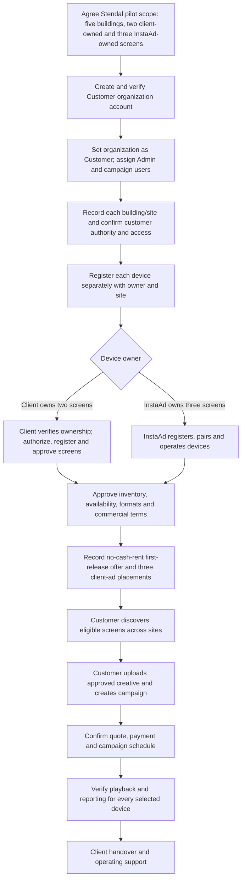

# First Organization Customer Pilot Readiness

| Field | Details |
|---|---|
| Audience | First advertiser/customer organization and InstaAd pilot team |
| Pilot scenario | One Stendal organization account with five building locations, two customer-owned screens, and three InstaAd-owned screens placed at the customer's locations |
| User role | Customer / advertiser / campaign publisher |
| Related documentation | [Customer flow](./User-Account-Customer-Flow.md), [Organizations and Workspaces](./Organizations-and-Workspaces.md), [Advertiser Campaigns and Media](./Advertiser-Campaigns-and-Media.md), [Host Screen Management](./Host-Screen-Management.md), [Host Rental Location Listings](./Host-Rental-Location-Listings.md), [First Host Client Readiness](./First-Host-Client-Readiness.md), [Resource Management and Monetization](./Resource-Management-and-Monetization.md) |
| Related Jira | Account activation [IA-4](https://insta-ad.atlassian.net/browse/IA-4); organization/team/workspace management [IA-108](https://insta-ad.atlassian.net/browse/IA-108), workspaces [IA-113](https://insta-ad.atlassian.net/browse/IA-113), organization Admin [IA-90](https://insta-ad.atlassian.net/browse/IA-90); Customer experience [IA-139](https://insta-ad.atlassian.net/browse/IA-139), Customer onboarding [IA-140](https://insta-ad.atlassian.net/browse/IA-140); campaign and media [IA-517](https://insta-ad.atlassian.net/browse/IA-517); screen management [IA-518](https://insta-ad.atlassian.net/browse/IA-518); Android Screen Player [IA-521](https://insta-ad.atlassian.net/browse/IA-521); slot inventory and monetization [IA-520](https://insta-ad.atlassian.net/browse/IA-520); Host type 2 rental-space terms [IA-194](https://insta-ad.atlassian.net/browse/IA-194), rental payment [IA-255](https://insta-ad.atlassian.net/browse/IA-255); resource discovery [IA-300](https://insta-ad.atlassian.net/browse/IA-300), booking [IA-312](https://insta-ad.atlassian.net/browse/IA-312), and payments [IA-213](https://insta-ad.atlassian.net/browse/IA-213) |
| Status | Stendal pilot example: five buildings, two customer-owned screens, three InstaAd-owned screens; first-release no-cash-rent and three-ad exchange terms require written confirmation and delivery details |
| Last updated | 2026-11-20 |

## 1. Purpose and pilot assumptions

This guide describes what must be ready for the first organization Customer to use InstaAd across several physical sites. The pilot example is an organization in **Stendal** with **five building locations**. The client owns **two screens**; InstaAd owns **three screens** that will be installed at the client's locations. Confirm the building-to-screen distribution, final device IDs, and operating sites during pilot setup; do not assume one screen per building.

The client also offers the space for InstaAd's three screens **without cash rent for the first release**, in exchange for InstaAd displaying **three of the client's advertisements**. Treat this as a pilot-specific, in-kind compensation agreement for the InstaAd-owned screens, not as the general Host rent policy or a free Host-owned-screen slot. Define and record which three creatives are included, where they will play, campaign dates, playback frequency/slot usage, creative specifications, approval, and any value/term limits in the accepted pilot request or agreement before installation or playback. “Three advertisements” means three campaign creatives; it does not by itself mean three slots, one slot per screen, one play per loop, or a permanent entitlement.

This pilot is an **advertiser/customer organization** using screen inventory. The customer organization is not automatically a Host and should not be given ownership or administrative control of devices merely because they are installed in its buildings.

This organization is the first Customer pilot in the staged rollout: validate the process with this Customer, expand to 10 Customers total only after success criteria are met, then continue toward the first 100 Customers with the approved Customer application-use fee waiver. The exact free-period inclusions and duration are not yet finalized; campaign bookings are not assumed to be free. Separately, Host type 1 will trial its two alternative fee routes with the first 100 eligible users; the Host application-subscription amount remains unset until those results are reviewed. The Customer fee-waiver cohort and Host monetization trial are distinct. See [Resource Management and Monetization](./Resource-Management-and-Monetization.md) for the respective cohort rules and data needs.

## 2. Separate the organization, building, device, and campaign roles

| Record / role | Pilot responsibility | Must not be confused with |
|---|---|---|
| Customer organization | Owns or manages the pilot account, authorizes campaign users, chooses campaigns, and provides access to its buildings. The organization's role is Customer / advertiser. | The device owner or Host organization. |
| Customer organization Admin and Members | Admin owns organization configuration and membership. Authorized Members may perform only the campaign/site tasks assigned to them. | A Host account or an InstaAd operator account. |
| Building / site | A physical venue where a screen may be installed. The customer confirms the site address, access permissions, facilities and local contact. | A screen/device listing or a Host's account. A building may contain multiple devices. |
| Device / screen | A physical display registered as a distinct inventory item, with a unique device identifier and an explicit owning party. | The Customer organization just because the device is located on its premises. |
| InstaAd device owner | Owns and operates three pilot devices installed at customer-authorized sites. InstaAd is responsible for device registration, operation and maintenance as agreed. | The customer organization, which owns two separate screens. |
| Customer-owned screen owner | Owns two screens and completes applicable Host verification and listing steps if those screens are offered as Host type 1 inventory. | Ownership of InstaAd's three screens or automatic management access to them. |
| Campaign publisher | The Customer organization creates and manages the campaign, schedules, approved creative and campaign budget. | The party that owns or maintains a screen. |

For this Stendal example, the inventory is **three InstaAd-owned devices** and **two customer-owned devices**. The customer organization participates as Customer/advertiser and provides site access for InstaAd's devices; it may also act as a Host for those premises and as a screen owner for its two separate devices. Record the role and agreement per asset so the client's free space offer does not create ownership of InstaAd's devices or automatically grant a Host slot on them.

The organization account model in the existing requirements applies Host/Customer role at the organization level. Keep the Stendal organization in the Customer role for campaign creation; it may additionally act as a Host for its premises and its two screens where the relevant Host path is supported. InstaAd-owned inventory is managed through the approved InstaAd operator account or system-owned organization. Do not solve cross-owner campaign access by adding InstaAd as a Member of the customer's organization unless Product explicitly approves that access model.

## 3. Pilot journey

Site authority, device ownership, Host verification, inventory approval and campaign payment are separate gates. Do not activate or sell an inventory item until its owner, site authorization and operational status are confirmed.

## 4. Organization account and access readiness

The customer should create or be invited into an **Organization** account using its organization email domain, with a designated organization Admin. An email domain is an identity signal, not by itself proof that the user is authorized to bind the company or buildings. Validate the Admin and the organization's authority through the approved business onboarding process.

Before the customer starts:

- Confirm whether the account is being newly created as an Organization or whether an existing Personal account/workspace must be linked or converted. Do not assume **Create Workspace** and **Create Organization** are interchangeable.
- Verify email/phone and complete account activation as defined in [Sign-up and Login](./Sign-up-and-Login.md), [IA-4](https://insta-ad.atlassian.net/browse/IA-4).
- Confirm the organization legal/display name, organization handle, Admin contact, billing contact, and account role is Customer.
- Set up the correct active organization/workspace before creating campaigns. Make the active context obvious so campaigns, uploaded media and reports are not accidentally created under a personal workspace.
- Decide which users can view all sites, invite Members, create campaigns, upload media, approve spending, or view reports. Test Admin and Member access separately; do not assume the visible workspace UI enforces the necessary boundaries.
- Confirm what happens if a Member leaves, the Admin changes, or the organization has more than one Admin. Ensure there is a supported recovery path.

Organization creation, invitation, role assignment and Admin/Member behavior are not fully verified in the reviewed application. Related scope is [IA-108](https://insta-ad.atlassian.net/browse/IA-108), [IA-113](https://insta-ad.atlassian.net/browse/IA-113), [IA-90](https://insta-ad.atlassian.net/browse/IA-90), and [IA-94](https://insta-ad.atlassian.net/browse/IA-94).

## 5. Site and device inventory required for the pilot

Maintain a site/device register for the 3–5 locations. Confirm whether each site belongs to, is leased by, or is otherwise managed by the customer organization. Record the permission basis and the site contact. A building location is not a device record.

| Required information | Site record | Device record |
|---|---:|---:|
| Stable unique ID and human-readable name | Site ID and site name | Device/screen ID, serial number and screen name |
| Place | Building name, full address, map coordinates, floor/area and local timezone | Installed site ID, exact placement, orientation, dimensions and resolution |
| Accountable party | Customer organization and site contact | Legal/operational owner: InstaAd or named Host organization |
| Authority | Customer's ownership/lease/management authority; installation and operating permission | Proof of device ownership/control, site placement authorization, and applicable Host approval |
| Operations | Site access hours, installation/security rules, power/network access, safety constraints, escalation contact | Installer, operator, maintenance owner, pairing/activation state, online health and replacement path |
| Advertising | Site restrictions, approved content categories, permitted hours and visibility expectations | Supported aspect ratios/media, playback schedule, availability, price or revenue share, and advertiser-facing status |
| Lifecycle | Site permission start/end and changes to access | Inventory approval, active/inactive state, service history, relocation and decommissioning |

Keep the owner and installed site as independent fields. Moving a customer-owned device to another site requires the owner's authorization and a new site/access check; it must not silently change the device owner. Maintain auditable history for ownership, placement, approvals and status changes.

Stendal pilot register (confirm screen-to-building distribution and fill in site/device identifiers before operations):

| Site | Device owner | Device status before launch | Customer site permission | Owner approval |
|---|---|---|---|---|
| Stendal building 1 | To confirm; five-screen total is two customer-owned and three InstaAd-owned | To register, pair and approve | To confirm | InstaAd and applicable screen owner |
| Stendal building 2 | To confirm | To confirm | To confirm | To confirm |
| Stendal building 3 | To confirm | To confirm | To confirm | To confirm |
| Stendal building 4 | To confirm | To confirm | To confirm | To confirm |
| Stendal building 5 | To confirm | To confirm | To confirm | To confirm |

Pilot inventory total: **five buildings, two customer-owned screens, three InstaAd-owned screens**. The table does not imply that these devices or sites are already installed or available in the application.

## 6. Customer campaign and cross-owner inventory requirements

The Customer should be able to use one organization campaign workflow to select eligible screens at the approved sites, including the two customer-owned screens and three InstaAd-owned screens, while each device remains under its owner's control.

For a client-ready pilot, verify that:

- Search/discovery can return eligible devices from the five Stendal buildings under the Customer organization's active context. Results identify site, device owner, availability, supported formats, timezone, price and relevant operating constraints.
- A Customer can select and schedule inventory from multiple owners in one campaign/order where the commercial and operational model allows it.
- The Customer can see a clear campaign/placement breakdown by site and device. An owner, site, schedule, price or approval change cannot silently alter a booked campaign.
- Campaign media meets each selected device's formats, aspect ratios and duration requirements, and approval/moderation status is clear before it is scheduled.
- Quote, checkout/payment, cancellation, refund/credit, invoice and campaign confirmation provide an understandable order record, including the screens/sites and periods purchased.
- Each owner receives only the operational and earnings information needed for their own device(s). The Customer sees campaign performance for their campaign but not another Host's private account, identity, payout or tax data.
- Device owners cannot view or modify the Customer organization's private profile, other sites or campaign assets unless explicitly authorized.
- Every user can distinguish whether a screen is owned by InstaAd or a Host, and who to contact for installation, service and playback issues.

The application exposes campaign discovery, media selection, quote and checkout UI, but the reviewed journey did not verify actual cross-owner discovery, payment, campaign booking, playback or reporting. Related references include [IA-517](https://insta-ad.atlassian.net/browse/IA-517), resource discovery [IA-300](https://insta-ad.atlassian.net/browse/IA-300), booking [IA-312](https://insta-ad.atlassian.net/browse/IA-312), and payments [IA-213](https://insta-ad.atlassian.net/browse/IA-213). These Jira references are related scope, not confirmation that the pilot workflow is implemented.

### First-release space and advertisement exchange

For this example, the Stendal customer provides space for the **three InstaAd-owned screens at no cash rent during the first release**. In exchange, InstaAd displays **three of the customer's advertisements on InstaAd-owned screen inventory**. Treat this as the proposed pilot-specific commercial exchange and record it in the accepted request/agreement; it is not the general fixed-rent policy, not three free slots, and not a grant of Host free slots on InstaAd devices. Paid bookings made by other advertisers on those InstaAd-owned screens remain InstaAd revenue under the accepted terms.

Before the first release, record in the accepted agreement:

- The three included creative assets and their approval/expiry status.
- Which of the three InstaAd-owned screens may display each creative and the agreed dates, frequency, schedule, and placement priority.
- Whether any of the customer's screens are also in the campaign, and the separate ownership, availability, and booking terms for those screens.
- The first-release start/end and the rent-free period. Do not assume the exchange or free space continues after that release.
- How value, delivery evidence, make-goods for missed plays, and any additional rent or paid booking are handled.

The phrase “three advertisements” refers to three campaign creatives. It does not specify three slots, one creative per screen, one play per loop, or a guaranteed impression count. Confirm these delivery details with the customer and Product before promising them.

## 7. Physical installation, launch and handover

Before installation at each building, agree with the customer and the relevant device owner:

- Exact screen position and number of screens, mounting and electrical requirements, power/network responsibility, installation date and building access arrangements.
- Who supplies and installs hardware, who pairs/configures the player, who approves test content, and who signs off the site.
- Ownership of the device, customer access boundaries, Host/customer responsibilities, maintenance SLA, incident contacts and replacement process.
- Content restrictions, operating hours, emergency/offline behavior, privacy notices where relevant, and any site-specific advertising restrictions.
- Campaign/pilot cost, billing contact, approved budget, cancellation policy and any Host earnings or payout terms.

Run an end-to-end acceptance test per device: correct account and site association; correct owner; successful pairing; online status; test playback; schedule/timezone; approved creative; proof that an unauthorized organization cannot manage the device; and a clear support/escalation path. Test campaign/reporting behavior across InstaAd-owned and customer-owned inventory before saying the pilot is generally available.

## 8. Go / no-go checklist

| Check | Evidence / owner | Status |
|---|---|---|
| Customer organization created/verified, Admin confirmed and Customer role set |  | [ ] |
| Active organization/workspace selected; campaign users and permissions tested |  | [ ] |
| Five Stendal buildings and per-site authority/access confirmed |  | [ ] |
| Every device has a unique ID, explicit owner, installed site and operator |  | [ ] |
| Three InstaAd-owned devices are registered, paired and operational at customer-authorized Stendal sites |  | [ ] |
| Two customer-owned screens have confirmed ownership, registration, approval and site placement |  | [ ] |
| First-release agreement records rent-free space and the three included client-ad creatives, placements and delivery term |  | [ ] |
| Cross-owner permissions tested; Customer cannot edit owner-controlled device/private data |  | [ ] |
| Inventory discovery, multi-site/multi-owner campaign selection and schedule tested |  | [ ] |
| Media approval, quote, checkout, payment and campaign confirmation tested |  | [ ] |
| Test playback and campaign/reporting verified on every device in scope |  | [ ] |
| Customer and InstaAd operations know their support/escalation duties; screen ownership and any Host responsibilities are explicit |  | [ ] |
| Rent-free first-release/ad-placement exchange, pricing, cancellation, privacy, site restrictions and commercial terms approved and communicated |  | [ ] |

If any core check is incomplete, label the rollout as a limited supervised pilot and tell the customer which steps are manual, unavailable or subject to change.

## 9. Related documentation

- [Customer flow](./User-Account-Customer-Flow.md)
- [Organizations and Workspaces](./Organizations-and-Workspaces.md)
- [Advertiser Campaigns and Media](./Advertiser-Campaigns-and-Media.md)
- [Host Screen Management](./Host-Screen-Management.md)
- [First Host Client Readiness](./First-Host-Client-Readiness.md)
