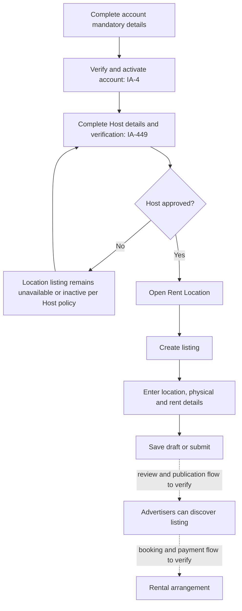

# Host Rental Location Listings

| Field | Details |
|---|---|
| User role | Host / rental-location provider — Host type 2 mapping |
| Parent wiki feature | [Host flow](./User-Account-Host-Flow.md) |
| Related Jira | Current app's advertiser-rentable listing [IA-519](https://insta-ad.atlassian.net/browse/IA-519); existing future Host type 2 rental-space flow [IA-194](https://insta-ad.atlassian.net/browse/IA-194) under Resource and Space Listing [IA-189](https://insta-ad.atlassian.net/browse/IA-189), with payment [IA-255](https://insta-ad.atlassian.net/browse/IA-255); Host Pathway and Host Types [IA-177](https://insta-ad.atlassian.net/browse/IA-177), choose Host type [IA-178](https://insta-ad.atlassian.net/browse/IA-178), Host details [IA-182](https://insta-ad.atlassian.net/browse/IA-182), Host Onboarding and Verification [IA-449](https://insta-ad.atlassian.net/browse/IA-449), business and ownership details [IA-458](https://insta-ad.atlassian.net/browse/IA-458) |
| Application review | 2026-11-16 |
| Status | Current application UI documented; product/Jira alignment and end-to-end actions need confirmation |

## 1. Purpose and role mapping

The app's **Rent Location** area lets a Host create and manage a rental-location listing described as a space advertisers can rent. This is mapped here to **Host type 2** for the current application.

**Important distinction:** the existing future Host type 2 definition in the [Host flow](./User-Account-Host-Flow.md) describes providing rental space where an InstaAd resource is assembled and controlled by InstaAd. The current app's listing form describes a location for advertisers to rent. Preserve both meanings in the documentation until the product owner confirms whether the future Host type 2 definition should be broadened or whether these are separate listing concepts.

For the future Host type 2 space-for-InstaAd-resource model, the standard compensation is fixed monthly rent under the accepted agreement, paid regardless of screen booking utilization; all advertising booking income for the InstaAd-owned device goes to InstaAd. No free slot is included in that rent arrangement. The parties may instead agree to no rent in exchange for one or more slots reserved for the Host's own content, or negotiate another explicit allocation. The accepted terms must state which arrangement applies, and any Host-reserved slots must be excluded from paid availability. This is separate from advertiser booking income and the Host's free-slot policy on a Host-owned screen. See [Resource Management and Monetization](./Resource-Management-and-Monetization.md). The current app's listing UI does not establish that either payment flow is implemented.

The first-customer Stendal scenario is a separate example: the customer offers space for three InstaAd-owned screens rent-free during the first release in exchange for three of the customer's ad creatives being displayed on InstaAd inventory. It is a campaign placement benefit, not three free slots; document the agreed creative schedule and term in the pilot agreement. See [First Organization Customer Pilot Readiness](./First-Organization-Customer-Pilot-Readiness.md).

## 2. Access prerequisites

The user first completes account-level mandatory details and account verification/activation under [Sign-up and Login](./Sign-up-and-Login.md), Jira [IA-4](https://insta-ad.atlassian.net/browse/IA-4). The planned Host-specific details and verification under [IA-449](https://insta-ad.atlassian.net/browse/IA-449) remain additional requirements. Do not interpret the availability of the signed-in listing form as proof those requirements are waived or that all listing actions are enabled.

## 3. Rental-location workflow

This diagram shows the visible listing actions and distinguishes them from review, publication, and booking outcomes that have not been verified.



### Sample UI: create rental-location listing

```text
+------------------------------------------------------------------+
| Create New Listing                       [Cancel] [Save Draft]   |
+------------------------------------------------------------------+
| Basic Information                                                |
| Title * [____________________________] Location Type * [Shop Front v]|
| Description [___________________________________________________] |
+------------------------------------------------------------------+
| Location Details                                                 |
| Address * [_______________________] City * [___________________] |
| District [_______________________] Postal Code * [_____________] |
| Country * [______________________] [Map search / location map]   |
+------------------------------------------------------------------+
| Physical & Financials                                            |
| Width [____ cm] Height [____ cm] Electricity [toggle]             |
| Rent Amount * [€ ________] Period * [Monthly v]                    |
+------------------------------------------------------------------+
```

This is a schematic transcription of the observed form, not a pixel-accurate screenshot.

## 4. My Listings

**Route:** `/rent-location/listings`

The page is titled “My Listings” and describes managing rental-location listings. Visible controls include:

- Cards, Map, and Split views
- Search by title, address, or city
- Refresh
- Create Listing action
- Empty state prompting the user to create a first listing

No listing was created, saved, or published during review.

## 5. Create a listing

**Route:** `/rent-location/listings/new`

The visible form includes:

### Basic information

- Required title
- Description
- Required location type (the displayed default was Shop Front)

### Location details

- Required address, city, postal code, and country
- Optional district
- Map interaction and location search to help populate the location

### Physical and financial details

- Available width and height in centimeters
- Electricity available toggle
- Required rent amount in EUR
- Required rent period (the displayed default was Monthly)

The page provides Save Draft and Cancel controls. The review did not submit the form, so validation, draft persistence, listing review, publication, advertiser booking, access arrangements, payments, and cancellations remain unverified.

## 6. Tenant-operated shop scenario

A person or business may rent a shop and operate a display screen there as part of its own business:

- Registering/listing the tenant's screen maps to **Host type 1**.
- Creating a rental-location listing for advertisers maps to **Host type 2** in the current app.
- A Host may use both pathways.

A lease or rental agreement can evidence the tenant's right to use the premises, but it does not prove building ownership. Confirm whether the lease must explicitly allow advertising/location listing and whether separate landlord consent is required. This scenario and authorization distinction are also documented in the [Host flow](./User-Account-Host-Flow.md).

## 7. Existing Jira mapping and gaps

| Application feature | Existing related Jira reference | Scope note |
|---|---|---|
| Host pathway and Host type | [IA-177](https://insta-ad.atlassian.net/browse/IA-177), [IA-178](https://insta-ad.atlassian.net/browse/IA-178) | Existing Host type issues; confirm that Host type 2 includes advertiser-rentable location listings. |
| Host business/ownership details | [IA-449](https://insta-ad.atlassian.net/browse/IA-449), [IA-458](https://insta-ad.atlassian.net/browse/IA-458) | Related future verification requirements; proof requirements for location-listing authority need product confirmation. |
| Current app: advertiser-rentable location listing UI | New feature [IA-519](https://insta-ad.atlassian.net/browse/IA-519) | Jira search found no issue for the app's Rent Location workflow. This feature records the deployed listing UI and its unverified outcomes. |
| Future Host type 2: space for an InstaAd resource | [IA-189](https://insta-ad.atlassian.net/browse/IA-189), Host type 2 listing [IA-194](https://insta-ad.atlassian.net/browse/IA-194) and payment [IA-255](https://insta-ad.atlassian.net/browse/IA-255) | These existing issues retain their distinct future meaning; they must not be treated as covering advertiser-rentable listings without Product confirmation. |

## 8. Related documentation

- [User Account Host Flow](./User-Account-Host-Flow.md)
- [Host Screen Management](./Host-Screen-Management.md)
- [Sign-up and Login](./Sign-up-and-Login.md)
