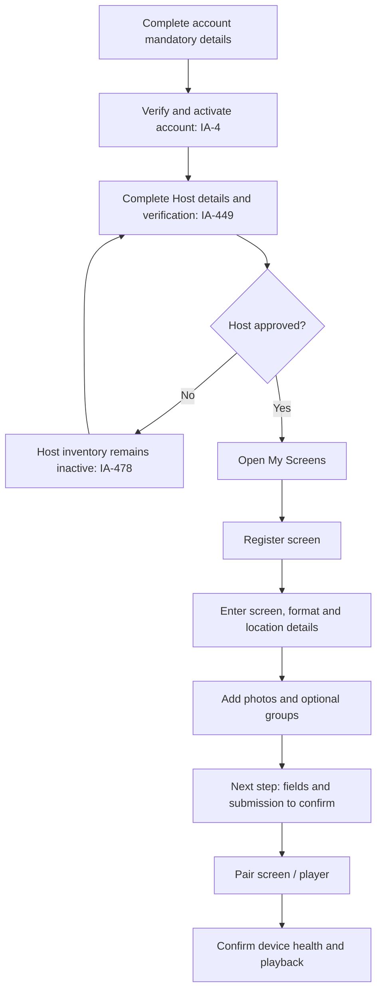

# Host Screen Management

| Field | Details |
|---|---|
| User role | Host / screen owner — Host type 1 mapping |
| Parent wiki feature | [Host flow](./User-Account-Host-Flow.md) |
| Related documentation | [Resource Management and Monetization](./Resource-Management-and-Monetization.md), [Android Screen Player](./Android-Screen-Player.md) |
| Related Jira | Screen registration, groups, and pairing [IA-518](https://insta-ad.atlassian.net/browse/IA-518); Android Screen Player [IA-521](https://insta-ad.atlassian.net/browse/IA-521); Screen Slot Inventory and Host Monetization [IA-520](https://insta-ad.atlassian.net/browse/IA-520); Resource and Space Listing [IA-189](https://insta-ad.atlassian.net/browse/IA-189), Host type 1 resource listing [IA-190](https://insta-ad.atlassian.net/browse/IA-190), Resource Management [IA-324](https://insta-ad.atlassian.net/browse/IA-324); Host Pathway and Host Types [IA-177](https://insta-ad.atlassian.net/browse/IA-177), choose Host type [IA-178](https://insta-ad.atlassian.net/browse/IA-178), Host details [IA-182](https://insta-ad.atlassian.net/browse/IA-182), Host Onboarding and Verification [IA-449](https://insta-ad.atlassian.net/browse/IA-449), ownership details [IA-458](https://insta-ad.atlassian.net/browse/IA-458), inactive inventory [IA-478](https://insta-ad.atlassian.net/browse/IA-478) |
| Application review | 2026-11-16 |
| Status | Current application UI documented; end-to-end actions not verified |

## 1. Purpose and role mapping

The application’s **My Screens** and **Register Screen** areas map to a Host managing advertising screens (Host type 1). The [Host flow](./User-Account-Host-Flow.md) remains authoritative for planned Host mandatory details, verification, activation, and the requirement that Host inventory remains inactive until approval.

### Host slot and booking economics

Under the proposed shared [Resource Management and Monetization](./Resource-Management-and-Monetization.md) model, each Host-owned screen has one 10-second no-charge Host content slot per playback loop. The Host may use it for their own content or release it to the paid booking pool.

The Host chooses one of two monetization routes: a booking-fee route where InstaAd receives an agreed X% from each successful slot booking, or an application-subscription route where the Host pays a recurring fee regardless of bookings and is not charged an InstaAd booking fee. The application subscription amount is not yet set; it will be determined after a trial with the first 100 eligible users. The routes must not be charged together. Percentage, subscription pricing, slot/promotion timing, adjustments and payout schedules are not verified in the current app.

The advertiser Basic plan's limit of up to 10 selected screens in one Ort, with an advertiser-selectable number of available slots per device (up to six), is a Customer subscription rule, not a limit on how many screens a Host may own, register or list. The locality-tiered price is per slot/device/month; the Kleinostheim low-tier example is €60 per slot, or €360/month for all six slots on one screen. See [Billing and Subscriptions](./Billing-and-Subscriptions.md) and its related pricing/entitlement Jira mapping.

## 2. Access prerequisites

The user first completes account-level mandatory details and account verification/activation under [Sign-up and Login](./Sign-up-and-Login.md), Jira [IA-4](https://insta-ad.atlassian.net/browse/IA-4). Host-specific details and verification are additional requirements under [IA-449](https://insta-ad.atlassian.net/browse/IA-449), including the activation checklist [IA-450](https://insta-ad.atlassian.net/browse/IA-450). The presence of signed-in screen-management UI does not waive these planned gates.

## 3. Screen-owner workflow

This diagram combines visible app steps with the planned account and Host approval gates. Pairing, activation, and playback outcomes remain unverified.



### Sample UI: screen registration

```text
+------------------------------------------------------------------+
| Register a Screen                                  Step 1 of 2   |
+------------------------------------------------------------------+
| Screen Name [____________]  Screen Type [Android TV v]            |
| Location [________________] Orientation [Landscape v]             |
| Environment [Indoor v]  Size [___] Resolution [1920x1080]          |
| Est. Daily Footfall [____]                                         |
+------------------------------------------------------------------+
| Supported formats: aspect ratios [16:9] [9:16] [1:1] [4:3]       |
| File types [MP4] [JPEG] [PNG] [GIF]  Max video duration [30 sec] |
+------------------------------------------------------------------+
| Location search / map | Address | City | District | Postal | Country|
| Location tags [___________________________________________]        |
| Screen photos [up to 5] | Assign to groups [optional]              |
|                                      [Next Step] [Cancel]          |
+------------------------------------------------------------------+
```

This is a schematic transcription of the observed first-step form, not a pixel-accurate screenshot. Step 2 was not inspected.

## 4. Screen inventory

**Route:** `/devices`

The My Screens page describes screens registered under the active organization and exposes:

- Cards, Map, and Split views
- Search by screen name, city, or location
- Filters and refresh
- Register Screen action
- Empty state directing the user to register a screen and complete pairing/playback setup

The screen inventory is scoped to the currently active organization according to the UI.

## 5. Register a screen

**Route:** `/devices/register`

The page presents a two-step process. The reviewed first step includes the following fields and controls:

### Basic information

- Screen name
- Screen type: Android TV, projector, smart TV, or other
- Location name
- Orientation: landscape or portrait
- Environment: indoor or outdoor
- Screen size in inches
- Resolution
- Estimated daily footfall

### Supported ad formats

- Aspect ratios: 16:9 landscape, 9:16 portrait, 1:1 square, and 4:3 classic
- Accepted file types: MP4 video, JPEG image, PNG image, and GIF
- Maximum video ad duration control, displayed with a 5–120-second range

### Location

- Search a location on a map or set coordinates by clicking/dragging the marker
- Address, city, district, postal code, and country
- Location tags, entered as comma-separated values

### Screen photos and groups

- Up to five physical-location photos
- JPEG, PNG, or WebP; up to 10 MB per photo
- First uploaded photo is described as the cover shown to advertisers
- Optional assignment to screen groups; multiple groups may be selected

The UI shows “Next Step” and “Cancel.” Step two was not inspected or submitted; its fields and behavior are not documented here.

## 6. Screen groups

**Route:** `/devices/groups`

The page describes screen groups as collections for organizing screens and easier targeting. During review, it displayed a load error (“Failed to load screen groups”) and a retry action. Create/edit/delete/assign behavior could not be verified.

## 7. Pairing, activation, and playback

The application UI and public landing page refer to pairing and playback, including opening a player with a secure link. The pairing workflow, device activation, health monitoring, content playback, and earnings were not completed or verified during review. Keep the relevant future Host activation and inactive-inventory requirements in the [Host flow](./User-Account-Host-Flow.md).

### Device ownership and campaign access

A screen's installed building/site and its legal/operational owner are separate attributes. A Customer organization may run campaigns that use eligible Host-owned or InstaAd-owned screens without becoming the device owner. The first mixed-owner organization pilot is specified in [First Organization Customer Pilot Readiness](./First-Organization-Customer-Pilot-Readiness.md).

For each registered screen, preserve an explicit owner, operating/maintenance responsibility, installation site, authorization to use that site, approval state, availability and campaign-facing status. A Customer should be able to select available inventory but must not be able to edit device configuration, Host details, or payout information unless separately authorized. These cross-owner permissions and campaign behavior remain to be tested.

## 8. Existing Jira mapping and gaps

| Application feature | Existing related Jira reference | Scope note |
|---|---|---|
| Host pathway and type selection | [IA-177](https://insta-ad.atlassian.net/browse/IA-177), [IA-178](https://insta-ad.atlassian.net/browse/IA-178) | Existing Host pathway/type references. |
| Host identity/ownership verification and activation | [IA-449](https://insta-ad.atlassian.net/browse/IA-449), [IA-450](https://insta-ad.atlassian.net/browse/IA-450), [IA-458](https://insta-ad.atlassian.net/browse/IA-458), [IA-478](https://insta-ad.atlassian.net/browse/IA-478) | These future Host requirements remain in force regardless of current screen UI. |
| Screen inventory, registration, groups, pairing, and playback | New feature [IA-518](https://insta-ad.atlassian.net/browse/IA-518) | Jira search found no dedicated screen/device-management issue. Resource listing/lifecycle scope remains in [IA-189](https://insta-ad.atlassian.net/browse/IA-189), [IA-190](https://insta-ad.atlassian.net/browse/IA-190), and [IA-324](https://insta-ad.atlassian.net/browse/IA-324); IA-518 records the distinct device-registration and player workflows. Pairing/playback remain unverified. |

## 9. Related documentation

- [User Account Host Flow](./User-Account-Host-Flow.md)
- [Sign-up and Login](./Sign-up-and-Login.md)
- [Advertiser Campaigns and Media](./Advertiser-Campaigns-and-Media.md)
- [First Organization Customer Pilot Readiness](./First-Organization-Customer-Pilot-Readiness.md)
