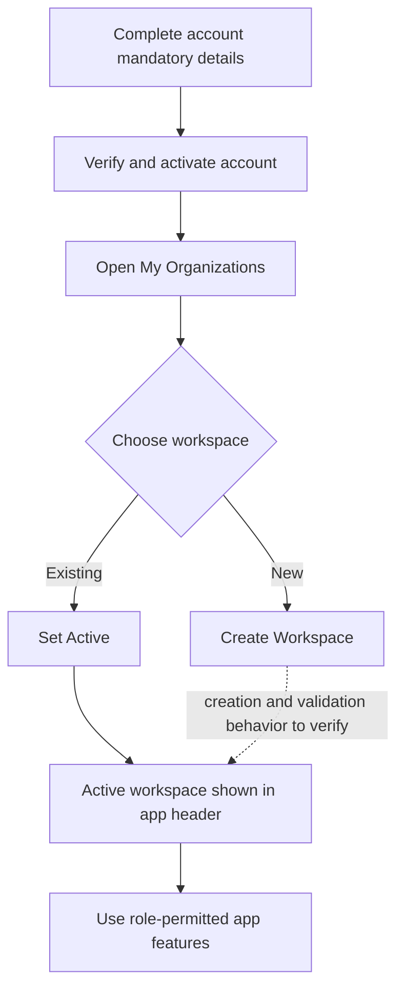

# Organizations and Workspaces

| Field | Details |
|---|---|
| User | Activated account; organization owner/admin/member as permitted |
| Parent wiki feature | [User Home Page](./User-Home-Page.md) |
| Related Jira | Organisations, Teams and Workspaces [IA-108](https://insta-ad.atlassian.net/browse/IA-108), Workspaces story [IA-113](https://insta-ad.atlassian.net/browse/IA-113), home-page Admin story [IA-90](https://insta-ad.atlassian.net/browse/IA-90), Member story [IA-94](https://insta-ad.atlassian.net/browse/IA-94) |
| Application review | 2026-11-16 |
| Status | Current application UI documented; organization-management workflows partially inspected |

## 1. Purpose and prerequisites

The application supports personal and business workspaces and an active-workspace context. Account-level mandatory details and verification/activation are required first under [Sign-up and Login](./Sign-up-and-Login.md), Jira [IA-4](https://insta-ad.atlassian.net/browse/IA-4).

The future organization, teams, access-rights, invitations, and Admin/Member requirements remain described in [User Home Page](./User-Home-Page.md) and the related existing Jira issues. This page records only the signed-in UI observed during review.

## 2. Workspace workflow and sample UI



```text
+------------------------------------------------------------------+
| My Organizations                         [Refresh] [Create Workspace]|
+------------------------------------------------------------------+
| Organizations                                                    |
| Personal Org / handle        Personal Workspace   OWNER  1       |
|                                            [Set Active]           |
| Business Org / handle        Business            OWNER  1        |
|                                            [Set Active]           |
| Current workspace                                  Active Context|
+------------------------------------------------------------------+
```

This is a schematic transcription of the observed list, not a pixel-accurate screenshot. Workspace creation and switching were not submitted.

## 3. Organization list

**Route:** `/my-organizations`

The page is titled “My Organizations” and says it supports managing workspaces, members, and invitations. The observed list showed:

- Personal and business workspace entries
- Workspace name and organization handle
- Account role (the observed account was marked OWNER)
- Member count
- Active Context indicator for the current workspace
- Set Active actions for other workspaces
- Create Workspace action

The app's header reflects the active workspace. Workspace creation, changing active context, member management, and invitations were not submitted or verified end to end.

## 4. Existing wiki and Jira mapping

| Application feature | Existing wiki/Jira reference | Scope note |
|---|---|---|
| Workspace list and active context | [User Home Page](./User-Home-Page.md), feature [IA-85](https://insta-ad.atlassian.net/browse/IA-85); Organizations/Teams/Workspaces [IA-108](https://insta-ad.atlassian.net/browse/IA-108), Workspaces story [IA-113](https://insta-ad.atlassian.net/browse/IA-113) | Current UI shows workspace selection and active-context state. |
| Admin and Member experiences | [User Home Page](./User-Home-Page.md), [IA-90](https://insta-ad.atlassian.net/browse/IA-90), [IA-94](https://insta-ad.atlassian.net/browse/IA-94) | Future role-specific home-page requirements remain in the existing wiki. |
| Teams, invitations, access rights, role assignment | [IA-108](https://insta-ad.atlassian.net/browse/IA-108), related stories in User Home Page section 10 | The current session did not verify these interactions; see existing requirements and stories. |

## 5. Related documentation

- [User Home Page](./User-Home-Page.md)
- [Sign-up and Login](./Sign-up-and-Login.md)
- [User Account Host Flow](./User-Account-Host-Flow.md)
- [User Account Customer Flow](./User-Account-Customer-Flow.md)
