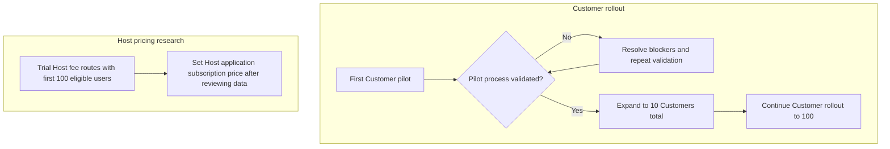

# Resource Management and Monetization

| Field | Details |
|---|---|
| Audience | All Customers / advertisers, screen-owning Hosts, space-renting Hosts, and InstaAd operations |
| Scope | Screen inventory, ad slots, customer subscriptions and targeting, Host booking revenue, and fixed space rent |
| Related documentation | [Customer flow](./User-Account-Customer-Flow.md), [Host flow](./User-Account-Host-Flow.md), [Advertiser Campaigns and Media](./Advertiser-Campaigns-and-Media.md), [Host Screen Management](./Host-Screen-Management.md), [Host Rental Location Listings](./Host-Rental-Location-Listings.md), [Billing and Subscriptions](./Billing-and-Subscriptions.md), [Android Screen Player](./Android-Screen-Player.md) |
| Related Jira | New screen slot inventory and Host monetization feature [IA-520](https://insta-ad.atlassian.net/browse/IA-520); Resource Management [IA-324](https://insta-ad.atlassian.net/browse/IA-324); Resource and Space Listing [IA-189](https://insta-ad.atlassian.net/browse/IA-189); Host type 1 listing [IA-190](https://insta-ad.atlassian.net/browse/IA-190); Host type 2 rental space [IA-194](https://insta-ad.atlassian.net/browse/IA-194); pricing model [IA-272](https://insta-ad.atlassian.net/browse/IA-272); Subscriptions and Plans [IA-262](https://insta-ad.atlassian.net/browse/IA-262), pricing [IA-263](https://insta-ad.atlassian.net/browse/IA-263), view plans [IA-264](https://insta-ad.atlassian.net/browse/IA-264), and plan limits [IA-288](https://insta-ad.atlassian.net/browse/IA-288); payments [IA-213](https://insta-ad.atlassian.net/browse/IA-213); Host payouts [IA-250](https://insta-ad.atlassian.net/browse/IA-250), receive payouts [IA-251](https://insta-ad.atlassian.net/browse/IA-251), and rental-space payment [IA-255](https://insta-ad.atlassian.net/browse/IA-255); Android Screen Player [IA-521](https://insta-ad.atlassian.net/browse/IA-521) |
| Status | Advertiser Basic plan: up to 10 selected screens in one Ort (locality/municipality), with a selectable number of slots per device. Price is per slot per month by locality tier; Kleinostheim low-tier example is €60/slot/month, up to 6 slots (€360/device/month). Broader Premium geo/category entitlements and other city rates remain TBD. Host-owned screens have two distinct monetization routes: a percentage fee on successful bookings, or a fixed application subscription with no booking fee. Host subscription pricing remains unset pending a first-100-user trial. |
| Last updated | 2026-11-19 |

## 1. Purpose and core separation

InstaAd primarily monetizes advertising campaigns that Customers create and publish on eligible screens. Resource management must keep four things separate:

1. **The Customer subscription** controls who can create campaigns and the plan's screen-count, slot-count, geographic coverage, or other usage limits. The Basic advertiser plan allows selection of up to 10 screens in one selected Ort; the Customer chooses how many available slots to book on each screen, and pays the locality-tiered monthly price per booked slot.
2. **The screen/device** is owned and operated either by a screen-owning Host or by InstaAd. Its owner is not changed by where the screen is installed.
3. **The ad slot** is a time position in the screen's playback loop. A screen-owning Host receives one no-charge slot per screen for their own content and may choose to release it for paid bookings instead. The Host receives the booking amount for successful bookings, less the agreed InstaAd booking royalty/charge under the booking-fee route.
4. **The location agreement** applies when a Host provides space for an InstaAd-owned resource. Under the standard rent agreement, InstaAd receives all booking revenue and pays the Host the accepted fixed monthly rent, irrespective of how fully booked the screen is. The space provider receives no free slot by default. Alternatively, the parties may agree to no rent in exchange for one or more Host content slots, or negotiate another explicit slot allocation; record the accepted terms and configure the inventory accordingly.

Advertiser subscription fees, Host application subscription fees, campaign booking revenue, Host screen-owner revenue, any percentage booking fee, and Host type 2 fixed space rent are different ledger entries. For Host type 1, the Host chooses either the booking-fee route or the application-subscription route; do not charge both a Host application subscription and an InstaAd booking fee for the same Host plan. The product and finance implementation must show these separately.

## 2. Ownership and revenue model by resource type

| Resource model | Device owner | Host's no-charge content slot | Who receives advertising booking money? | Host compensation |
|---|---|---|---|---|
| Host-owned screen (Host type 1) | Host | One 10-second slot per screen in the playback loop, under the proposed loop rule in section 3. Host may use it for their own content or make it bookable. | Depends on the Host's selected monetization route: percentage booking fee or fixed application subscription. | **Booking-fee route:** InstaAd receives an agreed X% from each successful slot booking; no booking fee is due when there is no successful booking. **Application-subscription route:** Host pays a recurring application-use fee regardless of bookings; no InstaAd booking fee is charged on bookings under this route. X% and the subscription amount are not yet set. |
| InstaAd-owned screen | InstaAd | No Host-owner slot applies. | InstaAd receives booking revenue, subject to customer plan/booking terms and any agreed partner terms. | No Host screen-owner payout. |
| Host provides space for an InstaAd-owned screen (future Host type 2 model) | InstaAd owns the device; Host owns/controls the premises | No free Host slot under the standard fixed-rent agreement. A slot or slots may be granted only under a separately accepted rent-free or negotiated compensation agreement. | InstaAd receives all advertising booking revenue for its screen/resource, except that any agreed Host content slots are reserved and unavailable for paid bookings. | Standard: fixed monthly rent under the accepted agreement, paid regardless of booking occupancy. Alternative: agreed Host slot allocation instead of cash rent; specify any hybrid terms explicitly. |

**Keep the Host type 2 distinction explicit:** this rental-space arrangement differs from the current app's Rent Location form, which presents a location advertisers can rent. Product must confirm how those models align before the two are treated as the same offer. See [Host flow](./User-Account-Host-Flow.md) and [Host Rental Location Listings](./Host-Rental-Location-Listings.md).

## 3. Playback slots and loop

The proposed playback unit is:

- One slot is **10 seconds**.
- One loop contains **6 slots**, so the base loop is **60 seconds**.
- Each Host-owned screen reserves one slot in each loop for the Host's own content at no charge. The Host may instead release that slot to the paid booking pool. This Host-owned-screen policy does not apply to a Host who only provides space for an InstaAd-owned screen; any such Host slot must be separately negotiated and recorded as part of the location agreement.
- Play a **5–10 second InstaAd application promotion at the end of each slot**.

### Timing note to finalize before implementation

The stated placement is at the **end of every slot**. Confirm whether the 5–10 second promotion is included within the 10-second slot or appended after the slot. If appended, a six-slot loop takes 90–120 seconds rather than 60 seconds. Confirm whether it runs on Host-owned as well as InstaAd-owned screens and whether it is additional to booked creative before publishing capacity or campaign delivery promises.

The application must enforce that booked creative duration, any Host-owned or separately agreed Host content slot, InstaAd promotion, and operational buffers cannot overlap. Availability, playback proof and advertiser reporting must use the same finalized loop definition.

### Proposed slot workflow

```mermaid
flowchart TD
    A[Register screen and confirm owner] --> B[Configure six-slot loop]
    B --> C{Screen owner}
    C -->|Host-owned| D[Reserve one 10-second slot for Host]
    D --> E{Host keeps own-content slot?}
    E -->|Yes| F[Play approved Host content in that slot]
    E -->|No| G[Release slot to paid bookings]
    C -->|InstaAd-owned| H[Apply accepted location agreement]
    H --> I{Host compensation}
    I -->|Fixed rent| J[InstaAd manages all slots; no Host slot]
    I -->|Agreed slot exchange| K[Reserve agreed Host slot(s); remaining slots managed by InstaAd]
    F --> L[Apply finalized InstaAd promotion timing]
    G --> L
    J --> L
    K --> L
    L --> M[Check availability and prevent overlap]
    M --> N[Play loop and record delivery]
```

The diagram describes the intended policy, not verified deployed scheduling behavior.

## 4. Customer subscription and geographic targeting

Customers pay a subscription to create and publish campaigns, subject to the selected plan. Targeting should let an advertiser define an audience by geographic area and business category, then select eligible screens:

- **All businesses in Kleinostheim** — broad area targeting.
- **Only bakeries in Aschaffenburg** — area plus business-category targeting.
- **Only shoe shops and gyms across Bavaria or Germany** — multiple business categories across a region or country.
- **All eligible businesses across Germany** — country-wide targeting on a plan that includes this coverage.

Campaign discovery must match target criteria against truthful screen metadata (coordinates/municipality/region and verified business/location category). Customers should see which screens match and why, then select eligible screens within the plan's limit and coverage. Premium and other higher-tier geographic entitlements and prices remain to be defined; do not imply that Basic includes multiple localities or nationwide coverage.

| Plan reach (planning model) | Illustrative audience | Current scope |
|---|---|---|
| Basic | All businesses/screens in one selected Ort | Up to 10 selected devices; choose available slots per device (up to 6), billed at locality-tiered price per slot/month. |
| Higher-tier / Premium | Selected categories across Bavaria or Germany, or all Germany | Plan names, caps, category combinations and prices are not yet finalized. |

These are targeting examples, not confirmation that the current application supports them. Each plan must constrain geography and category selection to its approved entitlements.

### Advertiser Basic plan

The **advertiser Basic subscription** covers up to **10 devices/screens in one selected Ort** (locality/municipality). For each selected screen, the advertiser may book any available number of its six slots, from one up to all six. The monthly price is per booked slot and depends on the locality's city-area tier:

| Locality / tier | Monthly price per slot | All 6 slots on one screen/month | All 6 slots on 10 screens/month |
|---|---:|---:|---:|
| Kleinostheim — low tier | €60 | €360 | €3,600 |
| Aschaffenburg — mid tier | To be confirmed | To be confirmed | To be confirmed |
| Berlin or Frankfurt — high tier | To be confirmed | To be confirmed | To be confirmed |

Calculate the monthly subscription per screen as:

```text
screen monthly price = number of slots booked on that screen × locality's monthly price per slot
campaign monthly price = sum of the selected screens' monthly prices
```

In the Kleinostheim low-tier example, one slot costs €60 per device/month. Booking all six slots on one screen costs **€60 × 6 = €360 per device/month**. Booking all six slots on each of 10 screens costs **€360 × 10 = €3,600/month**. Booking fewer slots costs proportionally less. The maximum of 10 selected devices in one Ort on Basic is a **Customer / advertiser subscription limit**, not a screen-owner limit; it does not cap how many screens a Host may own, register or list. Aschaffenburg and Berlin/Frankfurt slot rates and the complete locality-to-tier mapping are not yet specified.

Advertisers can book only slots actually available for that screen and period. For a Host-owned screen, the Host's no-charge slot is not bookable unless the Host releases it; availability must not exceed the six-slot loop capacity.

Higher plans (Basic through Premium) may provide broader geographic reach, such as category targeting across Bavaria, Germany, or all Germany. Confirm the plan-to-coverage mapping, screen caps, eligible categories, and prices before presenting those Premium entitlements as available. Subscription fees are distinct from campaign booking fees, Host payouts, and Host rent.

### Customer rollout and application-fee policy

The initial customer rollout is staged so the operating process and commercial model can be validated before broader adoption:

| Phase | Customer cohort | Entry condition | Application-fee treatment |
|---|---|---|---|
| 1 — pilot | The first Customer, including the first organization pilot described in [First Organization Customer Pilot Readiness](./First-Organization-Customer-Pilot-Readiness.md) | Begin with the initial release and validate onboarding, inventory, campaign delivery, support and payment operations. | Free under the first-release terms agreed for the pilot. Confirm precisely which application or subscription fees are waived. |
| 2 — initial expansion | The first 10 Customers in total, including the pilot Customer | Expand after the pilot process has been shown to work successfully and the go/no-go criteria are approved. | Continue the approved rollout offer. Confirm eligibility, included fees and duration before onboarding this cohort. |
| 3 — first-100 cohort | The first 100 Customers in total, including the earlier cohorts | Continue the rollout after the initial expansion; track each eligible Customer against the cohort limit. | Customer application-use fees are waived for these first 100 Customers. Define the waiver's duration and exactly which Customer-side fees it covers. |

“Free to use the application” is documented as a waiver of Customer application/subscription fees, not as a blanket waiver of campaign media bookings, taxes, payment-provider charges, or other separately disclosed charges. Campaign booking charges remain payable unless Product explicitly approves a waiver. Host screen-owner payouts, InstaAd royalties, and fixed rent owed under Host agreements remain separate obligations and must not be reduced or inferred from the Customer fee offer. Publish the exact inclusions, duration, eligibility, start/counting rule and payment treatment before accepting payment or promising free access.

The first Customer is part of the first 10, and the first 10 are part of the first 100 for planning purposes. Track the cohort by Customer organization/account, not individual seats, unless Product approves a different counting rule. The pilot go/no-go criteria, meaning of “process successful,” and any exceptions or replacement-customer rule remain to be agreed.



The Customer application-fee-waiver cohort and Host monetization trial are separate efforts; the diagram does not imply they have the same participants or eligibility rules.

### Data required before setting Host-owner subscription prices

Host type 1 chooses between two alternatives:

1. **Booking-fee route:** no fixed Host application subscription; InstaAd receives an agreed **X% of each successful slot booking**. No booking fee is due for unsuccessful or unbooked slots. The percentage, treatment of refunds/partial delivery, and settlement rules remain to be defined.
2. **Application-subscription route:** Host pays a fixed recurring application-use fee to use the platform, whether or not any slots are booked. **No InstaAd booking fee/percentage is charged on bookings under this route.** The subscription price and billing period remain uncurated and must not be presented as finalized.

The Host must be shown the selected route and its charges before activation or plan changes. These routes are alternatives, not cumulative fees; do not add a booking percentage to the application subscription. Payment processing, tax, refunds, and Host payout treatment must be separately specified and do not become waived merely because the Host is on the application-subscription route.

Do not set or promise a final Host application-subscription price based on assumptions. Run a trial with the first 100 eligible users (the precise cohort definition and whether these are Host accounts or individual users must be recorded) and gather real operating and commercial results. Compare application usage, booking volume and value, utilization, fee totals under each route, Host preference/retention, support and operating costs, and platform sustainability. The advertiser's first-100 Customer rollout is a separate cohort and does not by itself define or price the Host trial. Validate the price and route rules with Finance and participating Hosts before launch.

Collect and analyze at least:

- Customer organization onboarding, activation, conversion, retention, support load and willingness to pay after any free period.
- Customer/device counts, screens per organization, selected localities, category/geography demand, and the number of eligible versus selected screens.
- Campaign creation and booking volume, spend, gross booking revenue, refunds, failed payments, taxes, payment fees and net revenue.
- Host-owned screen occupancy, available versus booked slots, actual play duration, delivery failures, and the Host's kept or released free slot.
- Host's selected monetization route; gross and net Host booking payouts; successful bookings; X% booking fees under the booking-fee route; application-subscription charges and booking-fee exclusion under the subscription route; payout timing, disputes and adjustments.
- Fixed rent obligations for InstaAd-owned screens on Host premises, alongside installation, hardware, connectivity, energy, maintenance, support and other operating costs.
- Campaign performance and demand by locality, business category, customer cohort and screen type.
- Customer support, failed plays, cancellations, refunds, chargebacks and other operational risks/costs.
- Sensitivity scenarios for low, expected and high booking utilization; free-period conversion; locality mix; Host adoption; and changes in operating costs.
- Trial results for the first 100 eligible Host users, comparing the effective booking-fee totals with the proposed application-subscription price, including Hosts with no bookings.

Report cohort definitions, observation period and assumptions alongside results. Do not equate waived Customer application fees with free advertising inventory or use uncollected forecast revenue as evidence of Host or platform profitability.

## 5. Example screen earnings and revenue accounting

These figures were supplied as illustrative per-screen daily earnings for a screen open eight hours or more. They are **not guaranteed Host payouts or a finalized rate card**:

| Example location | Illustrative screen earnings per day (screen open at least 8 hours) |
|---|---:|
| Kleinostheim | €60/day |
| Ingolstadt | €70/day |
| Berlin | €125/day |

The booking volume, calculation basis, gross-versus-net meaning, fee route, taxes, energy/connectivity/maintenance costs, and whether these figures assume full occupancy remain to be defined. These daily screen-earnings examples are **not** the Customer's monthly subscription price. For example, the Basic Kleinostheim rate is €60 per booked slot/device/month; the monthly device charge depends on the slot quantity (up to €360 for all six slots). The €60/day screen-earnings example is a separate, unverified estimate.

For Host-owned screens, the expected calculation is:

```text
Booking-fee route:
  InstaAd booking fee = successful slot booking amount × agreed X%
  Host booking proceeds = successful slot booking amount - InstaAd booking fee
                          +/- documented adjustments, refunds, and taxes

Application-subscription route:
  Host application fee = fixed recurring subscription, even with zero bookings
  InstaAd booking fee = 0 for bookings under this selected route
  Host booking proceeds = successful slot booking amount
                          +/- documented adjustments, refunds, and taxes
```

The Host receives the successful booking amount and InstaAd takes the agreed percentage/charge on the booking-fee route; the booking-fee percentage X, application subscription amount, billing period, route changeover, calculation order, settlement period, minimum payout and refund/chargeback treatment are open until approved and documented. The application-subscription amount is to be informed by the first-100-user trial. Any payment-processing costs and taxes must be documented separately. A screen owner's one free slot is not a paid booking unless the Host releases it and a Customer actually books it.

For an InstaAd-owned device placed in a Host's premises, the standard arrangement is:

```text
InstaAd booking revenue = all paid advertising bookings for the InstaAd-owned resource
Host rent expense       = fixed monthly rent in the accepted agreement
```

The Host's rent is not reduced when campaign occupancy or bookings are low. There is no free Host slot under this standard rent arrangement. Record the accepted rent amount, start/end date, payment due date, and any contractually accepted adjustments. Do not calculate Host rent as a share of advertising bookings.

If the parties instead agree to no cash rent in exchange for one or more Host content slots, record that rent-free slot-exchange agreement explicitly. Reserve the agreed slot(s) for Host content and exclude them from paid availability; InstaAd receives all booking revenue only from the remaining bookable slots. Any hybrid rent-and-slot arrangement must also be explicitly negotiated and recorded rather than assumed.

## 6. Required product and admin behavior

### Customer

- View plan name, supported targeting, selected screen count, locality tier, per-slot monthly price, slots selected per device and the calculated total before purchase. For Basic, show the one-Ort limit and up-to-10-screen cap (e.g. Kleinostheim: €60/slot/month × 6 slots × 10 screens = €3,600/month).
- Target area and business category, preview matching screens, and see any screens excluded for availability, format, approval, or plan limits.
- Distinguish subscription charges from any campaign/booking charges before confirming.
- Get a quote/order confirmation with selected locality, screens, dates, loop frequency, creative duration, price, taxes and payment state.
- See campaign delivery evidence or a clear reason when a booked screen did not play.

### Host owning a screen

- See the device owner, approved screen details, slot allocation, the one included Host slot, and whether the Host is using or releasing it.
- Supply/manage approved own content for the included slot without being charged as a Customer booking.
- Choose and view the active monetization route: a percentage fee on successful bookings, or the recurring application subscription with no InstaAd booking fee.
- See booking statements and subscription invoices separately: gross and successful booking value, X% booking fee when that route is selected, or the fixed application fee when the subscription route is selected, plus documented adjustments and net payout.
- Never be promised a daily earning amount unless it is an approved guarantee with explicit terms.

### Host renting space to InstaAd

- Review and accept a written compensation offer/request before placement: fixed monthly rent, agreed Host slot(s) in lieu of rent, or explicitly negotiated hybrid terms.
- Under fixed rent, see that payment is made monthly as agreed regardless of screen booking occupancy; there is no free Host slot.
- Under a slot-exchange agreement, see the exact Host slot allocation and understand that those slots are reserved for Host content rather than paid bookings.
- See due dates and payment status for rent when applicable; the Host does not receive booking revenue for an InstaAd-owned device unless a separate agreement explicitly says otherwise.

### InstaAd operations and finance

- Store each screen's legal owner, operator, physical site, Host (if any), accepted location-compensation agreement (fixed rent, slot exchange or explicitly negotiated hybrid), any Host-reserved slots, activation status, slot policy, business categories, locality tier, approved formats and campaign availability.
- Keep Customer campaign access separate from ownership/admin controls, Host private data and payout information.
- Prevent double-booking and record scheduled versus actually played impressions/slots.
- Maintain auditable, separate ledgers for advertiser subscriptions, Host application subscriptions, campaign bookings, booking-fee deductions, Host screen payouts, fixed Host space rent and any recorded in-kind Host slot allocation.

## 7. Feature breakdown and Jira mapping

| Feature area | Required behavior and acceptance outcome | Jira mapping |
|---|---|---|
| Resource ownership and eligibility | Every screen has an explicit owner, operator, physical site, verification/approval state and bookable status. Customers only see screens eligible for their selected campaign and plan. | Resource Management [IA-324](https://insta-ad.atlassian.net/browse/IA-324); screen registration and pairing [IA-518](https://insta-ad.atlassian.net/browse/IA-518) |
| Slot inventory and Host choice | For Host-owned screens, configure the Host's one included slot per finalized loop; let the Host keep or release it. Released inventory becomes bookable only after availability and conflict checks. InstaAd-owned inventory has no Host-owner slot by default. | Screen Slot Inventory and Host Monetization [IA-520](https://insta-ad.atlassian.net/browse/IA-520), under workstream [IA-299](https://insta-ad.atlassian.net/browse/IA-299), linked to [IA-324](https://insta-ad.atlassian.net/browse/IA-324), [IA-312](https://insta-ad.atlassian.net/browse/IA-312) and [IA-250](https://insta-ad.atlassian.net/browse/IA-250) |
| Campaign targeting and bookings | Match geography and verified business categories to eligible screens; show the matching inventory, exclusions, price and booking outcome before confirmation. | Advertiser campaigns [IA-517](https://insta-ad.atlassian.net/browse/IA-517); resource discovery [IA-300](https://insta-ad.atlassian.net/browse/IA-300); booking [IA-312](https://insta-ad.atlassian.net/browse/IA-312) |
| Host monetization route and earnings | Let a Host choose either (a) an agreed X% fee from each successful slot booking, with no fixed application fee, or (b) a fixed application subscription regardless of booking count, with no InstaAd booking fee. Run a trial with the first 100 eligible users before setting the subscription price. Never charge both routes together. Show the selected route, booking outcomes, deductions/subscription invoices and payout statements. | Screen Slot Inventory and Host Monetization [IA-520](https://insta-ad.atlassian.net/browse/IA-520); pricing decision [IA-272](https://insta-ad.atlassian.net/browse/IA-272); plan catalog [IA-263](https://insta-ad.atlassian.net/browse/IA-263); Host payouts [IA-250](https://insta-ad.atlassian.net/browse/IA-250), receive payouts [IA-251](https://insta-ad.atlassian.net/browse/IA-251) |
| Host compensation for InstaAd-owned equipment at Host premises | Record the accepted compensation terms: standard fixed monthly rent paid regardless of occupancy, or explicitly negotiated Host slot(s) in lieu of rent (including any hybrid terms). Under fixed rent, no Host slot is included; under a slot exchange, reserve agreed Host content slot(s) and exclude them from paid availability. InstaAd retains booking revenue from all remaining bookable slots. Keep this separate from Host-owned screen booking payouts and the current advertiser-rentable listing flow. | Host type 2 listing [IA-194](https://insta-ad.atlassian.net/browse/IA-194), rental-space payments [IA-255](https://insta-ad.atlassian.net/browse/IA-255); Host type 2 resource tracking [IA-329](https://insta-ad.atlassian.net/browse/IA-329) |
| Customer plan, slot quantities, location tiers and first-100 rollout | Enforce the advertiser Basic limit of up to 10 selected screens in one Ort, with a selectable number of available slots per device (up to six). Charge the approved locality-tier price per booked slot/month. Kleinostheim low-tier example is €60 per slot/month: all six slots cost €360 per screen/month or €3,600/month for 10 screens. Keep premium geographic/category coverage and other city rates configurable until approved. Record Customer pilot, first-10 and first-100 cohort eligibility; do not infer waived application fees mean free campaign inventory. This is not a Host screen registration limit. | Pricing model [IA-272](https://insta-ad.atlassian.net/browse/IA-272); subscriptions [IA-262](https://insta-ad.atlassian.net/browse/IA-262); plans and pricing [IA-263](https://insta-ad.atlassian.net/browse/IA-263); plan limits [IA-288](https://insta-ad.atlassian.net/browse/IA-288); campaign targeting [IA-517](https://insta-ad.atlassian.net/browse/IA-517) |
| Android playback client | Pair a screen securely, fetch approved schedules and creative, play the assigned loop, report health and playback evidence, and recover from network interruption. Requirements are described separately and are not confirmed deployed behavior. | Android Screen Player Application [IA-521](https://insta-ad.atlassian.net/browse/IA-521), under workstream [IA-299](https://insta-ad.atlassian.net/browse/IA-299), linked to [IA-324](https://insta-ad.atlassian.net/browse/IA-324), [IA-518](https://insta-ad.atlassian.net/browse/IA-518) and [IA-517](https://insta-ad.atlassian.net/browse/IA-517) |

The feature requirements and acceptance criteria are recorded in [IA-520](https://insta-ad.atlassian.net/browse/IA-520) and [IA-521](https://insta-ad.atlassian.net/browse/IA-521), with related existing issues linked in Jira. Existing Jira references identify related scope, not proof of implementation or completion.

## 8. Decisions to finalize before selling this model

1. Does the 5–10 second InstaAd promotion fit inside a 10-second slot or extend the six-slot loop? Does it run on every screen and in every slot?
2. Is the Host's free slot once per six-slot loop per Host-owned screen? Can the Host change the choice at any time, and what happens to already booked time?
3. What creative length can a Customer book, and how are plays per hour, daily operating hours, gaps and proof of playback calculated?
4. What are the approved Aschaffenburg mid-tier and Berlin/Frankfurt high-tier per-slot monthly rates, and the complete city-to-tier mapping?
5. Which Basic-to-Premium plans include locality, regional, category-specific, Bavaria-wide and Germany-wide targeting? What are each plan's screen caps, eligible categories and prices?
6. What is X%, the fee basis, and the success/refund/partial-play definition for the booking-fee route? What is the Host application-subscription price and billing period after the first-100-user trial? Confirm the two routes are mutually exclusive and define changeover timing, taxes, payment fees, refunds, payout timing and statements.
7. Who pays electricity, connectivity, hardware, installation and maintenance costs for Host-owned screens versus InstaAd-owned screens?
8. For Host-provided space, who approves the compensation request, how is the choice between fixed rent and an agreed slot exchange recorded, when do rent or slot-allocation terms begin/end, and what happens during outages, relocation or site closure?
9. How does the current app's advertiser-rentable location listing align with the fixed-rent-for-InstaAd-resource Host type 2 model?
10. Which Host earnings values are contractual commitments, forecast estimates, or examples only? Keep the €60/€70/€125 daily per-screen examples distinct from the monthly advertiser subscription charge (for example €60 per Kleinostheim screen/month under Basic).
11. What exact Customer fees are waived for the first pilot, first 10 Customers and first 100 Customers, for how long, and are campaign booking charges explicitly excluded?
12. What measurable pilot-success criteria allow expansion to 10 Customers, and how are Customer cohort eligibility and counting administered?
13. Who counts as one user in the first-100 Host pricing trial, what is the observation period, and which Finance-approved profitability and Host-value thresholds are required before setting the application-subscription fee?

These decisions relate to existing Jira scope: pricing [IA-272](https://insta-ad.atlassian.net/browse/IA-272), subscription limits [IA-288](https://insta-ad.atlassian.net/browse/IA-288), resource management [IA-324](https://insta-ad.atlassian.net/browse/IA-324), Host payout [IA-250](https://insta-ad.atlassian.net/browse/IA-250), and Host rental-space payment [IA-255](https://insta-ad.atlassian.net/browse/IA-255). This page records the business rules and unresolved decisions; it does not assert those Jira items are complete.

## 9. Related documentation

- [Advertiser Campaigns and Media](./Advertiser-Campaigns-and-Media.md)
- [Billing and Subscriptions](./Billing-and-Subscriptions.md)
- [Host flow](./User-Account-Host-Flow.md)
- [Host Screen Management](./Host-Screen-Management.md)
- [Host Rental Location Listings](./Host-Rental-Location-Listings.md)
- [Android Screen Player](./Android-Screen-Player.md)
