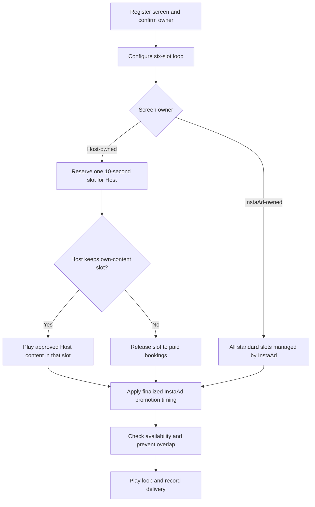
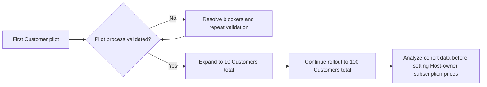

# Resource Management and Monetization

| Field | Details |
|---|---|
| Audience | All Customers / advertisers, screen-owning Hosts, space-renting Hosts, and InstaAd operations |
| Scope | Screen inventory, ad slots, customer subscriptions and targeting, Host booking revenue, and fixed space rent |
| Related documentation | [Customer flow](./User-Account-Customer-Flow.md), [Host flow](./User-Account-Host-Flow.md), [Advertiser Campaigns and Media](./Advertiser-Campaigns-and-Media.md), [Host Screen Management](./Host-Screen-Management.md), [Host Rental Location Listings](./Host-Rental-Location-Listings.md), [Billing and Subscriptions](./Billing-and-Subscriptions.md), [Android Screen Player](./Android-Screen-Player.md) |
| Related Jira | New screen slot inventory and Host monetization feature [IA-520](https://insta-ad.atlassian.net/browse/IA-520); Resource Management [IA-324](https://insta-ad.atlassian.net/browse/IA-324); Resource and Space Listing [IA-189](https://insta-ad.atlassian.net/browse/IA-189); Host type 1 listing [IA-190](https://insta-ad.atlassian.net/browse/IA-190); Host type 2 rental space [IA-194](https://insta-ad.atlassian.net/browse/IA-194); pricing model [IA-272](https://insta-ad.atlassian.net/browse/IA-272); Subscriptions and Plans [IA-262](https://insta-ad.atlassian.net/browse/IA-262), pricing [IA-263](https://insta-ad.atlassian.net/browse/IA-263), view plans [IA-264](https://insta-ad.atlassian.net/browse/IA-264), and plan limits [IA-288](https://insta-ad.atlassian.net/browse/IA-288); payments [IA-213](https://insta-ad.atlassian.net/browse/IA-213); Host payouts [IA-250](https://insta-ad.atlassian.net/browse/IA-250), receive payouts [IA-251](https://insta-ad.atlassian.net/browse/IA-251), and rental-space payment [IA-255](https://insta-ad.atlassian.net/browse/IA-255); Android Screen Player [IA-521](https://insta-ad.atlassian.net/browse/IA-521) |
| Status | Advertiser Basic plan terms confirmed for documentation: up to five selected screens at €50 per screen per month; slot, payout, rent and other commercial details remain subject to their stated decisions |
| Last updated | 2026-11-19 |

## 1. Purpose and core separation

InstaAd primarily monetizes advertising campaigns that Customers create and publish on eligible screens. Resource management must keep four things separate:

1. **The Customer subscription** controls who can create campaigns and the plan's screen-count or other usage limits. The Basic advertiser plan allows selection of up to five screens, charged at €50 per selected screen per month.
2. **The screen/device** is owned and operated either by a screen-owning Host or by InstaAd. Its owner is not changed by where the screen is installed.
3. **The ad slot** is a time position in the screen's playback loop. A screen-owning Host receives one no-charge slot per screen for their own content and may choose to release it for paid bookings instead.
4. **The location agreement** applies when a Host provides space for an InstaAd-owned resource. InstaAd receives booking revenue from that resource and pays the Host the agreed fixed monthly rent, irrespective of how fully booked the screen is.

Subscription fees, advertising booking revenue, screen-owner revenue share, InstaAd's booking royalty/charge, and Host space rent are different ledger entries. The product and finance implementation must show them separately.

## 2. Ownership and revenue model by resource type

| Resource model | Device owner | Host's no-charge content slot | Who receives advertising booking money? | Host compensation |
|---|---|---|---|---|
| Host-owned screen (Host type 1) | Host | One 10-second slot per screen in the playback loop, under the proposed loop rule in section 3. Host may use it for their own content or make it bookable. | Host receives the agreed booking amount for paid bookings on that screen; InstaAd deducts the agreed royalty/service charge. | Usage-based: depends on paid bookings, after the agreed InstaAd deduction. No minimum earnings are stated here. |
| InstaAd-owned screen | InstaAd | No Host-owner slot applies. | InstaAd receives booking revenue, subject to customer plan/booking terms and any agreed partner terms. | No Host screen-owner payout. |
| Host provides space for an InstaAd-owned screen (future Host type 2 model) | InstaAd owns the device; Host owns/controls the premises | No Host device-owner slot applies unless a separate arrangement explicitly grants one. | InstaAd receives all advertising booking revenue for its screen/resource. | Fixed monthly rent per accepted app request/agreement. Rent is paid regardless of whether the screen is fully booked. |

**Keep the Host type 2 distinction explicit:** this rental-space arrangement differs from the current app's Rent Location form, which presents a location advertisers can rent. Product must confirm how those models align before the two are treated as the same offer. See [Host flow](./User-Account-Host-Flow.md) and [Host Rental Location Listings](./Host-Rental-Location-Listings.md).

## 3. Playback slots and loop

The proposed playback unit is:

- One slot is **10 seconds**.
- One loop contains **6 slots**, so the base loop is **60 seconds**.
- Each Host-owned screen reserves one slot in each loop for the Host's own content at no charge. The Host may instead release that slot to the paid booking pool. The choice should be configurable per screen and visible to both Host and booking/operations users.
- InstaAd also wants to show a **5–10 second InstaAd application promotion at the end of each slot**.

### Timing rule that must be resolved before implementation

If the 5–10 second InstaAd promotion is included within each 10-second slot, it leaves only 0–5 seconds in that slot for other creative. If the promotion is added after every 10-second slot, it extends a nominal 60-second six-slot loop by 30–60 seconds. Confirm which interpretation is intended, whether all screens (including Host-owned screens) carry this promotion, and whether it is part of or additional to the 10-second booked creative before publishing slot capacity or campaign delivery promises.

The application must enforce that booked creative duration, the Host's optional slot, InstaAd promotion, and any operational buffer cannot overlap. Availability, playback proof and advertiser reporting must use the same finalized loop definition.

### Proposed slot workflow



The diagram describes the intended policy, not verified deployed scheduling behavior.

## 4. Customer subscription and geographic targeting

Customers pay a subscription to create and publish campaigns, subject to the selected plan. Targeting should let an advertiser define an audience by geographic area and business category, then select eligible screens:

- **All businesses in Kleinostheim** — broad area targeting.
- **Only bakeries in Aschaffenburg** — area plus business-category targeting.
- **Only shoe shops and gyms across Bavaria or Germany** — multiple business categories across a region or country.

Campaign discovery must match target criteria against truthful screen metadata (coordinates/municipality/region and verified business/location category). Customers should see which screens match and why, rather than a campaign silently expanding beyond the selected area or category.

### Advertiser Basic plan

The **advertiser Basic subscription** lets the Customer select up to **five screens** on which to display ads. The subscription price is **€50 per selected screen per month**:

| Selected screens | Monthly rate per screen | Monthly subscription total |
|---:|---:|---:|
| 1 | €50 | €50/month |
| 2 | €50 | €100/month |
| 3 | €50 | €150/month |
| 4 | €50 | €200/month |
| 5 (maximum) | €50 | €250/month |

This is a **Customer / advertiser plan limit**, not a screen-owner limit. It does not cap how many screens a Host may own, register or list. A Customer may target screens by geography and business category (for example, bakeries in Aschaffenburg or gyms across Bavaria); locality targeting does not change the stated €50 per selected screen price. The former 10-device / locality-tier price example is superseded and must not be used.

### Customer rollout and application-fee policy

The initial customer rollout is staged so the operating process and commercial model can be validated before broader adoption:

| Phase | Customer cohort | Entry condition | Application-fee treatment |
|---|---|---|---|
| 1 — pilot | The first Customer, including the first organization pilot described in [First Organization Customer Pilot Readiness](./First-Organization-Customer-Pilot-Readiness.md) | Begin with the initial release and validate onboarding, inventory, campaign delivery, support and payment operations. | Free under the first-release terms agreed for the pilot. Confirm precisely which application or subscription fees are waived. |
| 2 — initial expansion | The first 10 Customers in total, including the pilot Customer | Expand after the pilot process has been shown to work successfully and the go/no-go criteria are approved. | Continue the approved rollout offer. Confirm eligibility, included fees and duration before onboarding this cohort. |
| 3 — first-100 cohort | The first 100 Customers in total, including the earlier cohorts | Continue the rollout after the initial expansion; track each eligible Customer against the cohort limit. | Customer application-use fees are waived for these first 100 Customers. Define the waiver's duration and exactly which Customer-side fees it covers. |

“Free to use the application” is documented as a waiver of Customer application/subscription fees, not as a blanket waiver of campaign media bookings, taxes, payment-provider charges, or other separately disclosed charges. Campaign booking charges remain payable unless Product explicitly approves a waiver. Host screen-owner payouts, InstaAd royalties, and fixed rent owed under Host agreements remain separate obligations and must not be reduced or inferred from the Customer fee offer. Publish the exact inclusions, duration, eligibility, start/counting rule and payment treatment before accepting payment or promising free access.

The first Customer is part of the first 10, and the first 10 are part of the first 100 for planning purposes. Track the cohort by Customer organization/account, not individual seats, unless Product approves a different counting rule. The pilot go/no-go criteria, meaning of “process successful,” and any exceptions or replacement-customer rule remain to be agreed.



### Data required before setting Host-owner subscription prices

Do not set or promise a final monthly Host subscription price based on assumptions. After collecting real operating and commercial results from the first 100 Customers, compare a proposed Host subscription with the booking fees/royalties Hosts would otherwise pay or forgo. Model prices that are lower than the relevant cumulative booking-fee alternative while remaining sustainable for both screen-owning Hosts and InstaAd. Validate the fee basis and profitability with Finance and participating Hosts before launch.

Collect and analyze at least:

- Customer organization onboarding, activation, conversion, retention, support load and willingness to pay after any free period.
- Customer/device counts, screens per organization, selected localities, category/geography demand, and the number of eligible versus selected screens.
- Campaign creation and booking volume, spend, gross booking revenue, refunds, failed payments, taxes, payment fees and net revenue.
- Host-owned screen occupancy, available versus booked slots, actual play duration, delivery failures, and the Host's kept or released free slot.
- Gross and net Host booking payouts, InstaAd royalty/charges, payout timing, disputes and adjustments.
- Fixed rent obligations for InstaAd-owned screens on Host premises, alongside installation, hardware, connectivity, energy, maintenance, support and other operating costs.
- Campaign performance and demand by locality, business category, customer cohort and screen type.
- Customer support, failed plays, cancellations, refunds, chargebacks and other operational risks/costs.
- Sensitivity scenarios for low, expected and high booking utilization; free-period conversion; locality mix; Host adoption; and changes in operating costs.

Report cohort definitions, observation period and assumptions alongside results. Do not equate waived Customer application fees with free advertising inventory or use uncollected forecast revenue as evidence of Host or platform profitability.

## 5. Example screen earnings and revenue accounting

The following figures were supplied as illustrative daily device earnings for a screen open eight hours or more:

| Example location | Illustrative daily screen earnings |
|---|---:|
| Kleinostheim | €60/day |
| Ingolstadt | €70/day |
| Berlin | €125/day |

These are **examples, not guaranteed Host payouts or a validated earnings rate card**. The booking volume, calculation period, gross-versus-net basis, owner share, InstaAd royalty, taxes, energy/connectivity/maintenance costs, and whether the figures represent a full day, full occupancy, or target earnings remain to be defined. The Host daily earnings examples are separate from the advertiser's €50 per selected screen per month subscription charge and must not be presented as the same amount.

For Host-owned screens, the expected calculation is:

```text
Host screen payout = eligible paid booking revenue
                     - agreed InstaAd royalty/service charge
                     +/- documented adjustments, refunds, and taxes
```

The royalty rate, calculation order, settlement period, minimum payout and refund/chargeback treatment are open until approved and documented. A screen owner's one free slot is not a paid booking unless the Host releases it and a Customer actually books it.

For an InstaAd-owned device placed in a Host's premises:

```text
InstaAd booking revenue = paid advertising bookings for the InstaAd-owned resource
Host rent expense       = fixed monthly rent in the accepted agreement
```

The Host's rent is not reduced when campaign occupancy or bookings are low. Record the accepted rent amount, start/end date, payment due date, and any contractually accepted adjustments. Do not calculate Host rent as a share of advertising bookings.

## 6. Required product and admin behavior

### Customer

- View plan name, supported targeting, locality tier/rate, device cap, subscription period and total before purchase.
- Target area and business category, preview matching screens, and see any screens excluded for availability, format, approval, or plan limits.
- Distinguish subscription charges from any campaign/booking charges before confirming.
- Get a quote/order confirmation with selected locality, screens, dates, loop frequency, creative duration, price, taxes and payment state.
- See campaign delivery evidence or a clear reason when a booked screen did not play.

### Host owning a screen

- See the device owner, approved screen details, slot allocation, the one included Host slot, and whether the Host is using or releasing it.
- Supply/manage approved own content for the included slot without being charged as a Customer booking.
- See paid booking schedule and statements separating gross booking value, InstaAd royalty, adjustments and net payout.
- Never be promised a daily earning amount unless it is an approved guarantee with explicit terms.

### Host renting space to InstaAd

- Review and accept a written monthly rent offer/request before placement.
- See that rent is fixed by the accepted agreement and is independent of screen booking occupancy.
- See due dates and payment status for rent; the Host does not receive advertising booking revenue for an InstaAd-owned device unless a separate signed agreement says otherwise.

### InstaAd operations and finance

- Store each screen's legal owner, operator, physical site, Host (if any), rent agreement (if any), activation status, slot policy, business categories, locality tier, approved formats and campaign availability.
- Keep Customer campaign access separate from ownership/admin controls, Host private data and payout information.
- Prevent double-booking and record scheduled versus actually played impressions/slots.
- Maintain auditable ledgers for customer subscription invoices, campaign bookings, Host screen payouts, InstaAd royalties and fixed Host space rent.

## 7. Feature breakdown and Jira mapping

| Feature area | Required behavior and acceptance outcome | Jira mapping |
|---|---|---|
| Resource ownership and eligibility | Every screen has an explicit owner, operator, physical site, verification/approval state and bookable status. Customers only see screens eligible for their selected campaign and plan. | Resource Management [IA-324](https://insta-ad.atlassian.net/browse/IA-324); screen registration and pairing [IA-518](https://insta-ad.atlassian.net/browse/IA-518) |
| Slot inventory and Host choice | For Host-owned screens, configure the Host's one included slot per finalized loop; let the Host keep or release it. Released inventory becomes bookable only after availability and conflict checks. InstaAd-owned inventory has no Host-owner slot by default. | Screen Slot Inventory and Host Monetization [IA-520](https://insta-ad.atlassian.net/browse/IA-520), under workstream [IA-299](https://insta-ad.atlassian.net/browse/IA-299), linked to [IA-324](https://insta-ad.atlassian.net/browse/IA-324), [IA-312](https://insta-ad.atlassian.net/browse/IA-312) and [IA-250](https://insta-ad.atlassian.net/browse/IA-250) |
| Campaign targeting and bookings | Match geography and verified business categories to eligible screens; show the matching inventory, exclusions, price and booking outcome before confirmation. | Advertiser campaigns [IA-517](https://insta-ad.atlassian.net/browse/IA-517); resource discovery [IA-300](https://insta-ad.atlassian.net/browse/IA-300); booking [IA-312](https://insta-ad.atlassian.net/browse/IA-312) |
| Host screen-owner earnings | Calculate statements from paid bookings, the approved InstaAd royalty/charge and documented adjustments. Provide payout status and auditable history; never treat an unused free slot as earned revenue. | Host payouts [IA-250](https://insta-ad.atlassian.net/browse/IA-250), receive payouts [IA-251](https://insta-ad.atlassian.net/browse/IA-251); new feature above |
| Fixed rent for InstaAd-owned equipment | Record an accepted monthly rent agreement for Host-provided space and pay it independently of ad occupancy. Keep this separate from Host-owned screen booking payouts and the current advertiser-rentable listing flow. | Rental-space payments [IA-255](https://insta-ad.atlassian.net/browse/IA-255); Host type 2 resource tracking [IA-329](https://insta-ad.atlassian.net/browse/IA-329) |
| Customer plan and first-100 rollout | Enforce the advertiser Basic limit of five selected screens and charge €50 per selected screen per month; disclose totals before purchase. Record pilot, first-10 and first-100 cohort eligibility; do not infer waived application fees mean free campaign inventory. This is not a Host screen registration limit. | Pricing model [IA-272](https://insta-ad.atlassian.net/browse/IA-272); subscriptions [IA-262](https://insta-ad.atlassian.net/browse/IA-262); plans and pricing [IA-263](https://insta-ad.atlassian.net/browse/IA-263); plan limits [IA-288](https://insta-ad.atlassian.net/browse/IA-288) |
| Android playback client | Pair a screen securely, fetch approved schedules and creative, play the assigned loop, report health and playback evidence, and recover from network interruption. Requirements are described separately and are not confirmed deployed behavior. | Android Screen Player Application [IA-521](https://insta-ad.atlassian.net/browse/IA-521), under workstream [IA-299](https://insta-ad.atlassian.net/browse/IA-299), linked to [IA-324](https://insta-ad.atlassian.net/browse/IA-324), [IA-518](https://insta-ad.atlassian.net/browse/IA-518) and [IA-517](https://insta-ad.atlassian.net/browse/IA-517) |

The feature requirements and acceptance criteria are recorded in [IA-520](https://insta-ad.atlassian.net/browse/IA-520) and [IA-521](https://insta-ad.atlassian.net/browse/IA-521), with related existing issues linked in Jira. Existing Jira references identify related scope, not proof of implementation or completion.

## 8. Decisions to finalize before selling this model

1. Does the 5–10 second InstaAd promotion fit inside a 10-second slot or extend the six-slot loop? Does it run on every screen and in every slot?
2. Is the Host's free slot once per six-slot loop per Host-owned screen? Can the Host change the choice at any time, and what happens to already booked time?
3. What creative length can a Customer book, and how are plays per hour, daily operating hours, gaps and proof of playback calculated?
4. Which other campaign entitlements (active campaigns, creative limits, playback frequency and duration) are included in Basic alongside its confirmed five-screen maximum and €50 per selected screen per month?
5. Are geography and business-category filters available as proposed, and who verifies category metadata?
6. Is the Host screen-owner booking payout the full booking amount less a percentage, a fixed fee, or another royalty? Define taxes, refunds, cancellations, failed plays, payout timing and statements.
7. Who pays electricity, connectivity, hardware, installation and maintenance costs for Host-owned screens versus InstaAd-owned screens?
8. For Host-provided space, who approves the rent request, when does the monthly obligation begin/end, and what happens during outages, relocation or site closure?
9. How does the current app's advertiser-rentable location listing align with the fixed-rent-for-InstaAd-resource Host type 2 model?
10. Which Host earnings values are contractual commitments, forecast estimates, or examples only? In particular, keep the €60/€70/€125 daily screen earnings examples distinct from the advertiser Basic price of €50 per selected screen per month.
11. What exact Customer fees are waived for the first pilot, first 10 Customers and first 100 Customers, for how long, and are campaign booking charges explicitly excluded?
12. What measurable pilot-success criteria allow expansion to 10 Customers, and how are Customer cohort eligibility and counting administered?
13. Which first-100 cohort metrics, observation period and profitability thresholds must Finance approve before introducing a Host-owner subscription?

These decisions relate to existing Jira scope: pricing [IA-272](https://insta-ad.atlassian.net/browse/IA-272), subscription limits [IA-288](https://insta-ad.atlassian.net/browse/IA-288), resource management [IA-324](https://insta-ad.atlassian.net/browse/IA-324), Host payout [IA-250](https://insta-ad.atlassian.net/browse/IA-250), and Host rental-space payment [IA-255](https://insta-ad.atlassian.net/browse/IA-255). This page records the business rules and unresolved decisions; it does not assert those Jira items are complete.

## 9. Related documentation

- [Advertiser Campaigns and Media](./Advertiser-Campaigns-and-Media.md)
- [Billing and Subscriptions](./Billing-and-Subscriptions.md)
- [Host flow](./User-Account-Host-Flow.md)
- [Host Screen Management](./Host-Screen-Management.md)
- [Host Rental Location Listings](./Host-Rental-Location-Listings.md)
- [Android Screen Player](./Android-Screen-Player.md)
