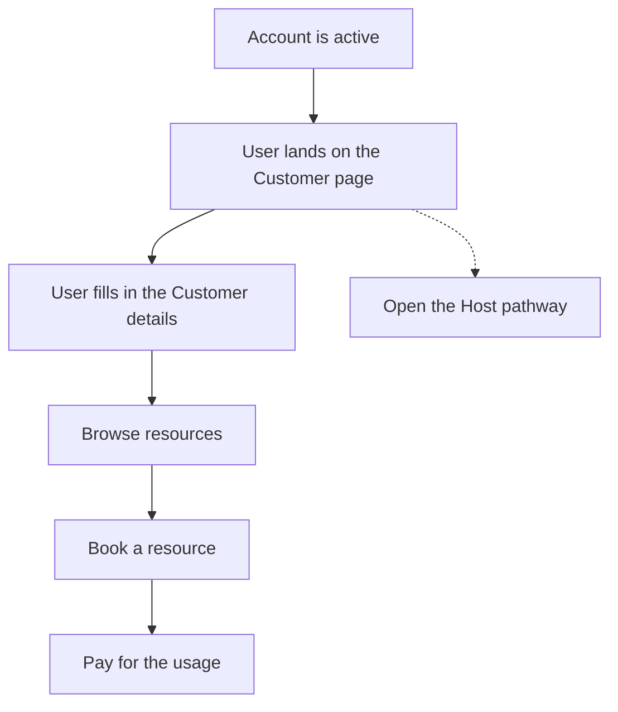

[Back to Feature ‐ Sign‐up and Login (FEAT-002)](https://github.com/InstaAd/Engineering-Wiki/wiki/Feature-%E2%80%90-Sign%E2%80%90up-and-Login)

# Sign‐up and Login: Customer flow

Field | Details
-- | --
Parent feature | FEAT-002 Sign-up and Login ([IA-4](https://insta-ad.atlassian.net/browse/IA-4))
Jira feature | [IA-140](https://insta-ad.atlassian.net/browse/IA-140) Customer Pathway and Onboarding, in workstream [IA-139](https://insta-ad.atlassian.net/browse/IA-139) Customer Experience. Stories: [IA-141](https://insta-ad.atlassian.net/browse/IA-141) Land on the Customer page and fill in customer details, [IA-145](https://insta-ad.atlassian.net/browse/IA-145) Open the Host pathway from the Customer page. Task: [IA-149](https://insta-ad.atlassian.net/browse/IA-149) Define the customer-specific fields
Related feature | FEAT-001 Sign-up and Account Onboarding
User type | Customer (resource user / advertiser / campaign publisher)
Other user type | [Host flow](https://github.com/InstaAd/Engineering-Wiki/wiki/Sign-up-and-Login-Host-Flow)
Status | Draft
Last updated | 2026-11-16

## 1. Summary

There are two main types of users, and each has its own page: the Customer and the Host. This page is for the Customer. A Customer wants to book the resources and pay for their usage. The Customer flow starts once the account is active. The role is not chosen at sign-up: the user lands on the Customer page after activation and fills in the Customer-specific details there.

### Account activation and current application access

The user first completes the account-level mandatory fields and verification/activation in [Sign-up and Login](./Sign-up-and-Login.md), Jira feature [IA-4](https://insta-ad.atlassian.net/browse/IA-4). After activation, the Customer uses the signed-in application as an advertiser and campaign publisher. The current workflow mapping below documents the app's visible surfaces; it does not replace the Customer requirements and open questions in this page, and its complete campaign, payment, and publishing behavior has not been verified end to end.

## 2. Who is a Customer

* A Customer is a resource user (see section 3 of the parent page).
* A Customer books the resources and pays for the usage of the resources.
* In the current application, this Customer role is presented as an advertiser/campaign publisher who discovers Host screens, selects a schedule and creative, and proceeds through quote and checkout.
* Host / Customer applies to the whole organisation. An organisation always has an organisation admin, who is set when the organisation is created.
* A Customer can also be a Host, and the other way round (see section 5).

## 3. Flow

## 4. Steps

1. **Account is active.** All account-level mandatory sign-up fields were provided, and the account is verified and activated, either online (OTP) or by our backend team (FEAT-002, Jira [IA-4](https://insta-ad.atlassian.net/browse/IA-4)). An inactive user sees only the home page with a message to verify the account.
2. **Land on the Customer page.** The user opens the Customer part of the application. Role selection is not a mandatory sign-up field.
3. **Fill in the Customer details.** The user fills in the relevant Customer fields on that page to use the Customer functionality. [Customer-specific fields to be confirmed; see existing task IA-149.]
4. **Browse resources.** The Customer browses the available resources. [Browsing steps to be confirmed]
5. **Book a resource.** The Customer books a resource. [Booking steps to be confirmed]
6. **Pay for the usage.** The Customer pays for the usage of the resource. [Payment steps to be confirmed]

**Sample UI workflow: Customer**

## 5. Opening the Host pathway

1. The Customer clicks the button for the Host part of the application.
2. The system asks for confirmation: "Yes, continue as Host".
3. The Customer completes the steps for the Host pathway (see the [Host flow](https://github.com/InstaAd/Engineering-Wiki/wiki/Sign-up-and-Login-Host-Flow)).

## 6. Rules

Rule | Detail
-- | --
Role is the type of user | It is separate from the account type (Personal or Organisation) in FEAT-001
Not part of sign-up | Role selection is not a mandatory sign-up field
Booking and payment | A Customer books the resources and pays for their usage
Combined roles | A Customer can also be a Host; the second pathway is opened later with one confirmation
Organisations | Host / Customer applies to the whole organisation, which always has an admin

## 7. Open questions

1. Which fields does a Customer fill in when first landing on the Customer page?
2. Does a Customer need any approval before booking a resource?
3. Which payment methods are supported, and when is the payment taken (at booking or after usage)?
4. Which existing Jira feature/stories cover campaign creation, screen discovery, media moderation, quote locking, checkout and campaign publishing?
5. Are live analytics and QR publishing available in the signed-in application, and what are their workflows?

## 8. Current application feature mapping

This mapping connects the current app surfaces to the existing Customer wiki/Jira work. It records current UI behavior for reference while retaining the future requirements and open questions above.

| Application feature | Existing wiki/Jira mapping | Current-app observation and scope note |
|---|---|---|
| Campaigns and campaign creation (`/campaigns`, `/campaigns/create`) | [Advertiser Campaigns and Media](./Advertiser-Campaigns-and-Media.md); new feature [IA-517](https://insta-ad.atlassian.net/browse/IA-517) under [IA-139](https://insta-ad.atlassian.net/browse/IA-139); Customer Pathway [IA-140](https://insta-ad.atlassian.net/browse/IA-140), story [IA-141](https://insta-ad.atlassian.net/browse/IA-141) | Campaign list supports Cards/Map/Split views. The four-step wizard discovers screens by city/district and environment; sets date range, daily time window, plays per hour and ad duration; checks availability and builds a screen cart; selects creatives; locks a quote for 15 minutes; and proceeds to checkout. Displayed prices and availability are estimates until quote lock; checkout and publication are unverified. |
| Media upload and advertisement library (`/ads`) | [Advertiser Campaigns and Media](./Advertiser-Campaigns-and-Media.md); new feature [IA-517](https://insta-ad.atlassian.net/browse/IA-517); Customer pathway [IA-140](https://insta-ad.atlassian.net/browse/IA-140), [IA-141](https://insta-ad.atlassian.net/browse/IA-141); customer-fields task [IA-149](https://insta-ad.atlassian.net/browse/IA-149) | UI lists JPEG/JPG/PNG/GIF images and MP4/WebM video (5–60 seconds), with validation/moderation before approved media can be used to create advertisements. The Ads tab lists advertisements created from approved assets. Upload and moderation outcomes were not tested. |
| Customer as advertiser/campaign publisher | This page; campaign/media feature [IA-517](https://insta-ad.atlassian.net/browse/IA-517); Customer pathway [IA-140](https://insta-ad.atlassian.net/browse/IA-140), [IA-141](https://insta-ad.atlassian.net/browse/IA-141) | The app presents the Customer as advertiser/campaign publisher. IA-517 captures the deployed campaign/media UI; IA-140/IA-141 retain the Customer pathway scope. |
| Advertised analytics and QR publishing | Customer flow / future requirements to verify | Public-site claims only; no matching existing Jira issue is identified in this wiki and the signed-in workflow was not verified. |

IA-517 was added after Jira search found no matching campaign, advertiser, media, creative, or advertisement issue. It records the current app surface and links to the UI/workflow documentation; it does not replace the future Customer booking, payment, and activation requirements in IA-140 and this page.

## 9. Change log

Version | Date | Change
-- | -- | --
0.3 | 2026-11-16 | Added Jira feature IA-517 for the previously uncovered campaign and media UI; retained the existing Customer pathway requirements.
0.2 | 2026-11-16 | Mapped the current advertiser/campaign-publisher app surfaces to this Customer flow and existing Jira references while retaining future booking, payment and customer-detail requirements.
0.1 | 2026-11-13 | First draft of the Customer flow.
