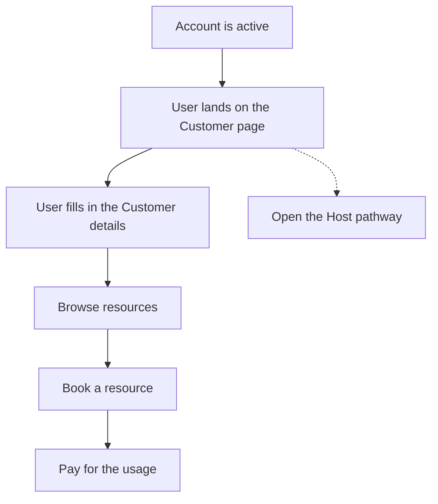

[Back to Feature ‐ Sign‐up and Login (FEAT-002)](https://github.com/InstaAd/Engineering-Wiki/wiki/Feature-%E2%80%90-Sign%E2%80%90up-and-Login)

# Sign‐up and Login: Customer flow

Field | Details
-- | --
Parent feature | FEAT-002 Sign-up and Login ([IA-4](https://insta-ad.atlassian.net/browse/IA-4))
Jira feature | [IA-140](https://insta-ad.atlassian.net/browse/IA-140) Customer Pathway and Onboarding, in workstream [IA-139](https://insta-ad.atlassian.net/browse/IA-139) Customer Experience. Stories: [IA-141](https://insta-ad.atlassian.net/browse/IA-141) Land on the Customer page and fill in customer details, [IA-145](https://insta-ad.atlassian.net/browse/IA-145) Open the Host pathway from the Customer page. Task: [IA-149](https://insta-ad.atlassian.net/browse/IA-149) Define the customer-specific fields
Related feature | FEAT-001 Sign-up and Account Onboarding
User type | Customer (resource user)
Other user type | [Host flow](https://github.com/InstaAd/Engineering-Wiki/wiki/Sign-up-and-Login-Host-Flow)
Status | Draft
Last updated | 2026-11-13

## 1. Summary

There are two main types of users, and each has its own page: the Customer and the Host. This page is for the Customer. A Customer wants to book the resources and pay for their usage. The Customer flow starts once the account is active. The role is not chosen at sign-up: the user lands on the Customer page after activation and fills in the Customer-specific details there.

## 2. Who is a Customer

* A Customer is a resource user (see section 3 of the parent page).
* A Customer books the resources and pays for the usage of the resources.
* Host / Customer applies to the whole organisation. An organisation always has an organisation admin, who is set when the organisation is created.
* A Customer can also be a Host, and the other way round (see section 5).

## 3. Flow

## 4. Steps

1. **Account is active.** All mandatory sign-up fields were provided when the account was created, and the account is verified and activated, either online (OTP) or by our backend team. An inactive user sees only the home page with a message to verify the account.
2. **Land on the Customer page.** The user opens the Customer part of the application. Role selection is not a mandatory sign-up field.
3. **Fill in the Customer details.** The user fills in the relevant Customer fields on that page to use the Customer functionality. [Customer-specific fields to be confirmed]
4. **Browse resources.** The Customer browses the available resources. [Browsing steps to be confirmed]
5. **Book a resource.** The Customer books a resource. [Booking steps to be confirmed]
6. **Pay for the usage.** The Customer pays for the usage of the resource. [Payment steps to be confirmed]

**Sample UI workflow: Customer**

## 5. Opening the Host pathway

1. The Customer clicks the button for the Host part of the application.
2. The system asks for confirmation: "Yes, continue as Host".
3. The Customer completes the steps for the Host pathway (see the [Host flow](https://github.com/InstaAd/Engineering-Wiki/wiki/Sign-up-and-Login-Host-Flow)).

## 6. Rules

Rule | Detail
-- | --
Role is the type of user | It is separate from the account type (Personal or Organisation) in FEAT-001
Not part of sign-up | Role selection is not a mandatory sign-up field
Booking and payment | A Customer books the resources and pays for their usage
Combined roles | A Customer can also be a Host; the second pathway is opened later with one confirmation
Organisations | Host / Customer applies to the whole organisation, which always has an admin

## 7. Open questions

1. Which fields does a Customer fill in when first landing on the Customer page?
2. Does a Customer need any approval before booking a resource?
3. Which payment methods are supported, and when is the payment taken (at booking or after usage)?
