[Back to Feature ‐ Sign‐up and Login (FEAT-002)](https://github.com/InstaAd/Engineering-Wiki/wiki/Feature-%E2%80%90-Sign%E2%80%90up-and-Login)

# Sign‐up and Login: Host flow

Field | Details
-- | --
Parent feature | FEAT-002 Sign-up and Login ([IA-4](https://insta-ad.atlassian.net/browse/IA-4))
Jira feature | [IA-449](https://insta-ad.atlassian.net/browse/IA-449) Host Onboarding and Verification (mandatory Host details, verification, activation) and [IA-177](https://insta-ad.atlassian.net/browse/IA-177) Host Pathway and Host Types, both in workstream [IA-176](https://insta-ad.atlassian.net/browse/IA-176) Host Experience. See section 16 for all stories and tasks
Related feature | FEAT-001 Sign-up and Account Onboarding
User type | Host: Host type 1 (screen owner) and Host type 2 (current app rental-location listing; future scope still requires confirmation)
Other user type | [Customer flow](https://github.com/InstaAd/Engineering-Wiki/wiki/User-Account-Customer-Flow)
Status | Draft
Last updated | 2026-11-16

## 1. Summary

There are two main types of users, and each has its own page: the Customer and the Host. This page is for the Host. A Host is either **Host type 1**, who owns a resource, lists it in our application and controls it, or **Host type 2**, who provides rental space to assemble an InstaAd-owned resource and is paid fixed monthly rent under the accepted agreement. A Host can be both types. The shared [Resource Management and Monetization](./Resource-Management-and-Monetization.md) model explains how Host-owned screen bookings differ from rent for an InstaAd-owned resource.

Because the Host earns money, the Host must give a set of **mandatory details** and pass **verification** before the Host role is active (section 4). **Until the Host is verified and active, all of the Host's resources stay inactive**: hidden from Customers and not bookable. This is the same activation idea as for the account itself.

The role is not chosen at sign-up: the user lands on the Host page after the account is active and fills in the Host details there.

### Account activation and current application access

The user first completes the account-level mandatory fields and account verification/activation in [Sign-up and Login](./Sign-up-and-Login.md), Jira feature [IA-4](https://insta-ad.atlassian.net/browse/IA-4). The user then enters the Host pathway and completes the Host-specific mandatory details and verification described in this page, including [IA-449](https://insta-ad.atlassian.net/browse/IA-449) and [IA-450](https://insta-ad.atlassian.net/browse/IA-450). Host inventory must not become active before Host approval ([IA-478](https://insta-ad.atlassian.net/browse/IA-478)). The signed-in app screens mapped below are the current product surfaces after sign-in; their visibility does not waive the account or Host activation requirements, and not every end-to-end workflow was verified.

## 2. Who is a Host

Host type | What the Host does | Control and maintenance of the resource | Gets paid for
-- | -- | -- | --
Type 1 | Owns the resource and lists it in our application | The Host controls and maintains the resource | Paid advertising bookings on the screen, less InstaAd's agreed royalty/service charge; amount and settlement details are open
Type 2 | Provides rental space to assemble our resource | InstaAd owns and controls the resource; Host's maintenance responsibilities remain subject to agreement | Fixed monthly rent in the accepted agreement, independent of screen booking utilization

* A Host is a resource owner (see section 3 of the parent page).
* A Host can be Host type 1, Host type 2, or both.
* **Both Host types give the same information and pass the same verification.** The difference is how the resource is maintained, not what we collect.
* Host / Customer applies to the whole organisation. An organisation always has an organisation admin, who is set when the organisation is created.
* A Host can also be a Customer, and the other way round (see section 12).

### Current application mapping

This table maps the roles and Host types to the signed-in application's existing UI. These are mappings of current surfaces, not replacements for the Host requirements and future workflows defined in this page.

| Application feature | Host mapping | Existing wiki/Jira references | Current-app observation and scope note |
|---|---|---|---|
| My Screens and Register Screen (`/devices`, `/devices/register`) | Host; screen listing is Host type 1 | [Host Screen Management](./Host-Screen-Management.md); new feature [IA-518](https://insta-ad.atlassian.net/browse/IA-518); related listing/resource issues [IA-189](https://insta-ad.atlassian.net/browse/IA-189), [IA-190](https://insta-ad.atlassian.net/browse/IA-190), [IA-324](https://insta-ad.atlassian.net/browse/IA-324); Host Pathway and Host Types [IA-177](https://insta-ad.atlassian.net/browse/IA-177), choose Host type [IA-178](https://insta-ad.atlassian.net/browse/IA-178), Host details [IA-182](https://insta-ad.atlassian.net/browse/IA-182), Host verification [IA-449](https://insta-ad.atlassian.net/browse/IA-449) and ownership details [IA-458](https://insta-ad.atlassian.net/browse/IA-458) | The UI exposes screen inventory and registration. IA-518 covers the distinct device/group/player workflow; the existing Host approval and inactive-inventory requirements remain. |
| Rent Location and My Listings (`/rent-location/listings`) | Host; rental-location listing is Host type 2 in current app mapping | [Host Rental Location Listings](./Host-Rental-Location-Listings.md); new feature [IA-519](https://insta-ad.atlassian.net/browse/IA-519); existing future Host type 2 issues [IA-189](https://insta-ad.atlassian.net/browse/IA-189), [IA-194](https://insta-ad.atlassian.net/browse/IA-194), and [IA-255](https://insta-ad.atlassian.net/browse/IA-255); [IA-177](https://insta-ad.atlassian.net/browse/IA-177), [IA-178](https://insta-ad.atlassian.net/browse/IA-178), ownership details [IA-458](https://insta-ad.atlassian.net/browse/IA-458) | IA-519 captures the current app's advertiser-rentable location listing. The existing future Host type 2 definition describes space for an InstaAd resource; keep both and confirm product alignment. |
| Host identity, mandatory details and verification | Host type 1 and Host type 2 | Host Onboarding and Verification [IA-449](https://insta-ad.atlassian.net/browse/IA-449); checklist [IA-450](https://insta-ad.atlassian.net/browse/IA-450), identity [IA-454](https://insta-ad.atlassian.net/browse/IA-454), ownership [IA-458](https://insta-ad.atlassian.net/browse/IA-458), review [IA-470](https://insta-ad.atlassian.net/browse/IA-470), inactive inventory [IA-478](https://insta-ad.atlassian.net/browse/IA-478) | Complete account activation first, then Host verification. These requirements remain future/product requirements even where the signed-in app currently exposes screens or listings. |

**Observed screen-registration fields:** screen name/type, location name, orientation, indoor/outdoor environment, size, resolution and estimated daily footfall; supported aspect ratios, file types and maximum video duration; map/location search and address fields; location tags; up to five screen photos; and optional screen-group assignment. The UI offers screen inventory in Cards/Map/Split views, search and filters. Registration, pairing, playback and screen-group operations were not completed end to end.

**Observed rental-location listing fields:** title, description, location type, address, city, district, postal code and country; available width/height, electricity availability, rent amount and period; map search/selection; and a draft action. Listing submission, review, publication, booking and payment were not verified.

The following diagram records the existing future Host model; it is not intended to represent every currently deployed app workflow.

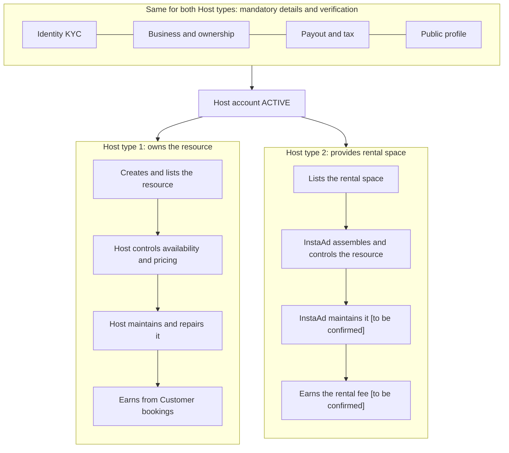

## 3. Flow

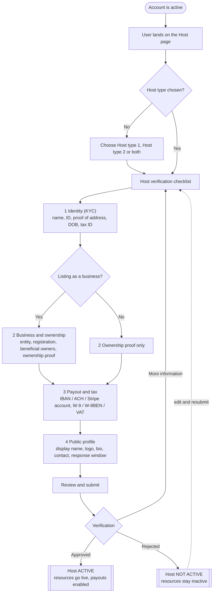

## 4. Mandatory Host details

These details are **mandatory** to activate the Host role. The Host can save each section as a draft, but cannot submit for verification until every mandatory item applies and is complete.

### A. Personal and identity verification (KYC)

Field | Applies to | Notes
-- | -- | --
Full legal name | Every Host | Must match the ID document
Primary contact details: email and phone | Every Host | Already verified at sign-up (OTP)
Government-issued ID: Passport, Driver's licence or National ID | Every Host | For identity verification
Proof of address: utility bill or bank statement | Every Host | Dated less than 90 days ago
Date of birth | Every Host | Must match the ID document
Tax Identification Number: SSN, ITIN, EIN, or VAT / GST ID | Every Host | Which one depends on the jurisdiction

### B. Business and ownership details (when listing as an entity)

Field | Applies to | Notes
-- | -- | --
Legal business name and entity type: LLC, Corporation, Sole proprietorship | Hosts listing as an entity |
Business registration number and official registered address | Hosts listing as an entity |
Beneficial ownership: details of every individual owning more than 25% | Hosts listing as an entity | Anti-Money Laundering (AML) compliance
Proof of resource ownership or right to use and authorization | Every Host [requirement to be confirmed] | For a Type 1 screen listing, evidence must show screen ownership or authority to operate/list the screen. For a Type 2 rental-location listing, evidence must show premises ownership or a right to offer the location. A tenant's lease may evidence premises use but not building ownership; landlord consent for installation or advertising may also be required. If the Host lists both a screen and a location, evidence is needed for each (see section 7).

### C. Financial and payout information

Field | Applies to | Notes
-- | -- | --
Payout method and account details: IBAN, ACH routing number and account number, or a connected Stripe Express / Custom account ID | Every Host | The account holder name must match the Host's legal or business name
Tax documentation: W-9 (US Hosts), W-8BEN (foreign Hosts), VAT registration status | Every Host | The form depends on the jurisdiction (see section 9)

### D. Communication and public profile

Field | Applies to | Notes
-- | -- | --
Public display name or business name, and avatar or logo | Every Host | Shown to Customers
Public bio / Host description | Every Host | Shown to Customers
Preferred contact method and response window (SLA) | Every Host | Shown to Customers

Only the fields in section D are public. Legal name, date of birth, tax ID, address, documents and payout details are **never** shown to Customers.

## 5. Host activation and status

The Host page shows a checklist of the four sections above and a progress bar. The **Submit for verification** button is enabled only when every mandatory section is complete.

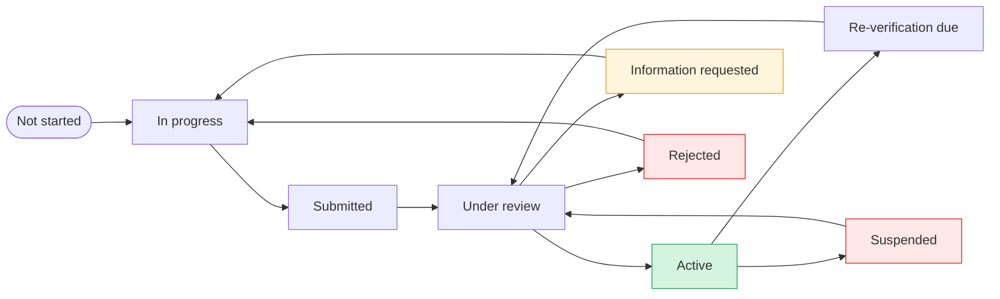

**Sample UI: Host page before activation**

### Resources stay inactive until the Host is active

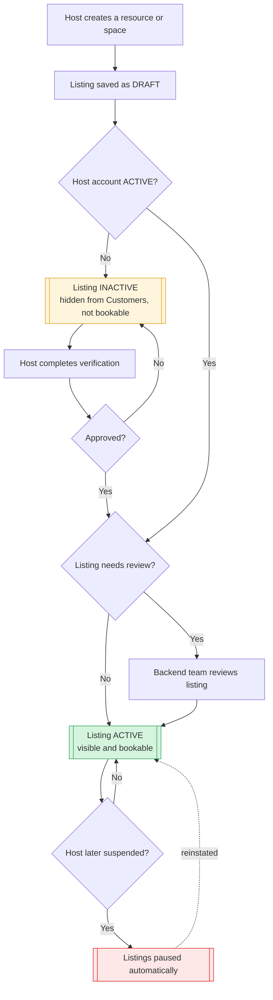

## 6. Steps

1. **Account is active.** All mandatory sign-up fields were provided when the account was created, and the account is verified and activated, either online (OTP) or by our backend team. An inactive user sees only the home page with a message to verify the account.
2. **Land on the Host page.** The user opens the Host part of the application. Role selection is not a mandatory sign-up field.
3. **Choose the Host type.** The user chooses Host type 1, Host type 2, or both. This is done in the settings or on the resources page when the Host opens it after login. The choice is required before a Host can create a resource or list their property.
4. **Fill in the Host details (section 4), step by step:**
    1. **Identity** (A): personal details and documents.
    2. **Business and ownership** (B): business details and beneficial owners if listing as an entity, and the proof of ownership or authorisation.
    3. **Payout and tax** (C): payout method and tax documents.
    4. **Public profile** (D): public name, logo, bio and contact preferences.
    5. **Review and submit**: the Host checks the details and submits for verification.
5. **Verification.** Automated checks run, then our backend team reviews (section 8). The Host sees the status and gets an email and an in-app message at every change.
6. **Host is active.** The Host's resources go live and payouts are enabled.
7. **Host type 1: create the resource and list it.** The Host owns the resource, lists it in our application and controls and maintains it. Drafts can be created before activation but stay inactive. [Resource and listing steps to be confirmed]
8. **Host type 2: list the rental space.** The Host lists the space where our resource will be assembled and is paid for the space. The Host has no control over the resource; we have full control. [Space listing steps to be confirmed]

**Sample UI workflow: Host type**

**Sample UI: Step 1, Identity**

**Sample UI: Step 2, Business and ownership**

**Sample UI: Step 3, Payout and tax**

**Sample UI: Step 4, Public profile**

## 7. Individual or business, and proof of ownership

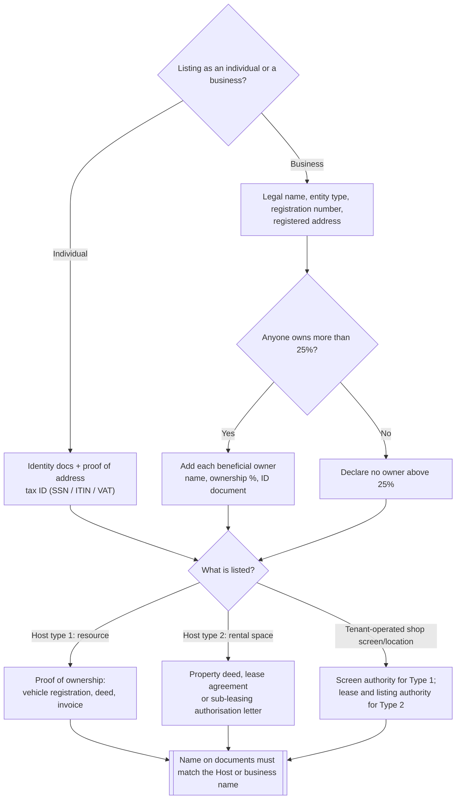

Scenario | Typical proof of ownership, right to use, or authorisation
-- | --
Type 1 (owns the resource) | Vehicle registration, property deed, purchase invoice, or other accepted proof
Type 2 (provides rental space for an InstaAd resource) | Property deed, lease agreement, or an authorisation letter granting sub-leasing rights
Current application Type 2 mapping (rental-location listing for advertisers) | Property deed if the Host owns the premises, or lease/rental agreement showing the right to offer the location; include any required landlord/subletting/advertising authorization. This is a current-app mapping and does not replace the future Type 2 requirements above.
Tenant-operated shop screen and location | For the screen listing (Type 1), proof of screen ownership or authority to operate/list it. For a rental-location listing (Type 2), lease/rental agreement showing the right to use and offer the premises. A tenant's lease does not establish building ownership; landlord consent may be needed for screen installation or advertising.

### Tenant-operated shop: current application mapping

A person or business rents a shop and installs a display screen there as part of its own business. In the current application mapping, registering/listing that screen is Host type 1. If the tenant also creates a rental-location listing for advertisers, that listing is Host type 2; one Host may use both pathways.

The existing future Host type 2 definition above describes rental space for an InstaAd resource, while the app's Rent Location workflow describes a location offered to advertisers. Keep both requirements in scope and confirm how the future Host type 2 definition aligns with the currently deployed listing. The tenant's lease or rental agreement can evidence their right to use the premises, but does not prove building ownership. Confirm whether separate landlord consent is required to install the screen and/or offer the location to advertisers.

## 8. Verification and review

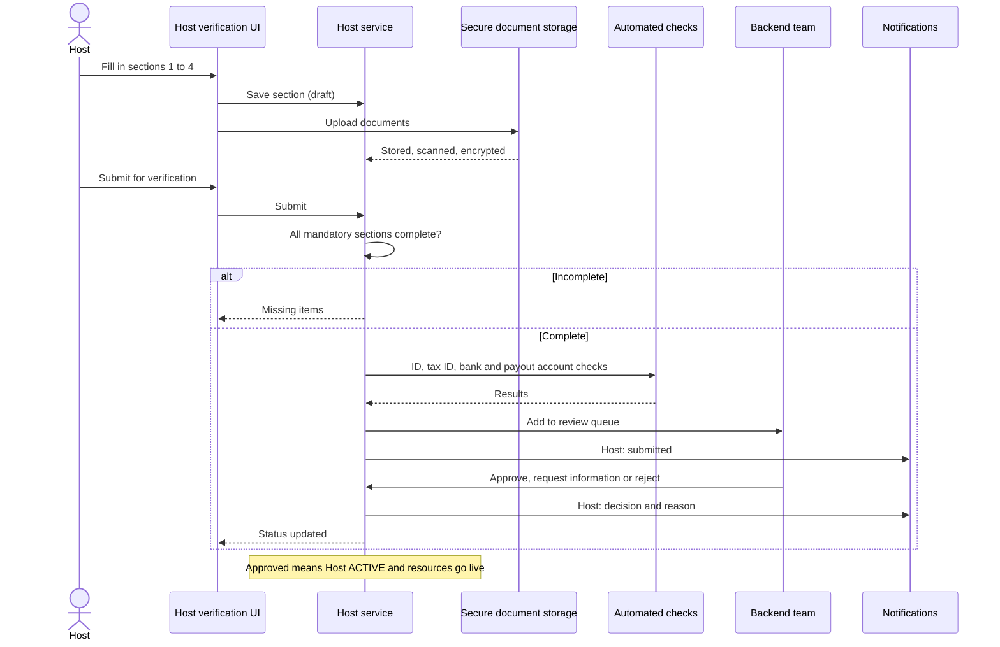

**Sample UI: Review, submit and status**

**Sample UI: Outcomes the Host can see**

### Backend team review

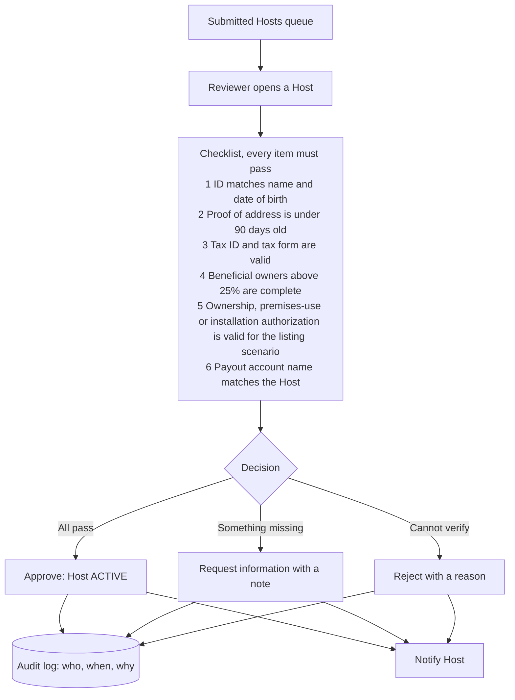

## 9. Tax and payout rules

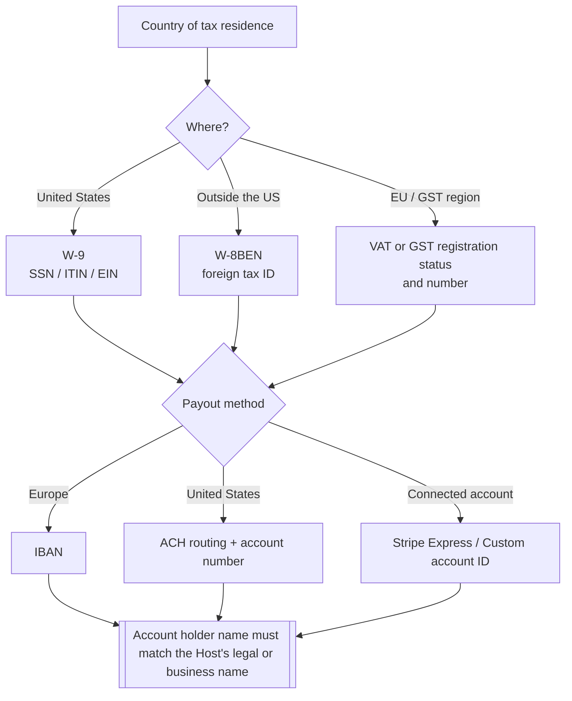

## 10. Data model (for developers)

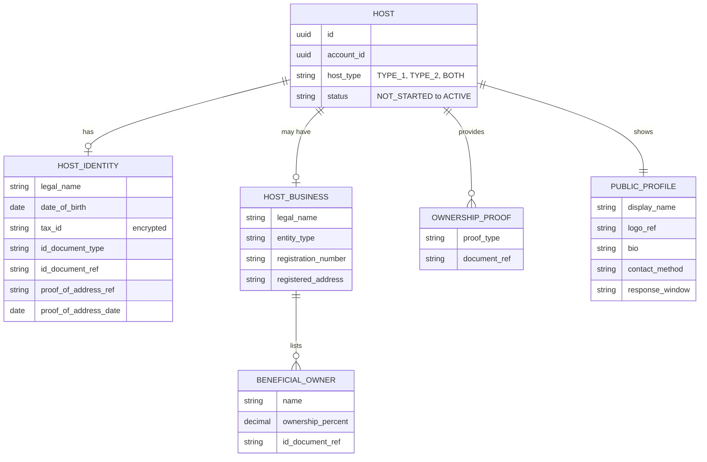

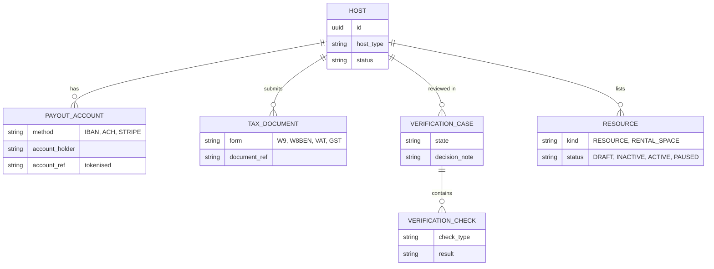

The model is a starting point for design (Jira task [IA-486](https://insta-ad.atlassian.net/browse/IA-486)). Tax ID, bank references and documents must be encrypted at rest.

## 11. Re-verification and suspension (proposed)

This section is a proposal based on the 90-day proof-of-address rule. It needs confirmation from Product and Legal.

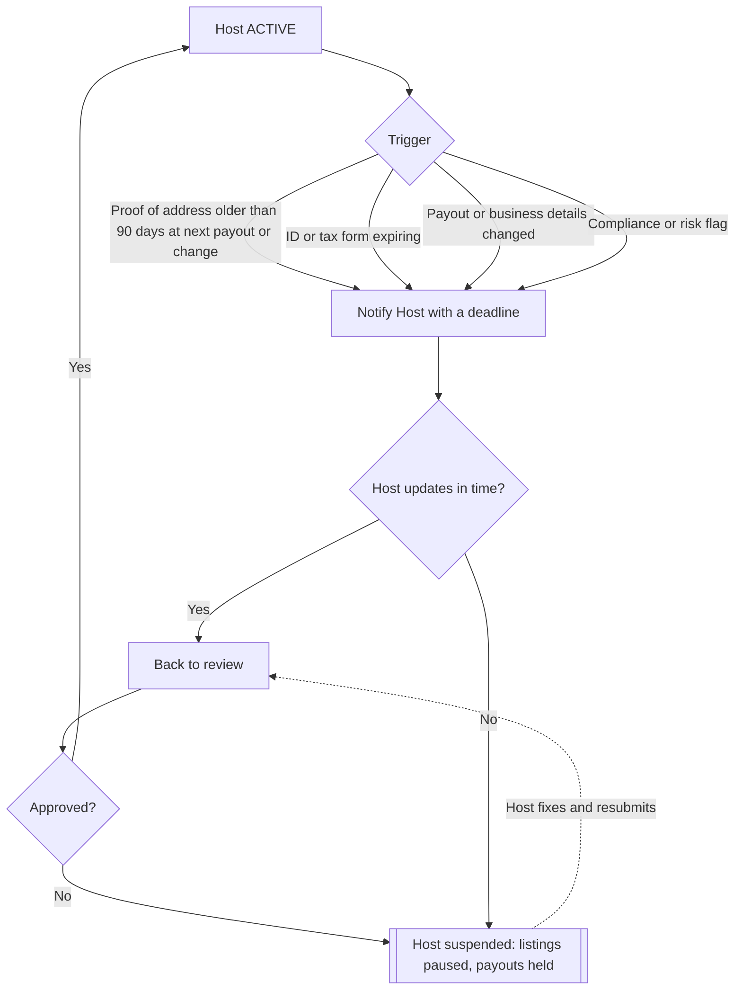

Notifications (email and in-app) are sent on: submitted, information requested, approved, rejected, document expiring, suspended.

## 12. Opening the Customer pathway

1. The Host clicks the button for the Customer part of the application.
2. The system asks for confirmation: "Yes, continue as Customer".
3. The Host completes the steps for the Customer pathway (see the [Customer flow](https://github.com/InstaAd/Engineering-Wiki/wiki/User-Account-Customer-Flow)).

## 13. Rules

Rule | Detail
-- | --
Role is the type of user | It is separate from the account type (Personal or Organisation) in FEAT-001
Not part of sign-up | Role selection is not a mandatory sign-up field
Host earns money | The Host must give the mandatory details (section 4) and pass verification
Host type 1 | Owns the resource, lists it in our application and controls and maintains it
Host type 2 | Provides rental space to assemble our resource, is paid for the space and has no control over the resource; we have full control
Both types | A Host can be Host type 1, Host type 2, or both
Same information | Both Host types give the same details and pass the same verification
Resources inactive | A Host's resources stay inactive until the Host is verified and active
Type before listing | A Host must choose the Host type before creating a resource or listing a property
Current application mapping | Screen listing is Host type 1; rental-location listing is Host type 2 (see section 2)
Proof of address | Dated less than 90 days ago
Beneficial owners | Every individual owning more than 25% is listed (AML)
Public data | Only the public profile (section 4 D) is shown to Customers
Combined roles | A Host can also be a Customer; the second pathway is opened later with one confirmation
Organisations | Host / Customer applies to the whole organisation, which always has an admin

## 14. Open questions

1. Can the Host type be changed later, and by whom in an organisation?
2. What does a Host see on the Host page before the Host type is chosen?
3. How and when does a Host type 1 get paid?
4. How and when is a Host type 2 paid for the rental space (amount, frequency)?
5. Who assembles, installs and maintains our resource in the rental space, and with which SLA?
6. Which countries and tax ID types are supported at launch?
7. Is identity verification automated (provider) or manual review only?
8. Is proof of ownership or authorisation also required from individual Hosts? (Assumed yes.)
9. Can a Host edit a section while the verification is under review?
10. What is the expected review time shown to the Host?
11. What happens to existing bookings if a Host is suspended?
12. Which triggers and deadlines apply to re-verification (section 11)?
13. Does a tenant need separate landlord consent to install a screen and/or offer the shop as a rental location to advertisers, beyond permissions in the lease?
14. How should the future Host type 2 requirement (rental space for an InstaAd resource) align with the app's current Rent Location listing for advertisers?
15. What booking royalty, payout schedule, playback accounting and dispute/adjustment rules apply to Host type 1 screen earnings? See the shared [Resource Management and Monetization](./Resource-Management-and-Monetization.md) model.

## 15. Change log

Version | Date | Change
-- | -- | --
0.5 | 2026-11-16 | Added Jira features IA-518 and IA-519 for previously uncovered current-app screen management and advertiser-rentable listings; retained the existing future Host type 2 definition and activation requirements.
0.4 | 2026-11-16 | Mapped current app screens to Host type 1, rental-location listings to Host type 2, and linked the mappings to existing Host Jira references without replacing future requirements.
0.3 | 2026-11-16 | Added the tenant-operated shop and display screen scenario for confirmation, including the distinction between premises-use authorization and building ownership proof.
0.2 | 2026-11-13 | Added the mandatory Host details, activation and status, resources inactive until active, verification and review, tax and payout rules, data model, sample UI and diagrams. Jira stories and tasks added
0.1 | 2026-11-13 | First draft of the Host flow

## 16. Jira stories and tasks

Feature [IA-449](https://insta-ad.atlassian.net/browse/IA-449) Host Onboarding and Verification, workstream [IA-176](https://insta-ad.atlassian.net/browse/IA-176) Host Experience. Every story has three sub-tasks (Backend / API, Frontend / UI, Tests and acceptance) and every task has two (Implementation, Verification and documentation).

Key | Type | Title | Covers
-- | -- | -- | --
[IA-450](https://insta-ad.atlassian.net/browse/IA-450) | Story | Host activation checklist and Host status | Section 5
[IA-454](https://insta-ad.atlassian.net/browse/IA-454) | Story | Collect personal and identity details (KYC) | Section 4 A
[IA-458](https://insta-ad.atlassian.net/browse/IA-458) | Story | Collect business and ownership details | Section 4 B, section 7
[IA-462](https://insta-ad.atlassian.net/browse/IA-462) | Story | Collect payout method and tax documentation | Section 4 C, section 9
[IA-466](https://insta-ad.atlassian.net/browse/IA-466) | Story | Collect public profile and communication preferences | Section 4 D
[IA-470](https://insta-ad.atlassian.net/browse/IA-470) | Story | Review, submit and track verification (Host view) | Section 8
[IA-474](https://insta-ad.atlassian.net/browse/IA-474) | Story | Backend team Host verification console | Section 8
[IA-478](https://insta-ad.atlassian.net/browse/IA-478) | Story | Keep resources inactive until the Host is active | Sections 2 and 5
[IA-482](https://insta-ad.atlassian.net/browse/IA-482) | Story | Re-verification, document expiry and suspension (proposed) | Section 11
[IA-486](https://insta-ad.atlassian.net/browse/IA-486) | Task | Design the Host data model and database schema | Section 10
[IA-489](https://insta-ad.atlassian.net/browse/IA-489) | Task | Secure document storage and personal data protection | Sections 4 and 10
[IA-492](https://insta-ad.atlassian.net/browse/IA-492) | Task | Decide and integrate identity verification (KYC / KYB) | Section 8, question 7
[IA-495](https://insta-ad.atlassian.net/browse/IA-495) | Task | Integrate the payout provider (Stripe Connect Express / Custom) | Section 9
[IA-498](https://insta-ad.atlassian.net/browse/IA-498) | Task | Tax ID, VAT / GST and tax form rules by jurisdiction | Section 9, question 6
[IA-501](https://insta-ad.atlassian.net/browse/IA-501) | Task | Host verification notifications | Sections 8 and 11
[IA-504](https://insta-ad.atlassian.net/browse/IA-504) | Task | Define maintenance responsibilities, SLAs and payment terms per Host type | Section 2, questions 1 and 3 to 5
[IA-507](https://insta-ad.atlassian.net/browse/IA-507) | Task | Audit log and role-based access for Host verification data | Section 8

Earlier items on the Host page: [IA-177](https://insta-ad.atlassian.net/browse/IA-177) Host Pathway and Host Types with stories [IA-178](https://insta-ad.atlassian.net/browse/IA-178) Choose the Host type and [IA-182](https://insta-ad.atlassian.net/browse/IA-182) Land on the Host page and fill in host details, and task [IA-186](https://insta-ad.atlassian.net/browse/IA-186) Define the Host-specific fields (answered by section 4).

The application-to-wiki/Jira mappings are listed in section 2. The current-app screen-management and advertiser-rentable location workflows are now captured in [IA-518](https://insta-ad.atlassian.net/browse/IA-518) and [IA-519](https://insta-ad.atlassian.net/browse/IA-519), respectively. Existing Host verification, resource listing, resource management, and future Host type 2 requirements remain separate and in force.
