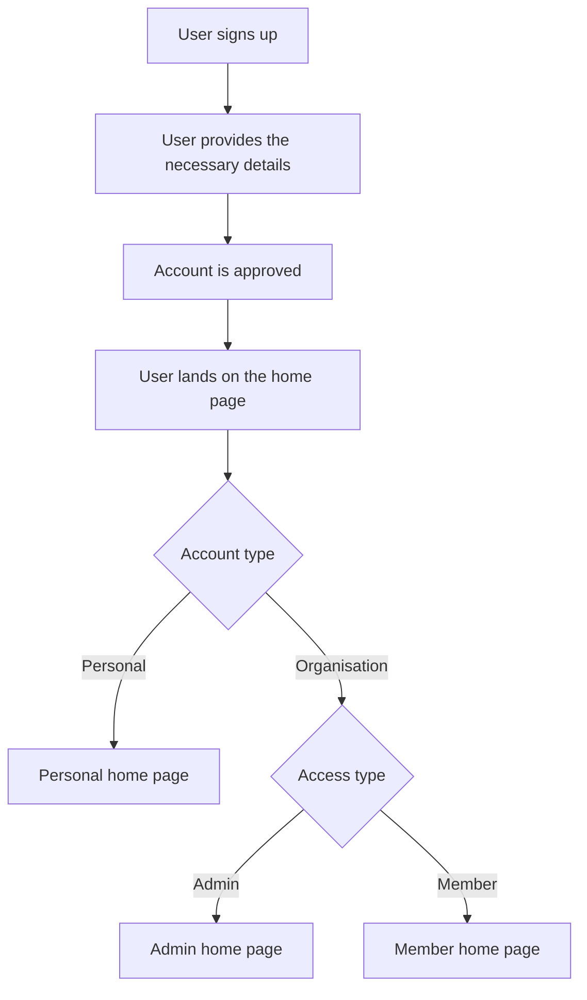
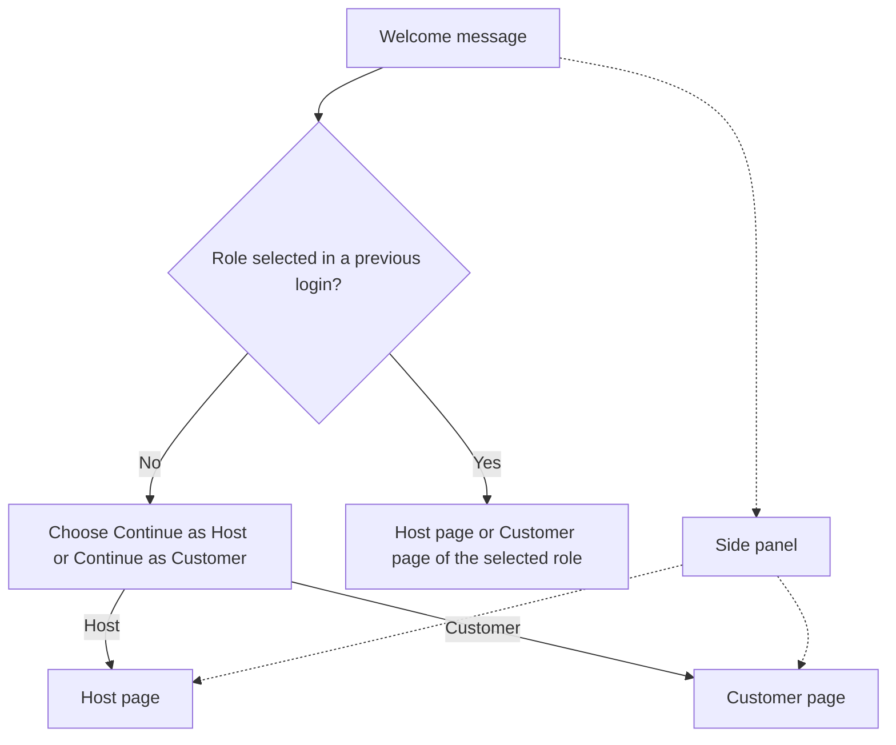
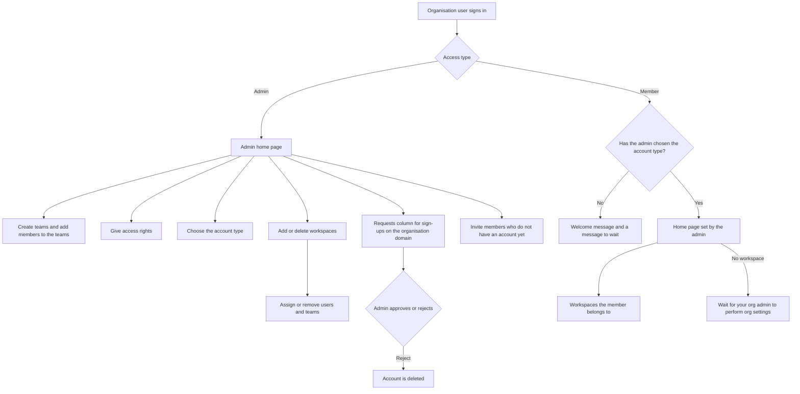

[Back to Feature - Sign-up and Login (FEAT-002)](https://github.com/InstaAd/Engineering-Wiki/wiki/Feature-%E2%80%90-Sign%E2%80%90up-and-Login)

# Feature ‐ User Home Page

Field | Details
-- | --
Feature ID | [IA-85](https://insta-ad.atlassian.net/browse/IA-85) (Jira feature)
Jira workstream | [IA-1](https://insta-ad.atlassian.net/browse/IA-1) Accounts, Identity and Onboarding
Jira stories and tasks | See section 10
Owner (Product) | [Name]
Tech lead | [Name]
Status | Draft
Related features | FEAT-002 Sign-up and Login ([IA-4](https://insta-ad.atlassian.net/browse/IA-4)), FEAT-001 Sign-up and Account Onboarding, [IA-108](https://insta-ad.atlassian.net/browse/IA-108) Organisations, Teams and Workspaces
Related pages | [Host flow](https://github.com/InstaAd/Engineering-Wiki/wiki/User-Account-Host-Flow), [Customer flow](https://github.com/InstaAd/Engineering-Wiki/wiki/User-Account-Customer-Flow)
Last updated | 2026-11-16

## 1. Summary

The home page is where a user lands after the account is approved. What the user sees depends on the account type and, for an organisation, on the access type of the user.

* A **Personal** user sees a welcome message and can continue as a Host or as a Customer.
* An **Organisation** user sees a page that depends on the access type: **Admin** or **Member**.
  * An Admin manages teams, access rights, the account type of the organisation and the workspaces.
  * A Member sees the home page set up by the admin and the workspaces the Member belongs to.

### Current application mapping

After account mandatory details are submitted and the account is verified/activated (FEAT-002, Jira [IA-4](https://insta-ad.atlassian.net/browse/IA-4)), the signed-in app presents a dashboard with active-device, running-ad, subscription and ad-play summaries; quick actions for campaigns, screen registration/management and rental-location listings; and profile-status indicators. This is the current app surface mapped to this home-page feature, not a replacement for the account-type and Admin/Member home-page requirements below.

| Application area | Existing wiki/Jira mapping | Current-app observation and scope note |
|---|---|---|
| Signed-in dashboard (`/dashboard`) | This User Home Page; Jira feature [IA-85](https://insta-ad.atlassian.net/browse/IA-85), Personal home page [IA-86](https://insta-ad.atlassian.net/browse/IA-86), Organisation Admin [IA-90](https://insta-ad.atlassian.net/browse/IA-90), Organisation Member [IA-94](https://insta-ad.atlassian.net/browse/IA-94) | Shows account summaries, quick actions and profile status. Confirm whether the current dashboard layout and metrics fall within the existing home-page story scope. |
| Organizations and workspaces (`/my-organizations`) | [Organizations and Workspaces](./Organizations-and-Workspaces.md); this page, section 5; Organisations, Teams and Workspaces [IA-108](https://insta-ad.atlassian.net/browse/IA-108), Workspaces story [IA-113](https://insta-ad.atlassian.net/browse/IA-113) | Lists personal/business workspaces, member counts and roles; lets the user set an active workspace and offers workspace creation. Member invitations and role-management behavior were not verified. |
| Campaigns and media (`/campaigns`, `/ads`) | [Advertiser Campaigns and Media](./Advertiser-Campaigns-and-Media.md); new feature [IA-517](https://insta-ad.atlassian.net/browse/IA-517), under Customer Experience [IA-139](https://insta-ad.atlassian.net/browse/IA-139) | Captures campaign discovery/creation and media library UI. Checkout, upload moderation, and publication were not verified. |
| Screen management (`/devices`, `/devices/register`) | [Host Screen Management](./Host-Screen-Management.md); new feature [IA-518](https://insta-ad.atlassian.net/browse/IA-518), related resource work [IA-189](https://insta-ad.atlassian.net/browse/IA-189), [IA-190](https://insta-ad.atlassian.net/browse/IA-190), [IA-324](https://insta-ad.atlassian.net/browse/IA-324) | Maps screen ownership/registration to Host type 1. Registration, groups, pairing, and playback are not all verified. |
| Rental-location listings (`/rent-location/listings`) | [Host Rental Location Listings](./Host-Rental-Location-Listings.md); new feature [IA-519](https://insta-ad.atlassian.net/browse/IA-519); distinct future Host type 2 issue [IA-194](https://insta-ad.atlassian.net/browse/IA-194) | Current app maps advertiser-rentable location listings to Host type 2; retain the different future Host type 2 meaning until Product confirms alignment. |
| Billing and subscriptions (`/subscriptions`) | [Billing and Subscriptions](./Billing-and-Subscriptions.md); [IA-262](https://insta-ad.atlassian.net/browse/IA-262), [IA-263](https://insta-ad.atlassian.net/browse/IA-263), [IA-275](https://insta-ad.atlassian.net/browse/IA-275), [IA-287](https://insta-ad.atlassian.net/browse/IA-287), [IA-292](https://insta-ad.atlassian.net/browse/IA-292) | The app displays advertiser and screen-owner plan offers. Plan selection and payment were not tested. |
| Account settings (`/settings`) | [Account Settings](./Account-Settings.md); profile/preferences [IA-466](https://insta-ad.atlassian.net/browse/IA-466), notifications [IA-374](https://insta-ad.atlassian.net/browse/IA-374), billing [IA-215](https://insta-ad.atlassian.net/browse/IA-215)/[IA-292](https://insta-ad.atlassian.net/browse/IA-292), device controls [IA-518](https://insta-ad.atlassian.net/browse/IA-518) | The signed-in app exposes profile/security, notification and regional preferences, payment/invoice UI, and device-management controls. Changes were not saved or verified. |

## 2. Users and access types

User | Description
-- | --
Personal user | An individual using the product on their own. The user has one role at a time: Host or Customer.
Organisation Admin | Manages the organisation: teams, access rights, the account type and the workspaces. An organisation can have more than one admin.
Organisation Member | Uses the workspaces the admin has given the Member access to.

The Host and the Customer are the two main user types. See the [Host flow](https://github.com/InstaAd/Engineering-Wiki/wiki/User-Account-Host-Flow) and the [Customer flow](https://github.com/InstaAd/Engineering-Wiki/wiki/User-Account-Customer-Flow).

## 3. Flow

1. **Sign up.** The user signs up (see FEAT-002).
2. **Provide the necessary details.** The user provides the mandatory details (section 6.1 of FEAT-002). For an organisation this includes the organisation details.
3. **Account is approved.** The account is verified and activated, online with an OTP or by our backend team (see FEAT-002). For an organisation Member who was not added by an admin, the admin verifies and approves the account (see section 5.3).
4. **Land on the home page.** The page shown depends on the account type and the access type.

## 4. Home page for a Personal account

* A welcome message is shown: "Welcome [user name]".
* If the user has not selected a role in a previous login, the user can choose to become a Host or a Customer.
* The user chooses **Continue as Host** or **Continue as Customer**. Based on the choice, the user lands on the Host page or the Customer page.
* The user can also open the Customer page or the Host page from the side panel.
* If a role was already selected in a previous login, the user goes to the Customer page or the Host page for that role.

**Sample UI workflow: Personal account**

## 5. Home page for an Organisation account

The page varies with the access type of the user. There are two access types: **Admin** and **Member**.

### 5.1 Admin

An Admin can:

* Create teams, add team members to the teams and provide access rights. The access types are Admin and Member.
* Choose the type of account the organisation continues as (Host or Customer). Only an admin can do this. The account type applies to the whole organisation and all its workspaces.
* Decide to continue as the other account type in the future. Only an admin can do this.
* Add and delete many workspaces inside the organisation.
* Assign users and teams to each workspace, and remove them. The admin creates the workspaces and allows the Members to work in them.
* See the requests from users who signed up with an email on the organisation domain. The admin is notified by email, and the admin's home page has a Requests column. The admin can approve or reject a request. When the admin rejects a request, the account is deleted.
* Send an invite to Members who do not have an account yet.

An organisation can have more than one admin. The admin access of a user can be changed, including from Admin to Member, but at least one admin must remain. If there is only one admin, that admin's access cannot be changed to Member. An organisation cannot be created without an admin email (see FEAT-002).

There is no wait message for an admin. The admin sets up the flow: the account type, the teams and the workspaces.

**Sample UI workflow: Admin**

### 5.2 Member

* The home page is displayed according to the settings made by the organisation admin.
* The workspaces the Member is part of are displayed, and the Member has write access in each of them. The minimum access of a Member in a workspace is write access.
* If the admin has not chosen the account type (workflow) yet, the Member sees the welcome message "Welcome [user name]", followed by the message "Wait for your org admin to perform org settings".
* If the Member is not part of any workspace yet, the Member sees the message "Wait for your org admin to perform org settings".

**Sample UI workflow: Member**

### 5.3 A user who was not added by the admin

If a user has not been added by the admin, but signs up with an email on the organisation domain (for example user@domain.com):

1. The user account is created.
2. The account waits for the admin to verify and approve it.
3. While the account waits, it is shown as inactive with the message "Waiting for admin's approval".
4. The admin is notified by email, and the request appears in the Requests column on the admin's home page.
5. The admin approves or rejects the request. If the admin rejects it, the account is deleted.

The admin can also send an invite to Members who do not have an account yet.

## 6. Rules

Rule | Detail
-- | --
Home page depends on the account type | Personal, or Organisation with the access type Admin or Member
Welcome message | A user sees "Welcome [user name]" on the home page
Role choice | A Personal user who has not selected a role before can choose Continue as Host or Continue as Customer
Role already selected | A Personal user who already selected a role goes to the Customer page or the Host page for that role
Side panel | The Customer page and the Host page can also be opened from the side panel
Account type of the organisation | Only an admin chooses the type of account the organisation continues as, and only an admin can decide to continue as the other account type later. The account type applies to the whole organisation and all its workspaces
Teams and access rights | Only an admin creates teams, adds members to teams and provides access rights (Admin or Member)
Admin required | An organisation cannot be created without an admin email (see FEAT-002)
Workspaces | An admin can add and delete many workspaces and assign or remove users and teams to each workspace. The admin creates the workspaces and allows the Members to work in them
Several admins | An organisation can have more than one admin, and admin access can be changed
Last admin | At least one admin must remain. If there is only one admin, that admin's access cannot be changed to Member
Access type change | When the access type of a user changes (Admin to Member or Member to Admin), the home page changes immediately, by auto refresh or when the page is reloaded
Member access | A Member sees the workspaces the Member is part of and has write access in them. The minimum access of a Member in a workspace is write access
Waiting for the admin | If no account type is chosen yet, a Member sees the welcome message and the message "Wait for your org admin to perform org settings". An admin sees no wait message
Member without a workspace | A Member who is not part of any workspace sees the message "Wait for your org admin to perform org settings"
Domain email | A user who is not added by the admin but signs up with an email on the organisation domain gets an account that waits for admin approval. The account is shown as inactive with the message "Waiting for admin's approval"
Requests and invites | The admin is notified by email about a domain sign-up and sees it in the Requests column on the admin's home page. The admin can also send an invite to Members who do not have an account yet
Rejecting a request | The admin can reject a request from a domain sign-up, and the account is deleted when the admin rejects it

## 7. Edge cases and messages

Scenario | Expected behavior
-- | --
Personal user has not selected a role | The Continue as Host and Continue as Customer options are shown
Personal user already selected a role | The user goes to the Customer page or the Host page for that role
Member signs in before the admin has chosen the account type | The welcome message is shown, followed by the message "Wait for your org admin to perform org settings"
Member is not part of any workspace | The message "Wait for your org admin to perform org settings" is shown
Admin signs in before the flow is set up | No wait message. The admin sets up the flow
User signs up with an email on the organisation domain but was not added by the admin | The account is created and shown as inactive with the message "Waiting for admin's approval". The admin is notified by email and sees the request in the Requests column
Admin invites a Member who does not have an account yet | The invited user signs up or logs in and joins the organisation (see FR-12 in FEAT-002)
Admin rejects a request from a domain sign-up | The account is deleted
The only admin is changed to Member | Not allowed. At least one admin must remain
Access type of a user is changed (Admin to Member or Member to Admin) | The user's home page changes immediately to match the new access type, by auto refresh or when the page is reloaded

Message | Shown to | Text
-- | -- | --
Welcome | Users on the home page | Welcome [user name]
Wait | Organisation Member whose organisation is not set up yet, or who is not part of any workspace | Wait for your org admin to perform org settings
Wait | Organisation Admin | No message. The admin sets up the flow
Waiting for approval | A user who signed up with an email on the organisation domain and is not yet approved | Waiting for admin's approval

## 8. Open questions

None at the moment.

## 9. Change log

Date | Version | Change | Author
-- | -- | -- | --
2026-11-12 | 0.1 | Initial draft of the home page flows for Personal and Organisation accounts |
2026-11-12 | 0.2 | Added the welcome and wait messages, the Personal user with a role already selected, the access types Admin and Member, and the admin email requirement |
2026-11-12 | 0.3 | Added the waiting-for-approval state, the admin notification and Requests column, member invites, the minimum Member access and the account type applying to the whole organisation |
2026-11-12 | 0.4 | Added rejecting a domain sign-up request (the account is deleted) and the rule that at least one admin must remain |
2026-11-12 | 0.5 | The home page changes immediately when the access type of a user changes; no open questions left |
2026-11-12 | 0.6 | Added sample UI workflows for the Personal, Admin and Member home pages |
2026-11-12 | 0.7 | Renamed the page to User Home Page |
2026-11-13 | 0.8 | Set the Feature ID to the Jira feature IA-85 and added section 10 with the related Jira stories and tasks |
2026-11-16 | 0.9 | Mapped the signed-in dashboard, organization/workspace, billing and settings surfaces to the existing home-page wiki and Jira references without replacing the planned account-type-specific home pages |

## 10. Jira Stories and Tasks

Jira feature: [IA-85](https://insta-ad.atlassian.net/browse/IA-85) User Home Page, in workstream [IA-1](https://insta-ad.atlassian.net/browse/IA-1) Accounts, Identity and Onboarding. Stories and tasks sit under the workstream and are linked to the feature with a "relates to" link and the label `feat-user-home-page`.

### 10.1 User Home Page ([IA-85](https://insta-ad.atlassian.net/browse/IA-85))

Jira | Type | Title | Wiki section | Sub-tasks
-- | -- | -- | -- | --
[IA-86](https://insta-ad.atlassian.net/browse/IA-86) | Story | Personal home page and role choice | 4 | IA-87 to IA-89
[IA-90](https://insta-ad.atlassian.net/browse/IA-90) | Story | Organisation Admin home page | 5.1 | IA-91 to IA-93
[IA-94](https://insta-ad.atlassian.net/browse/IA-94) | Story | Organisation Member home page and waiting messages | 5.2, 7 | IA-95 to IA-97
[IA-98](https://insta-ad.atlassian.net/browse/IA-98) | Story | Home page updates when the access type changes | 6 (Access type change) | IA-99 to IA-101
[IA-102](https://insta-ad.atlassian.net/browse/IA-102) | Task | Home page routing by account type and access type | 3 | IA-103 to IA-104
[IA-105](https://insta-ad.atlassian.net/browse/IA-105) | Task | Home page messages and copy | 7 (Messages) | IA-106 to IA-107

### 10.2 Organisations, Teams and Workspaces ([IA-108](https://insta-ad.atlassian.net/browse/IA-108), label `feat-organisations`)

Jira | Type | Title | Wiki section | Sub-tasks
-- | -- | -- | -- | --
[IA-109](https://insta-ad.atlassian.net/browse/IA-109) | Story | Teams and access rights | 5.1, 6 | IA-110 to IA-112
[IA-113](https://insta-ad.atlassian.net/browse/IA-113) | Story | Workspaces | 5.1, 6 | IA-114 to IA-116
[IA-117](https://insta-ad.atlassian.net/browse/IA-117) | Story | Several admins and the last-admin rule | 5.1, 6, 7 | IA-118 to IA-120
[IA-121](https://insta-ad.atlassian.net/browse/IA-121) | Story | Admin transfer | FEAT-002 section 3 | IA-122 to IA-124
[IA-125](https://insta-ad.atlassian.net/browse/IA-125) | Story | Requests from users on the organisation domain | 5.3 | IA-126 to IA-128
[IA-129](https://insta-ad.atlassian.net/browse/IA-129) | Story | Invite members | 5.1, 7 | IA-130 to IA-132
[IA-133](https://insta-ad.atlassian.net/browse/IA-133) | Task | Data model and RBAC for organisations, teams and workspaces | 5, 6 | IA-134 to IA-135
[IA-136](https://insta-ad.atlassian.net/browse/IA-136) | Task | Admin notification emails | 5.1, 5.3 | IA-137 to IA-138
